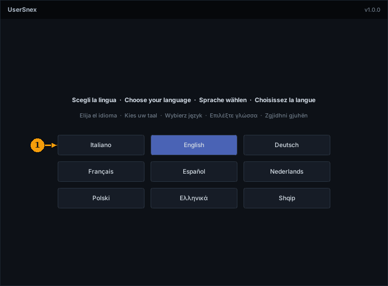
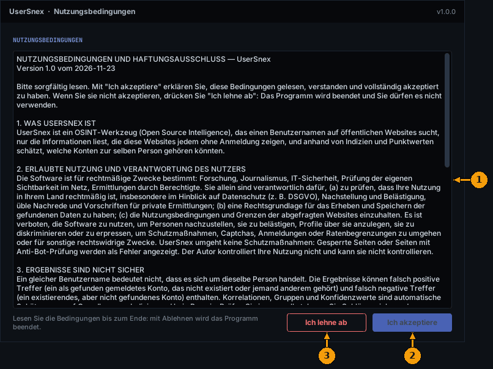
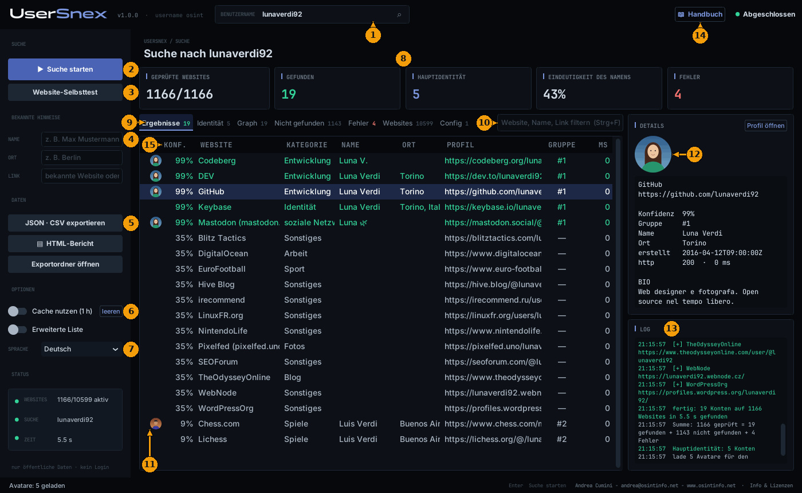
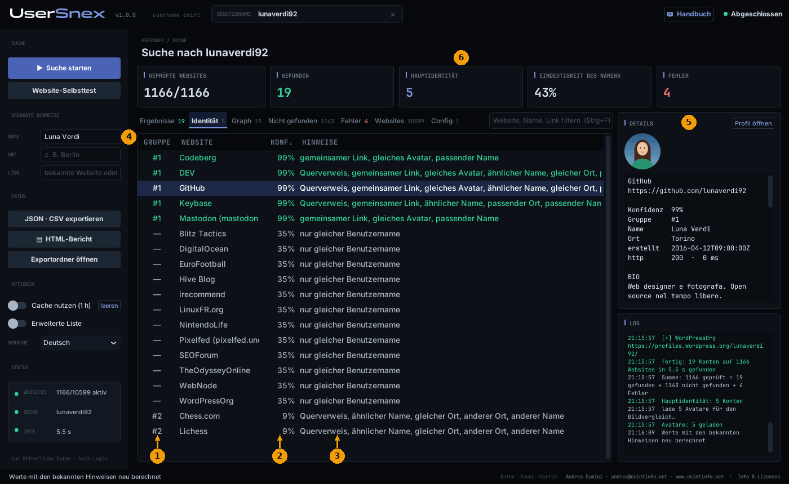
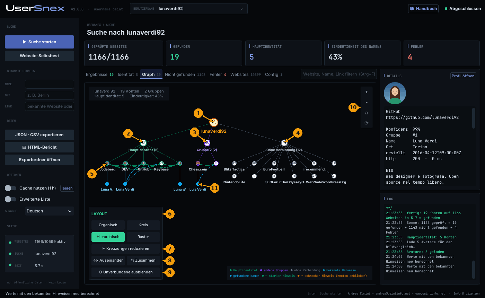
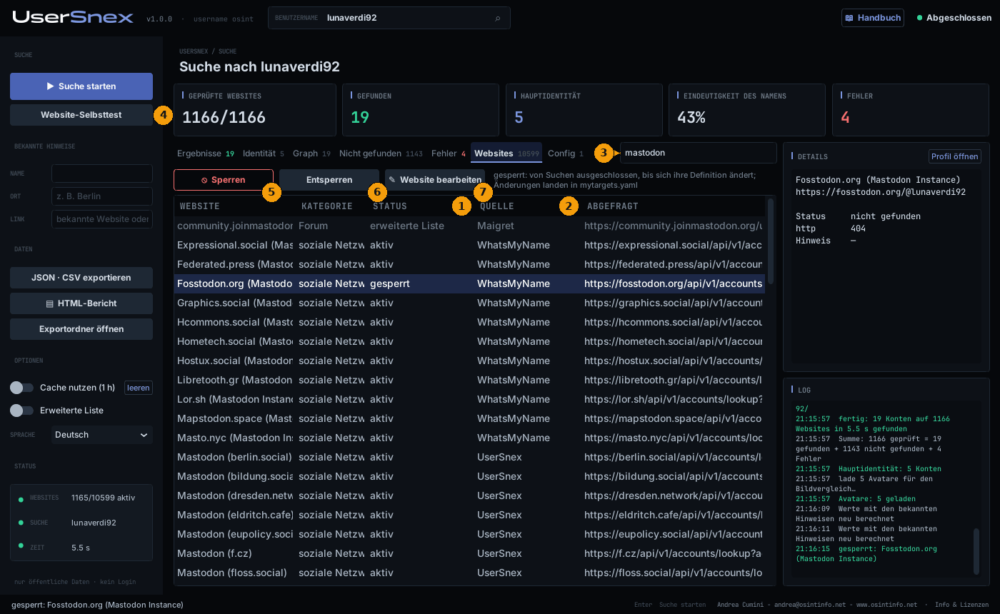
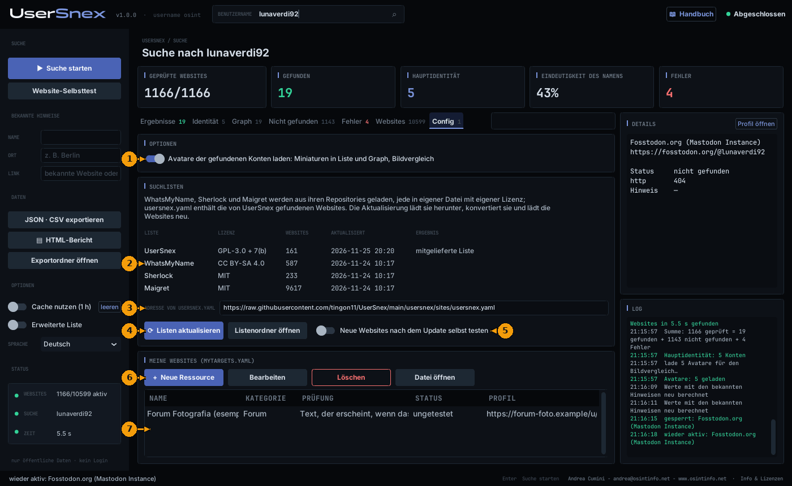
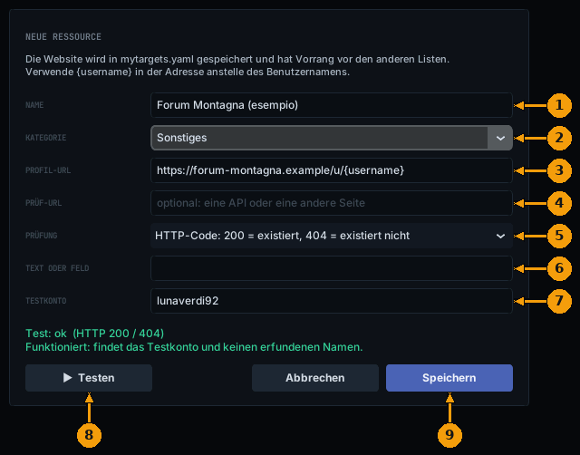

# UserSnex — Benutzerhandbuch

UserSnex sucht einen Benutzernamen auf Tausenden öffentlicher Websites und sagt nicht nur „existiert hier“: Es schätzt, **welche Konten wirklich zur selben Person gehören**, mit welcher Konfidenz, und erklärt immer, warum. Es nutzt nur öffentliche Daten ohne Login, hält die Limits der Websites ein und umgeht keine Schutzmaßnahmen: Eine gesperrte Seite oder eine Anti-Bot-Prüfung erscheint als Fehler, nie als Ergebnis.

Alle Namen, Konten und Daten in den Beispielen dieses Handbuchs sind **erfunden** (der Beispielnutzer ist `lunaverdi92`).

## Inhalt

1. [Erster Start: Sprache und Nutzungsbedingungen](#1-erster-start-sprache-und-nutzungsbedingungen)
2. [Das Hauptfenster](#2-das-hauptfenster)
3. [Eine Suche starten](#3-eine-suche-starten)
4. [Ergebnisse, Details und Avatare](#4-ergebnisse-details-und-avatare)
5. [Identität und Punktzahlen](#5-identität-und-punktzahlen)
6. [Graph](#6-graph)
7. [Nicht gefunden und Fehler](#7-nicht-gefunden-und-fehler)
8. [Websites und Selbsttest](#8-websites-und-selbsttest)
9. [Config](#9-config)
10. [Eine Website hinzufügen: Neue Ressource](#10-eine-website-hinzufügen-neue-ressource)
11. [Daten exportieren](#11-daten-exportieren)
12. [Kommandozeile](#12-kommandozeile)
13. [Info und Lizenzen](#13-info-und-lizenzen)
14. [Häufige Probleme](#14-häufige-probleme)

---

## 1. Erster Start: Sprache und Nutzungsbedingungen

Beim ersten Öffnen erscheint ein Fenster, das sich nicht überspringen lässt.



1. **Sprache wählen.** Die Schaltflächen zeigen die neun verfügbaren Sprachen: italiano, English, Deutsch, Français, Español, Nederlands, Polski, Ελληνικά, Shqip. Die Sprache gilt für das ganze Programm und lässt sich später im Menü **Sprache** der Seitenleiste ändern.



1. Der Text der **Nutzungsbedingungen** in der gewählten Sprache. Lesen Sie ihn bis zum Ende.
2. **Ich akzeptiere** wird erst aktiv, wenn der Text bis zum Ende gescrollt wurde.
3. **Ich lehne ab** beendet das Programm.

Die Zustimmung wird gespeichert: Das Fenster erscheint nur wieder, wenn sich die Version der Bedingungen ändert. Beim ersten Start lädt UserSnex außerdem die Website-Listen herunter (siehe [Config](#9-config)).

## 2. Das Hauptfenster



1. **USERNAME**: der gesuchte Benutzername. **Enter** startet die Suche.
2. **Suche starten**. Während der Suche wird die Schaltfläche zu **Abbrechen**.
3. **Website-Selbsttest**: prüft, welche Websites aus Ihrem Netz funktionieren (siehe [Kapitel 8](#8-websites-und-selbsttest)).
4. **Bekannte Hinweise**: ein Name, ein Ort oder ein Link, von dem Sie bereits wissen, dass er zur Person gehört. Sie helfen, die richtige Identität zu wählen (siehe [Kapitel 5](#5-identität-und-punktzahlen)).
5. **Daten**: **JSON · CSV exportieren**, **HTML-Bericht** und **Exportordner öffnen** (siehe [Kapitel 11](#11-daten-exportieren)).
6. **Optionen**: **Cache nutzen (1 h)** verwendet aktuelle Antworten erneut (**leeren** löscht ihn); **Erweiterte Liste** fügt Tausende Foren und kleinere Websites hinzu, macht die Suche aber deutlich länger.
7. **Sprache** der Oberfläche.
8. **Zähler**: geprüfte Websites, gefundene Konten, Konten der Hauptidentität, Eindeutigkeit des Namens, Fehler.
9. **Reiter**: Ergebnisse, Identität, Graph, Nicht gefunden, Fehler, Websites, Config. Die Zahl neben dem Namen ist die Anzahl der Zeilen.
10. **Filter** (**Strg+F**): zeigt nur Zeilen, die den Text enthalten – in Website, Name, Link oder Kategorie.
11. **Avatar-Miniatur** des Kontos, wenn die Website eines veröffentlicht.
12. **Details**: Avatar und vollständige Daten der ausgewählten Zeile. **Profil öffnen** öffnet die Seite im Browser.
13. **Log**: die Meldungen des Programms mit Uhrzeit.
14. **📖 Handbuch** (oder **F1**) öffnet dieses Handbuch in der Sprache der Oberfläche.
15. **Sortieren**: Ein Klick auf eine Spaltenüberschrift sortiert von A bis Z, ein zweiter Klick von Z bis A; der Pfeil ▲ oder ▼ zeigt die verwendete Spalte (hier *Konf.*, höchste zuerst).

Im Handbuchfenster hebt das Suchfeld oben (**Strg+F**) alle Treffer hervor: **Enter** oder **F3** springt zum nächsten, **Umschalt+Enter** zum vorherigen, **Esc** leert die Suche. Das Inhaltsverzeichnis links führt zu den Kapiteln.

## 3. Eine Suche starten

1. Geben Sie den Benutzernamen oben ein und drücken Sie **Enter** oder **Suche starten**.
2. UserSnex fragt alle aktiven Websites parallel ab, mit einem Anfragelimit pro Website. Gefundene Konten erscheinen sofort unter **Ergebnisse** und im **Log**.
3. Am Ende lädt UserSnex die öffentlichen Avatare der gefundenen Konten herunter (wenn die Option aktiv ist), vergleicht sie und berechnet die Punktzahlen neu.

Wenn Sie schon etwas über die Person wissen, tragen Sie es unter **Bekannte Hinweise** ein, auch nach der Suche: Die Punktzahlen werden sofort neu berechnet, ohne erneute Suche.

Ein seltener Benutzername (`lunaverdi92`) hat wenige Namensvettern, ein häufiger (`luna`) sehr viele. Deshalb fließt der Zähler **Eindeutigkeit des Namens** in alle Punktzahlen ein.

## 4. Ergebnisse, Details und Avatare

Der Reiter **Ergebnisse** listet die gefundenen Konten nach Konfidenz sortiert: **Konf.**, Website, Kategorie, Anzeigename, Ort, Profillink, Gruppe und Antwortzeit. Grüne Zeilen gehören zur Hauptidentität.

- Ein Klick wählt das Konto aus und zeigt rechts seine **Details**: Avatar, URL, Konfidenz, Gruppe, Name, Ort, Erstellungsdatum, HTTP-Code, Bio, gefundene Links und die Hinweise, die es mit den anderen Konten verbinden.
- Ein Doppelklick öffnet das Profil im Browser.

**Avatare.** Profilbilder werden nur einmal heruntergeladen (Cache für 7 Tage), in der Liste, den Details und im Graph angezeigt und per **visuellem Fingerabdruck** verglichen: Dasselbe Foto wird erkannt, auch wenn es auf verschiedenen Servern verkleinert oder neu komprimiert wurde. Leere Bilder und Standard-Avatare der Websites zählen nicht. Der Download lässt sich in [Config](#9-config) abschalten.

**Tabellen sortieren.** In allen Tabellen sortiert ein Klick auf eine Spaltenüberschrift die Zeilen von A bis Z (bzw. vom kleinsten Wert); ein zweiter Klick auf dieselbe Spalte sortiert von Z bis A. Der Pfeil ▲ oder ▼ neben dem Titel zeigt Spalte und Richtung; leere Zellen bleiben unten.

## 5. Identität und Punktzahlen



1. **Gruppe**: Konten mit starken Verbindungen untereinander bilden eine Gruppe. **#1** ist die Hauptidentität, — bedeutet „ohne Verbindung“.
2. **Konf.**: die Konfidenz, dass das Konto der gesuchten Person gehört.
3. **Hinweise**: die Gründe im Klartext. Zum Beispiel *Querverweis* (ein Profil verlinkt das andere), *gemeinsamer Link*, *gleiches Avatar*, *ähnlicher Name*, *gleicher Ort*; oder Gegenhinweise wie *anderer Name* und *anderer Ort*. *nur gleicher Benutzername* bedeutet, dass es sonst nichts gibt.
4. **Bekannte Hinweise**: Hier wurde der Name *Luna Verdi* eingetragen. Die Hauptidentität wird die Gruppe, die zu den bekannten Hinweisen passt.
5. **Details** des ausgewählten Kontos.
6. Der Zähler **Hauptidentität** zeigt, wie viele Konten dazugehören.

Im Beispiel bilden Codeberg, DEV, GitHub, Keybase und Mastodon die Hauptidentität (Link zur persönlichen Website, gleiches Avatar, gleicher Name). Chess.com und Lichess verlinken sich gegenseitig, gehören aber einem Namensvetter, *Luis Verdi* aus Buenos Aires: Sie bilden eine zweite Gruppe mit niedriger Konfidenz.

Die Punktzahlen sind **Schätzungen**, keine Beweise: Prüfen Sie immer selbst, bevor Sie Schlüsse ziehen.

## 6. Graph



1. Der gesuchte **Benutzername**, im Zentrum der Struktur.
2. **Hauptidentität**, mit der Anzahl der Konten.
3. **Andere Gruppen** (hier *Gruppe 2*, der Namensvetter).
4. **Ohne Verbindung**: Konten mit demselben Benutzernamen, aber ohne weitere Hinweise.
5. Ein **Konto** mit seinem Avatar. Die Linien zwischen Konten sind Hinweise: durchgezogen für starke, gestrichelt für schwache Hinweise (sichtbar nach Klick auf den Knoten).
6. Bereich **Layout**: **Organisch**, **Kreis**, **Hierarchisch** (Standard) und **Raster**.
7. **Kreuzungen reduzieren** ordnet die Knoten neu, damit sich weniger Linien kreuzen.
8. **Auseinander** und **Zusammen** vergrößern oder verkleinern die Darstellung.
9. **Unverbundene ausblenden** entfernt Konten ohne Hinweise (die Schaltfläche wird zu **Unverbundene zeigen**).
10. **Zoom**: +, −, an Fenster anpassen und neu zeichnen. Auch das Mausrad zoomt.
11. **Gefundener Name** (hellblauer Knoten): hier *Luis Verdi*, derselbe Name auf Chess.com und Lichess, zu einem einzigen Knoten zusammengeführt.

Ein Klick auf einen Knoten wählt ihn aus und zeigt seine Details; beim Überfahren mit der Maus sieht man seine Hinweise. Ein Doppelklick auf eine Gruppe klappt sie zu oder auf. Knoten lassen sich verschieben.

**Gefundene Namen.** Jeder auf einem Profil gefundene Anzeigename wird zu einem hellblauen Knoten, der mit allen Konten verbunden ist, in denen er vorkommt: Erscheint derselbe Name (ohne Rücksicht auf Groß-/Kleinschreibung, Akzente und Symbole) auf mehreren Websites, gibt es nur einen Knoten, der die Übereinstimmungen zeigt. Im Beispiel verbindet *Luna Verdi* DEV, GitHub und Keybase, *Luis Verdi* verbindet Chess.com und Lichess. Namen, die dem Benutzernamen entsprechen, werden nicht hinzugefügt. Beim Überfahren mit der Maus sieht man die Websites.

## 7. Nicht gefunden und Fehler

- **Nicht gefunden**: Websites, die geantwortet haben, dass das Konto nicht existiert.
- **Fehler**: Websites ohne gültige Antwort: gesperrte Seite (401/403), zu viele Anfragen (429), Anti-Bot-Prüfung, Zeitüberschreitung, Netzwerkfehler. UserSnex umgeht diese Schutzmaßnahmen nicht: Prüfen Sie diese Websites **von Hand**. Im Beispiel antwortet Reddit mit 429 und Docker Hub mit 403.

## 8. Websites und Selbsttest



1. **Status** der Website: *aktiv*, *erweiterte Liste* (nur mit der Option Erweiterte Liste verwendet) oder vom Selbsttest deaktiviert. Eine von Hand gesperrte Website zeigt *gesperrt*.
2. **Quelle**: die Liste, aus der die Website stammt (UserSnex, WhatsMyName, Sherlock, Maigret oder Ihre eigenen Websites, *mytargets*). Die Spalte **Abgefragt** zeigt die aufgerufene Adresse.
3. Der **Filter** funktioniert auch hier: Im Beispiel zeigt er die Websites, die „mastodon“ enthalten.
4. **Website-Selbsttest**: Für jede Website wird ein existierendes und ein erfundenes Konto geprüft. Websites, die aus Ihrem Netz falsch antworten oder Fehler liefern, werden bei späteren Suchen übersprungen. Das Ergebnis bleibt gespeichert.
5. **Sperren**: lässt die ausgewählten Websites bei Suchen aus (hier *Fosstodon.org*, mit dem Status *gesperrt*).
6. **Entsperren**: aktiviert die ausgewählten Websites wieder.
7. **Website bearbeiten**: öffnet die Website im Formular Neue Ressource und speichert die Änderung in `mytargets.yaml`.

**Eine Website sperren.** Wenn eine Website nicht mehr funktioniert oder falsche Ergebnisse liefert, wählen Sie sie aus (auch mehrere, mit Strg oder Umschalt) und drücken Sie **Sperren**, oder klicken Sie in einer beliebigen Tabelle mit der rechten Maustaste auf eine Zeile. Die Website wird bei Suchen ausgelassen und die Spalte Status zeigt *gesperrt*. **Entsperren** aktiviert sie wieder. Beim Aktualisieren der Listen (WhatsMyName, Sherlock, Maigret, UserSnex) bleibt eine gesperrte Website mit identischer Definition gesperrt; hat sich die Definition geändert (zum Beispiel wurde die Adresse korrigiert), wird die Sperre aufgehoben und die Website ist wieder aktiv. Sperren werden in `banlist.json` gespeichert.

**Eine Website bearbeiten.** **Website bearbeiten** (oder Rechtsklick › Website bearbeiten) öffnet das Formular [Neue Ressource](#10-eine-website-hinzufügen-neue-ressource) mit den Daten der Website. Beim Speichern landet die bearbeitete Version direkt in `mytargets.yaml` und ersetzt die aus der ursprünglichen Liste; Regeln, die das Formular nicht zeigt (Profilfelder, Ausdrücke, Header), bleiben erhalten. War die Website gesperrt und haben Sie die Adresse geändert, ist sie wieder aktiv.

## 9. Config



1. **Avatare der gefundenen Konten laden**: Miniaturen in Liste und Graph und Bildvergleich. Schalten Sie es aus, um zusätzliche Anfragen zu vermeiden.
2. **Suchlisten**: für jede Liste die Lizenz, die Zahl der Websites, das Datum der letzten Aktualisierung und das Ergebnis. *usersnex.yaml* enthält die von UserSnex gefundenen Websites und verbesserte Versionen bekannter Websites; WhatsMyName, Sherlock und Maigret werden aus ihren Repositorys geladen, jede in einer eigenen Datei mit eigener Lizenz.
3. **Adresse von usersnex.yaml**: woher die UserSnex-Liste aktualisiert wird (das Repository des Projekts). Sie lässt sich ändern.
4. **Listen aktualisieren** lädt alle Listen herunter, wandelt sie um und lädt die Websites neu. Lässt sich eine Liste nicht laden oder wirkt sie beschädigt, bleibt die vorherige erhalten. **Listenordner öffnen** öffnet den Ordner `lists`.
5. **Neue Websites nach dem Update selbst testen**: Wenn aktiv, werden die durch das Update hinzugekommenen Websites sofort geprüft.
6. **Meine Websites (mytargets.yaml)**: **Neue Ressource** fügt eine Website hinzu (siehe [Kapitel 10](#10-eine-website-hinzufügen-neue-ressource)); **Bearbeiten**, **Löschen** und **Datei öffnen** wirken auf die ausgewählte Website bzw. die Datei.
7. Die Liste Ihrer Websites. Ein Doppelklick öffnet die Bearbeitung.

## 10. Eine Website hinzufügen: Neue Ressource

Eine hier hinzugefügte Website wird in `mytargets.yaml` gespeichert und hat Vorrang vor den anderen Listen: Hat sie denselben Namen wie eine vorhandene Website, ersetzt sie diese.



1. **Name** der Website.
2. **Kategorie** (Forum, Social, Entwicklung, Spiele…).
3. **Profil-URL**, mit `{username}` anstelle des Benutzernamens, zum Beispiel `https://forum-montagna.example/u/{username}`.
4. **Prüf-URL** (optional): eine API oder eine andere Seite als das Profil, die stattdessen abgefragt wird.
5. **Prüfung**: woran man erkennt, dass das Konto existiert. *HTTP-Code* (200 = existiert, 404 = existiert nicht), ein *Text, der nur vorhanden ist, wenn das Konto existiert* (zum Beispiel „Mitglied seit“), ein *Text, der erscheint, wenn das Konto nicht existiert* (zum Beispiel „Benutzer nicht gefunden“), oder ein *Feld der JSON-API* (zum Beispiel `data.id`).
6. **Text oder Feld** für die gewählte Prüfung (bei *HTTP-Code* nicht nötig und ausgegraut).
7. **Testkonto**: ein Benutzername, von dem Sie wissen, dass er auf der Website existiert.
8. **Testen**: fragt die Website mit dem Testkonto und einem erfundenen Namen ab und zeigt, ob die Prüfung funktioniert. Im Beispiel: *ok (HTTP 200 / 404)*.
9. **Speichern** schreibt die Website in `mytargets.yaml`; **Abbrechen** schließt ohne zu speichern.

## 11. Daten exportieren

- **JSON · CSV exportieren** speichert Ergebnisse und Identitäten im Ordner `results`.
- **HTML-Bericht** erstellt einen in jedem Browser lesbaren Bericht und öffnet ihn.
- **Exportordner öffnen** öffnet den Ordner mit den gespeicherten Dateien.

Die Dateien können personenbezogene Daten enthalten: Bewahren Sie sie sorgfältig auf und löschen Sie sie, wenn sie nicht mehr gebraucht werden.

## 12. Kommandozeile

Dieselben Funktionen gibt es im Terminal:

```
python run.py lunaverdi92 --html --name "Luna Verdi" --location Torino
python run.py --update-lists
python run.py --selftest
```

Wichtige Optionen: `--name`, `--location`, `--link` (bekannte Hinweise, `--link` wiederholbar), `--extended` (erweiterte Liste), `--only` (nur bestimmte Websites, durch Kommas getrennt), `--sites` (zusätzliche YAML-Datei oder -Ordner), `--out` (Ausgabeordner), `--html`, `--no-export`, `--no-cache`, `--all` (auch Websites ohne Treffer zeigen), `--timeout`, `--usersnex-url`. `python run.py --help` listet alle auf.

## 13. Info und Lizenzen

Klicken Sie in der unteren Leiste auf **Info & Lizenzen**: Version, Autor, Lizenz des Programms (GPL-3.0 mit Pflicht zur Namensnennung), die Website-Listen und Komponenten Dritter mit ihren Lizenzen sowie die Schaltfläche **Nutzungsbedingungen**, um die Bedingungen erneut zu lesen. UserSnex ist freie Software, ohne jede Gewährleistung.

## 14. Häufige Probleme

| Meldung oder Situation | Was tun |
|---|---|
| Listen fehlen beim ersten Start | Config › Listen aktualisieren. Eine Internetverbindung ist nötig. |
| Viele 429-Fehler | Die Website begrenzt Anfragen: warten und erneut versuchen oder den Cache einschalten. |
| Fehler 403 oder Anti-Bot-Seite | Die Website sperrt Programme: Prüfen Sie dieses Konto von Hand im Browser. |
| Eine Website liefert immer falsche Ergebnisse | Website-Selbsttest drücken: Websites, die aus Ihrem Netz versagen, werden ausgeschlossen. |
| Suche sehr langsam | Erweiterte Liste ausschalten: Sie fügt rund 9.000 kleinere Websites hinzu. |
| Avatare erscheinen nicht | Config › Optionen › Avatare laden muss aktiv sein; manche Websites veröffentlichen kein Bild. |
| Meine Website findet das Konto nicht | In Neue Ressource auf Testen klicken und URL, Prüfung und Text kontrollieren. |
| Handbuch nicht gefunden | Der Ordner `docs/manual` fehlt: Installieren Sie das Programm neu. |
