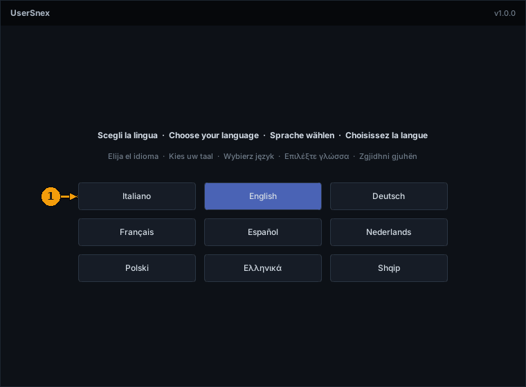
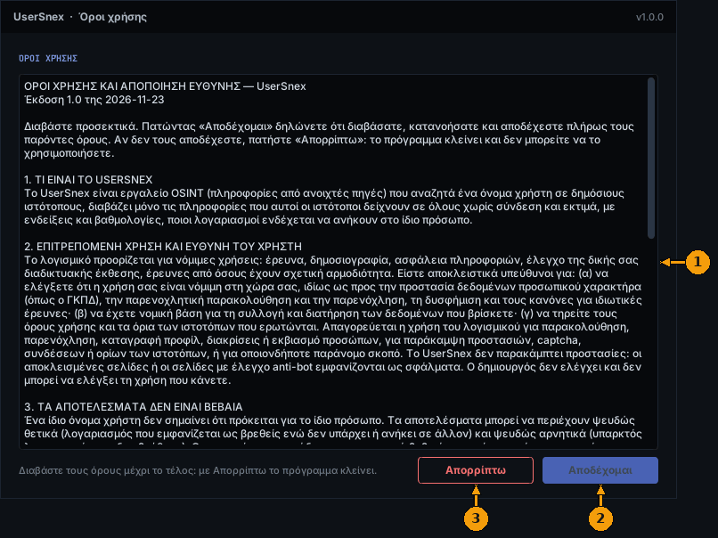
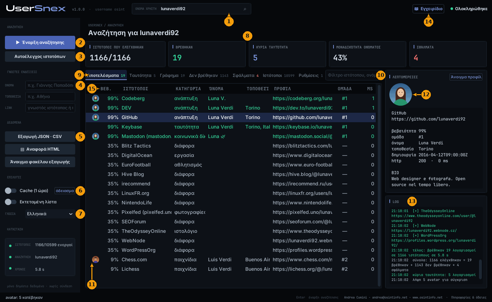
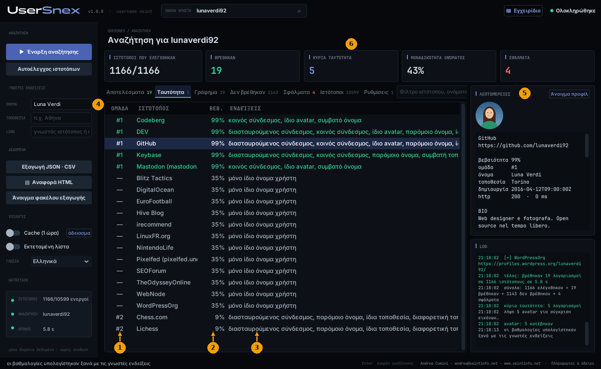
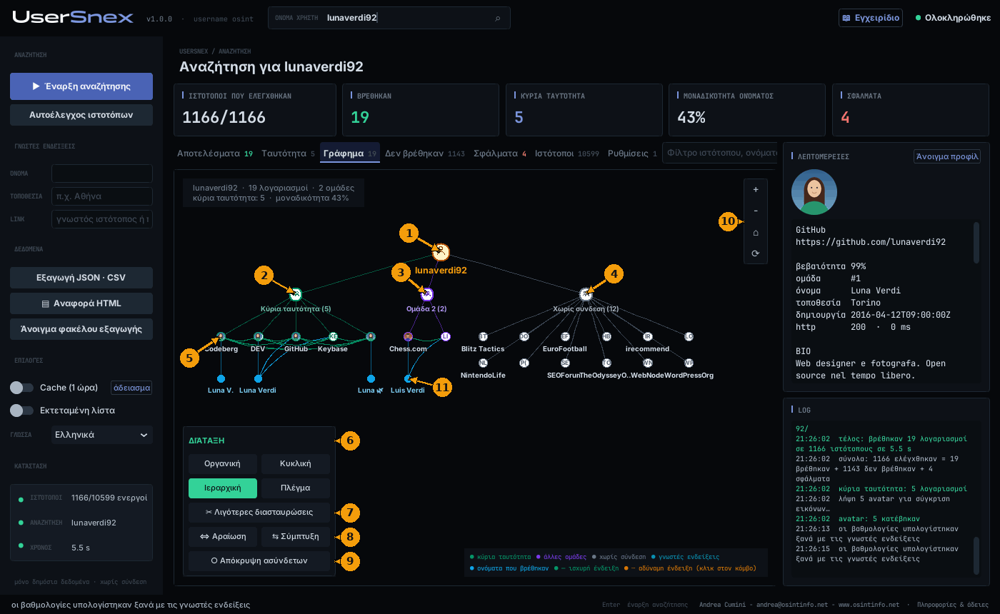
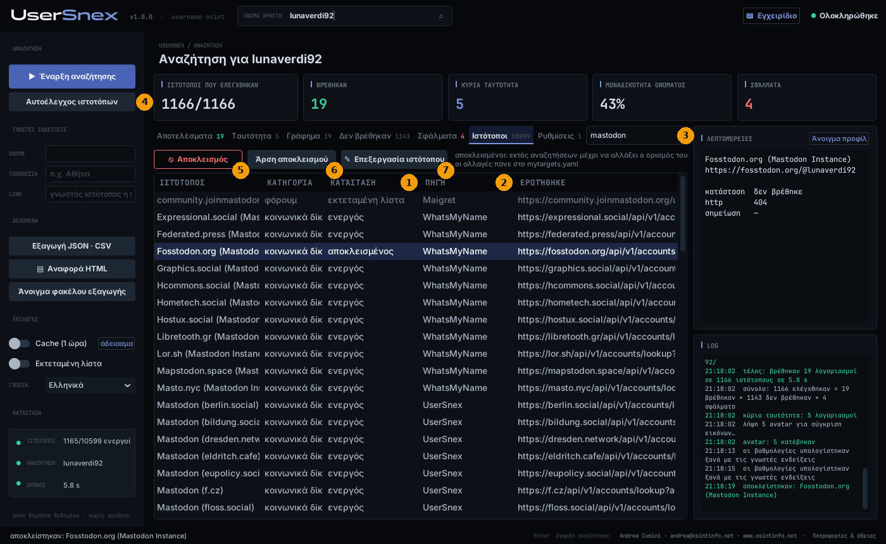
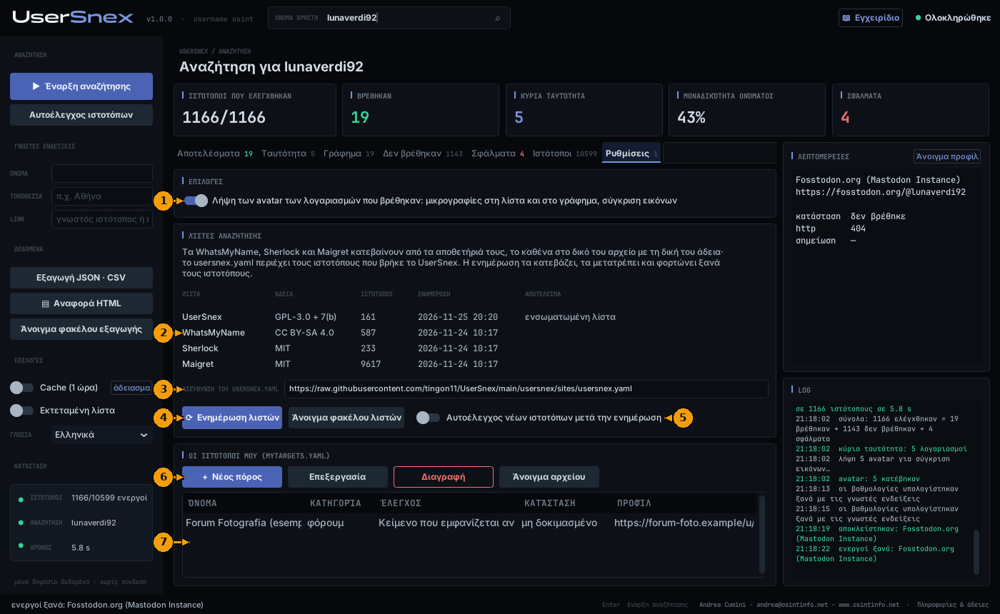
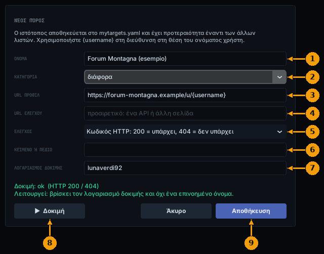

# UserSnex — Εγχειρίδιο χρήσης

Το UserSnex αναζητά ένα όνομα χρήστη σε χιλιάδες δημόσιους ιστοτόπους και δεν σταματά στο «υπάρχει εδώ»: εκτιμά **ποιοι λογαριασμοί ανήκουν πραγματικά στο ίδιο πρόσωπο**, με ποια βεβαιότητα, και εξηγεί πάντα γιατί. Χρησιμοποιεί μόνο δημόσια δεδομένα, χωρίς σύνδεση, σέβεται τα όρια των ιστοτόπων και δεν παρακάμπτει προστασίες: μια αποκλεισμένη σελίδα ή ένας έλεγχος anti-bot εμφανίζεται ως σφάλμα, ποτέ ως αποτέλεσμα.

Όλα τα ονόματα, οι λογαριασμοί και τα δεδομένα στα παραδείγματα αυτού του εγχειριδίου είναι **επινοημένα** (ο χρήστης του παραδείγματος είναι ο `lunaverdi92`).

## Περιεχόμενα

1. [Πρώτη εκκίνηση: γλώσσα και όροι χρήσης](#1-πρώτη-εκκίνηση-γλώσσα-και-όροι-χρήσης)
2. [Το κύριο παράθυρο](#2-το-κύριο-παράθυρο)
3. [Αναζήτηση](#3-αναζήτηση)
4. [Αποτελέσματα, λεπτομέρειες και avatar](#4-αποτελέσματα-λεπτομέρειες-και-avatar)
5. [Ταυτότητα και βαθμολογίες](#5-ταυτότητα-και-βαθμολογίες)
6. [Γράφημα](#6-γράφημα)
7. [Δεν βρέθηκαν και Σφάλματα](#7-δεν-βρέθηκαν-και-σφάλματα)
8. [Ιστότοποι και αυτοέλεγχος](#8-ιστότοποι-και-αυτοέλεγχος)
9. [Ρυθμίσεις](#9-ρυθμίσεις)
10. [Προσθήκη ιστότοπου: Νέος πόρος](#10-προσθήκη-ιστότοπου-νέος-πόρος)
11. [Εξαγωγή δεδομένων](#11-εξαγωγή-δεδομένων)
12. [Γραμμή εντολών](#12-γραμμή-εντολών)
13. [Πληροφορίες και άδειες](#13-πληροφορίες-και-άδειες)
14. [Συχνά προβλήματα](#14-συχνά-προβλήματα)

---

## 1. Πρώτη εκκίνηση: γλώσσα και όροι χρήσης

Την πρώτη φορά εμφανίζεται ένα παράθυρο που δεν μπορεί να παραλειφθεί.



1. **Επιλέξτε γλώσσα.** Τα κουμπιά δείχνουν τις εννέα διαθέσιμες γλώσσες: italiano, English, Deutsch, Français, Español, Nederlands, Polski, Ελληνικά, Shqip. Η γλώσσα ισχύει για όλο το πρόγραμμα και αλλάζει αργότερα από το μενού **Γλώσσα** στην πλαϊνή μπάρα.



1. Το κείμενο των **όρων χρήσης**, στη γλώσσα που επιλέξατε. Διαβάστε το μέχρι το τέλος.
2. Το **Αποδέχομαι** ενεργοποιείται μόνο αφού κυλήσετε το κείμενο μέχρι το τέλος.
3. Το **Απορρίπτω** κλείνει το πρόγραμμα.

Η αποδοχή αποθηκεύεται: το παράθυρο εμφανίζεται ξανά μόνο αν αλλάξει η έκδοση των όρων. Στην πρώτη εκκίνηση το UserSnex κατεβάζει επίσης τις λίστες ιστοτόπων (βλ. [Ρυθμίσεις](#9-ρυθμίσεις)).

## 2. Το κύριο παράθυρο



1. **USERNAME**: το όνομα χρήστη που αναζητάτε. Το **Enter** ξεκινά την αναζήτηση.
2. **Έναρξη αναζήτησης**. Κατά την αναζήτηση το κουμπί γίνεται **Διακοπή**.
3. **Αυτοέλεγχος ιστοτόπων**: ελέγχει ποιοι ιστότοποι λειτουργούν από το δίκτυό σας (βλ. [κεφάλαιο 8](#8-ιστότοποι-και-αυτοέλεγχος)).
4. **Γνωστές ενδείξεις**: ένα όνομα, μια τοποθεσία ή ένας σύνδεσμος που ήδη γνωρίζετε ότι ανήκει στο πρόσωπο. Βοηθούν να επιλεγεί η σωστή ταυτότητα (βλ. [κεφάλαιο 5](#5-ταυτότητα-και-βαθμολογίες)).
5. **Δεδομένα**: **Εξαγωγή JSON · CSV**, **Αναφορά HTML** και **Άνοιγμα φακέλου εξαγωγής** (βλ. [κεφάλαιο 11](#11-εξαγωγή-δεδομένων)).
6. **Επιλογές**: το **Cache (1 ώρα)** ξαναχρησιμοποιεί πρόσφατες απαντήσεις (το **άδειασμα** τη σβήνει)· η **Εκτεταμένη λίστα** προσθέτει χιλιάδες φόρουμ και μικρότερους ιστοτόπους, αλλά κάνει την αναζήτηση πολύ πιο αργή.
7. **Γλώσσα** της διεπαφής.
8. **Μετρητές**: ιστότοποι που ελέγχθηκαν, λογαριασμοί που βρέθηκαν, λογαριασμοί της κύριας ταυτότητας, μοναδικότητα ονόματος, σφάλματα.
9. **Καρτέλες**: Αποτελέσματα, Ταυτότητα, Γράφημα, Δεν βρέθηκαν, Σφάλματα, Ιστότοποι, Ρυθμίσεις. Ο αριθμός δίπλα στο όνομα είναι το πλήθος των γραμμών.
10. **Φίλτρο** (**Ctrl+F**): δείχνει μόνο τις γραμμές που περιέχουν το κείμενο, σε ιστότοπο, όνομα, σύνδεσμο ή κατηγορία.
11. **Μικρογραφία avatar** του λογαριασμού, όταν ο ιστότοπος δημοσιεύει.
12. **Λεπτομέρειες**: avatar και πλήρη δεδομένα της επιλεγμένης γραμμής. Το **Άνοιγμα προφίλ** ανοίγει τη σελίδα στον browser.
13. **Log**: τα μηνύματα του προγράμματος, με την ώρα.
14. Το **📖 Εγχειρίδιο** (ή **F1**) ανοίγει αυτό το εγχειρίδιο στη γλώσσα της διεπαφής.
15. **Ταξινόμηση**: ένα κλικ στην επικεφαλίδα μιας στήλης ταξινομεί από το Α στο Ω, ένα δεύτερο κλικ από το Ω στο Α· το βέλος ▲ ή ▼ δείχνει τη στήλη που χρησιμοποιείται (εδώ *Βεβ.*, από τη μεγαλύτερη).

Στο παράθυρο του εγχειριδίου, το πεδίο αναζήτησης επάνω (**Ctrl+F**) επισημαίνει όλα τα ευρήματα: **Enter** ή **F3** πηγαίνει στο επόμενο, **Shift+Enter** στο προηγούμενο, **Esc** καθαρίζει την αναζήτηση. Τα περιεχόμενα αριστερά οδηγούν στα κεφάλαια.

## 3. Αναζήτηση

1. Γράψτε το όνομα χρήστη στο πεδίο επάνω και πατήστε **Enter** ή **Έναρξη αναζήτησης**.
2. Το UserSnex ρωτά παράλληλα όλους τους ενεργούς ιστοτόπους, με όριο αιτημάτων ανά ιστότοπο. Οι λογαριασμοί που βρίσκονται εμφανίζονται αμέσως στα **Αποτελέσματα** και στο **Log**.
3. Στο τέλος το UserSnex κατεβάζει τα δημόσια avatar των λογαριασμών (αν η επιλογή είναι ενεργή), τα συγκρίνει και υπολογίζει ξανά τις βαθμολογίες.

Αν ήδη γνωρίζετε κάτι για το πρόσωπο, γράψτε το στις **Γνωστές ενδείξεις**, ακόμη και μετά την αναζήτηση: οι βαθμολογίες υπολογίζονται αμέσως ξανά, χωρίς νέα αναζήτηση.

Ένα σπάνιο όνομα χρήστη (`lunaverdi92`) έχει λίγους συνονόματους· ένα κοινό (`luna`) έχει πάρα πολλούς. Γι' αυτό ο μετρητής **Μοναδικότητα ονόματος** επηρεάζει όλες τις βαθμολογίες.

## 4. Αποτελέσματα, λεπτομέρειες και avatar

Η καρτέλα **Αποτελέσματα** δείχνει τους λογαριασμούς που βρέθηκαν, ταξινομημένους κατά βεβαιότητα: **Βεβ.**, ιστότοπος, κατηγορία, εμφανιζόμενο όνομα, τοποθεσία, σύνδεσμος προφίλ, ομάδα και χρόνος απόκρισης. Οι πράσινες γραμμές ανήκουν στην κύρια ταυτότητα.

- Ένα κλικ επιλέγει τον λογαριασμό και δείχνει δεξιά τις **Λεπτομέρειες**: avatar, URL, βεβαιότητα, ομάδα, όνομα, τοποθεσία, ημερομηνία δημιουργίας, κωδικός HTTP, βιογραφικό, σύνδεσμοι που βρέθηκαν και οι ενδείξεις που τον συνδέουν με τους άλλους λογαριασμούς.
- Ένα διπλό κλικ ανοίγει το προφίλ στον browser.

**Avatar.** Οι εικόνες προφίλ κατεβαίνουν μόνο μία φορά (cache 7 ημερών), εμφανίζονται στη λίστα, στις λεπτομέρειες και στο γράφημα, και συγκρίνονται με **οπτικό αποτύπωμα**: η ίδια φωτογραφία αναγνωρίζεται ακόμη κι αν έχει σμικρυνθεί ή συμπιεστεί ξανά σε διαφορετικούς διακομιστές. Οι κενές εικόνες και τα προεπιλεγμένα avatar των ιστοτόπων δεν μετράνε. Η λήψη απενεργοποιείται στις [Ρυθμίσεις](#9-ρυθμίσεις).

**Ταξινόμηση πινάκων.** Σε όλους τους πίνακες, ένα κλικ στην επικεφαλίδα μιας στήλης ταξινομεί τις γραμμές από το Α στο Ω (ή από τη μικρότερη τιμή)· ένα δεύτερο κλικ στην ίδια στήλη τις ταξινομεί από το Ω στο Α. Το βέλος ▲ ή ▼ δίπλα στον τίτλο δείχνει τη στήλη και τη φορά· τα κενά κελιά μένουν στο τέλος.

## 5. Ταυτότητα και βαθμολογίες



1. **Ομάδα**: οι λογαριασμοί με ισχυρούς δεσμούς μεταξύ τους σχηματίζουν ομάδα. Το **#1** είναι η κύρια ταυτότητα, το — σημαίνει «χωρίς σύνδεση».
2. **Βεβ.**: η βεβαιότητα ότι ο λογαριασμός ανήκει στο πρόσωπο που αναζητάτε.
3. **Ενδείξεις**: οι λόγοι, με απλά λόγια. Για παράδειγμα *διασταυρούμενος σύνδεσμος* (ένα προφίλ παραπέμπει στο άλλο), *κοινός σύνδεσμος*, *ίδιο avatar*, *παρόμοιο όνομα*, *ίδια τοποθεσία*· ή αντίθετες ενδείξεις όπως *διαφορετικό όνομα* και *διαφορετική τοποθεσία*. Το *μόνο ίδιο όνομα χρήστη* σημαίνει ότι δεν υπάρχει τίποτε άλλο.
4. **Γνωστές ενδείξεις**: εδώ έχει εισαχθεί το όνομα *Luna Verdi*. Κύρια ταυτότητα γίνεται η ομάδα που ταιριάζει με τις γνωστές ενδείξεις.
5. **Λεπτομέρειες** του επιλεγμένου λογαριασμού.
6. Ο μετρητής **Κύρια ταυτότητα** δείχνει πόσοι λογαριασμοί ανήκουν σε αυτήν.

Στο παράδειγμα, τα Codeberg, DEV, GitHub, Keybase και Mastodon σχηματίζουν την κύρια ταυτότητα (σύνδεσμος στον προσωπικό ιστότοπο, ίδιο avatar, ίδιο όνομα). Τα Chess.com και Lichess παραπέμπουν το ένα στο άλλο αλλά ανήκουν σε έναν συνονόματο, τον *Luis Verdi* από το Μπουένος Άιρες: σχηματίζουν δεύτερη ομάδα με χαμηλή βεβαιότητα.

Οι βαθμολογίες είναι **εκτιμήσεις**, όχι αποδείξεις: ελέγχετε πάντα με το χέρι πριν βγάλετε συμπεράσματα.

## 6. Γράφημα



1. Το **όνομα χρήστη** που αναζητήθηκε, στο κέντρο της δομής.
2. **Κύρια ταυτότητα**, με τον αριθμό των λογαριασμών.
3. **Άλλες ομάδες** (εδώ η *Ομάδα 2*, ο συνονόματος).
4. **Χωρίς σύνδεση**: λογαριασμοί με το ίδιο όνομα χρήστη αλλά χωρίς άλλες ενδείξεις.
5. Ένας **λογαριασμός**, με το avatar του. Οι γραμμές μεταξύ λογαριασμών είναι ενδείξεις: συνεχείς για τις ισχυρές, διακεκομμένες για τις αδύναμες (ορατές με κλικ στον κόμβο).
6. Πλαίσιο **Layout**: **Οργανική**, **Κυκλική**, **Ιεραρχική** (η προεπιλογή) και **Πλέγμα**.
7. Το **Λιγότερες διασταυρώσεις** αναδιατάσσει τους κόμβους ώστε να διασταυρώνονται λιγότερες γραμμές.
8. Η **Αραίωση** και η **Σύμπτυξη** απλώνουν ή μαζεύουν το σχέδιο.
9. Η **Απόκρυψη ασύνδετων** αφαιρεί τους λογαριασμούς χωρίς ενδείξεις (το κουμπί γίνεται **Εμφάνιση ασύνδετων**).
10. **Zoom**: +, −, προσαρμογή στο παράθυρο και επανασχεδίαση. Ζουμ κάνει και ο τροχός του ποντικιού.
11. **Όνομα που βρέθηκε** (γαλάζιος κόμβος): εδώ *Luis Verdi*, το ίδιο όνομα στο Chess.com και στο Lichess, ενωμένο σε έναν κόμβο.

Ένα κλικ σε κόμβο τον επιλέγει και δείχνει τις λεπτομέρειές του· περνώντας το ποντίκι από πάνω φαίνονται οι ενδείξεις του. Ένα διπλό κλικ σε ομάδα την κλείνει ή την ανοίγει. Οι κόμβοι μετακινούνται με σύρσιμο.

**Ονόματα που βρέθηκαν.** Κάθε εμφανιζόμενο όνομα που βρίσκεται σε ένα προφίλ γίνεται γαλάζιος κόμβος, συνδεδεμένος με όλους τους λογαριασμούς όπου εμφανίζεται: αν το ίδιο όνομα (χωρίς να μετράνε κεφαλαία, τόνοι και σύμβολα) εμφανίζεται σε πολλούς ιστοτόπους, υπάρχει ένας μόνο κόμβος που δείχνει τις συνεμφανίσεις. Στο παράδειγμα το *Luna Verdi* ενώνει DEV, GitHub και Keybase, και το *Luis Verdi* ενώνει Chess.com και Lichess. Τα ονόματα ίδια με το όνομα χρήστη δεν προστίθενται. Περνώντας το ποντίκι πάνω από τον κόμβο φαίνονται οι ιστότοποι.

## 7. Δεν βρέθηκαν και Σφάλματα

- **Δεν βρέθηκαν**: οι ιστότοποι που απάντησαν ότι ο λογαριασμός δεν υπάρχει.
- **Σφάλματα**: οι ιστότοποι που δεν έδωσαν έγκυρη απάντηση: αποκλεισμένη σελίδα (401/403), πάρα πολλά αιτήματα (429), έλεγχος anti-bot, λήξη χρόνου, σφάλμα δικτύου. Το UserSnex δεν παρακάμπτει αυτές τις προστασίες: για αυτούς τους ιστοτόπους **ελέγξτε με το χέρι**. Στο παράδειγμα το Reddit απαντά 429 και το Docker Hub 403.

## 8. Ιστότοποι και αυτοέλεγχος



1. **Κατάσταση** του ιστότοπου: *ενεργός*, *εκτεταμένη λίστα* (χρησιμοποιείται μόνο με την επιλογή Εκτεταμένη λίστα) ή απενεργοποιημένος από τον αυτοέλεγχο. Ένας ιστότοπος που αποκλείσατε δείχνει *αποκλεισμένος*.
2. **Πηγή**: η λίστα από την οποία προέρχεται ο ιστότοπος (UserSnex, WhatsMyName, Sherlock, Maigret ή οι δικοί σας ιστότοποι, *mytargets*). Η στήλη **Ερωτήθηκε** δείχνει τη διεύθυνση που καλείται.
3. Το **φίλτρο** λειτουργεί και εδώ: στο παράδειγμα δείχνει τους ιστοτόπους που περιέχουν «mastodon».
4. **Αυτοέλεγχος ιστοτόπων**: για κάθε ιστότοπο δοκιμάζει έναν λογαριασμό που υπάρχει και έναν επινοημένο. Οι ιστότοποι που απαντούν λάθος ή δίνουν σφάλμα από το δίκτυό σας παραλείπονται στις επόμενες αναζητήσεις. Το αποτέλεσμα αποθηκεύεται.
5. **Αποκλεισμός**: αφήνει εκτός αναζητήσεων τους επιλεγμένους ιστοτόπους (εδώ *Fosstodon.org*, με κατάσταση *αποκλεισμένος*).
6. **Άρση αποκλεισμού**: ενεργοποιεί ξανά τους επιλεγμένους ιστοτόπους.
7. **Επεξεργασία ιστότοπου**: ανοίγει τον ιστότοπο στη φόρμα Νέος πόρος και αποθηκεύει την αλλαγή στο `mytargets.yaml`.

**Αποκλεισμός ιστότοπου.** Αν ένας ιστότοπος σταματήσει να λειτουργεί ή δίνει λάθος αποτελέσματα, επιλέξτε τον (και περισσότερους, με Ctrl ή Shift) και πατήστε **Αποκλεισμός**, ή κάντε δεξί κλικ σε μια γραμμή οποιουδήποτε πίνακα. Ο ιστότοπος μένει εκτός αναζητήσεων και η στήλη Κατάσταση δείχνει *αποκλεισμένος*. Η **Άρση αποκλεισμού** τον ενεργοποιεί ξανά. Όταν ενημερώνετε τις λίστες (WhatsMyName, Sherlock, Maigret, UserSnex), ένας αποκλεισμένος ιστότοπος με ίδιο ορισμό μένει αποκλεισμένος· αν ο ορισμός άλλαξε (για παράδειγμα διορθώθηκε η διεύθυνση), ο αποκλεισμός αίρεται και ο ιστότοπος γίνεται ξανά ενεργός. Οι αποκλεισμοί αποθηκεύονται στο `banlist.json`.

**Επεξεργασία ιστότοπου.** Η **Επεξεργασία ιστότοπου** (ή δεξί κλικ › Επεξεργασία ιστότοπου) ανοίγει τη φόρμα [Νέος πόρος](#10-προσθήκη-ιστότοπου-νέος-πόρος) με τα δεδομένα του ιστότοπου. Με την αποθήκευση, η τροποποιημένη έκδοση πηγαίνει απευθείας στο `mytargets.yaml` και αντικαθιστά εκείνη της αρχικής λίστας· οι κανόνες που δεν δείχνει η φόρμα (πεδία προφίλ, εκφράσεις, κεφαλίδες) διατηρούνται. Αν ο ιστότοπος ήταν αποκλεισμένος και αλλάξατε τη διεύθυνση, γίνεται ξανά ενεργός.

## 9. Ρυθμίσεις



1. **Λήψη των avatar** των λογαριασμών: μικρογραφίες στη λίστα και στο γράφημα και σύγκριση εικόνων. Απενεργοποιήστε το για να αποφύγετε επιπλέον αιτήματα.
2. **Λίστες αναζήτησης**: για κάθε λίστα η άδεια, ο αριθμός ιστοτόπων, η ημερομηνία τελευταίας ενημέρωσης και το αποτέλεσμα. Το *usersnex.yaml* περιέχει τους ιστοτόπους που βρήκε το UserSnex και βελτιωμένες εκδόσεις γνωστών ιστοτόπων· οι WhatsMyName, Sherlock και Maigret κατεβαίνουν από τα αποθετήριά τους, η καθεμία στο δικό της αρχείο με τη δική της άδεια.
3. **Διεύθυνση του usersnex.yaml**: από πού ενημερώνεται η λίστα του UserSnex (το αποθετήριο του έργου). Μπορεί να αλλάξει.
4. Η **Ενημέρωση λιστών** κατεβάζει όλες τις λίστες, τις μετατρέπει και φορτώνει ξανά τους ιστοτόπους. Αν μια λίστα δεν κατεβαίνει ή φαίνεται χαλασμένη, παραμένει η προηγούμενη. Το **Άνοιγμα φακέλου λιστών** ανοίγει τον φάκελο `lists`.
5. **Αυτοέλεγχος νέων ιστοτόπων μετά την ενημέρωση**: αν είναι ενεργό, οι ιστότοποι που πρόσθεσε η ενημέρωση δοκιμάζονται αμέσως.
6. **Οι ιστότοποί μου (mytargets.yaml)**: ο **Νέος πόρος** προσθέτει ιστότοπο (βλ. [κεφάλαιο 10](#10-προσθήκη-ιστότοπου-νέος-πόρος))· η **Επεξεργασία**, η **Διαγραφή** και το **Άνοιγμα αρχείου** ενεργούν στον επιλεγμένο ιστότοπο ή στο αρχείο.
7. Η λίστα των ιστοτόπων σας. Ένα διπλό κλικ ανοίγει την επεξεργασία.

## 10. Προσθήκη ιστότοπου: Νέος πόρος

Ένας ιστότοπος που προστίθεται από εδώ αποθηκεύεται στο `mytargets.yaml` και έχει προτεραιότητα έναντι των άλλων λιστών: αν έχει το ίδιο όνομα με υπάρχοντα ιστότοπο, τον αντικαθιστά.



1. **Όνομα** του ιστότοπου.
2. **Κατηγορία** (φόρουμ, social, ανάπτυξη, παιχνίδια…).
3. **URL προφίλ**, με `{username}` στη θέση του ονόματος χρήστη, για παράδειγμα `https://forum-montagna.example/u/{username}`.
4. **URL ελέγχου** (προαιρετικό): ένα API ή μια σελίδα διαφορετική από το προφίλ, που ερωτάται στη θέση του.
5. **Έλεγχος**: πώς καταλαβαίνουμε αν ο λογαριασμός υπάρχει. *Κωδικός HTTP* (200 = υπάρχει, 404 = δεν υπάρχει), *κείμενο που υπάρχει μόνο αν υπάρχει ο λογαριασμός* (για παράδειγμα «Μέλος από»), *κείμενο που εμφανίζεται αν δεν υπάρχει ο λογαριασμός* (για παράδειγμα «Ο χρήστης δεν βρέθηκε») ή *πεδίο του JSON API* (για παράδειγμα `data.id`).
6. **Κείμενο ή πεδίο** που χρησιμοποιεί ο επιλεγμένος έλεγχος (με *Κωδικό HTTP* δεν χρειάζεται και είναι απενεργοποιημένο).
7. **Λογαριασμός δοκιμής**: ένα όνομα χρήστη που ξέρετε ότι υπάρχει στον ιστότοπο.
8. **Δοκιμή**: ρωτά τον ιστότοπο με τον λογαριασμό δοκιμής και με ένα επινοημένο όνομα και λέει αν ο έλεγχος λειτουργεί. Στο παράδειγμα: *ok (HTTP 200 / 404)*.
9. Η **Αποθήκευση** γράφει τον ιστότοπο στο `mytargets.yaml`· το **Άκυρο** κλείνει χωρίς αποθήκευση.

## 11. Εξαγωγή δεδομένων

- Η **Εξαγωγή JSON · CSV** αποθηκεύει αποτελέσματα και ταυτότητες στον φάκελο `results`.
- Η **Αναφορά HTML** δημιουργεί αναφορά που διαβάζεται σε κάθε browser και την ανοίγει.
- Το **Άνοιγμα φακέλου εξαγωγής** ανοίγει τον φάκελο με τα αποθηκευμένα αρχεία.

Τα αρχεία μπορεί να περιέχουν προσωπικά δεδομένα: φυλάξτε τα προσεκτικά και διαγράψτε τα όταν δεν χρειάζονται πια.

## 12. Γραμμή εντολών

Οι ίδιες λειτουργίες υπάρχουν και από τερματικό:

```
python run.py lunaverdi92 --html --name "Luna Verdi" --location Torino
python run.py --update-lists
python run.py --selftest
```

Κύριες επιλογές: `--name`, `--location`, `--link` (γνωστές ενδείξεις, το `--link` επαναλαμβάνεται), `--extended` (εκτεταμένη λίστα), `--only` (μόνο ορισμένοι ιστότοποι, χωρισμένοι με κόμμα), `--sites` (επιπλέον αρχείο ή φάκελος YAML), `--out` (φάκελος εξόδου), `--html`, `--no-export`, `--no-cache`, `--all` (δείχνει και τους ιστοτόπους χωρίς αποτέλεσμα), `--timeout`, `--usersnex-url`. Το `python run.py --help` τις εμφανίζει όλες.

## 13. Πληροφορίες και άδειες

Κάντε κλικ στο **Πληροφορίες & άδειες** στην κάτω μπάρα: έκδοση, δημιουργός, άδεια του προγράμματος (GPL-3.0 με υποχρέωση αναφοράς δημιουργού), οι λίστες ιστοτόπων και τα στοιχεία τρίτων με τις άδειές τους, και το κουμπί **Όροι χρήσης** για να ξαναδιαβάσετε τους όρους. Το UserSnex είναι ελεύθερο λογισμικό, χωρίς καμία εγγύηση.

## 14. Συχνά προβλήματα

| Μήνυμα ή κατάσταση | Τι να κάνετε |
|---|---|
| Λείπουν οι λίστες στην πρώτη εκκίνηση | Ρυθμίσεις › Ενημέρωση λιστών. Χρειάζεται σύνδεση στο internet. |
| Πολλά σφάλματα 429 | Ο ιστότοπος περιορίζει τα αιτήματα: περιμένετε και δοκιμάστε ξανά ή ενεργοποιήστε την cache. |
| Σφάλμα 403 ή σελίδα anti-bot | Ο ιστότοπος μπλοκάρει τα προγράμματα: ελέγξτε τον λογαριασμό με το χέρι στον browser. |
| Ένας ιστότοπος δίνει πάντα λάθος αποτελέσματα | Πατήστε Αυτοέλεγχος ιστοτόπων: οι ιστότοποι που αποτυγχάνουν από το δίκτυό σας εξαιρούνται. |
| Πολύ αργή αναζήτηση | Απενεργοποιήστε την Εκτεταμένη λίστα: προσθέτει περίπου 9.000 μικρότερους ιστοτόπους. |
| Δεν εμφανίζονται τα avatar | Ρυθμίσεις › Επιλογές › η λήψη των avatar πρέπει να είναι ενεργή· ορισμένοι ιστότοποι δεν δημοσιεύουν εικόνα. |
| Ο ιστότοπός μου δεν βρίσκει τον λογαριασμό | Στον Νέο πόρο πατήστε Δοκιμή και ελέγξτε URL, έλεγχο και κείμενο. |
| δεν βρέθηκε το εγχειρίδιο | Λείπει ο φάκελος `docs/manual`: εγκαταστήστε ξανά το πρόγραμμα. |
