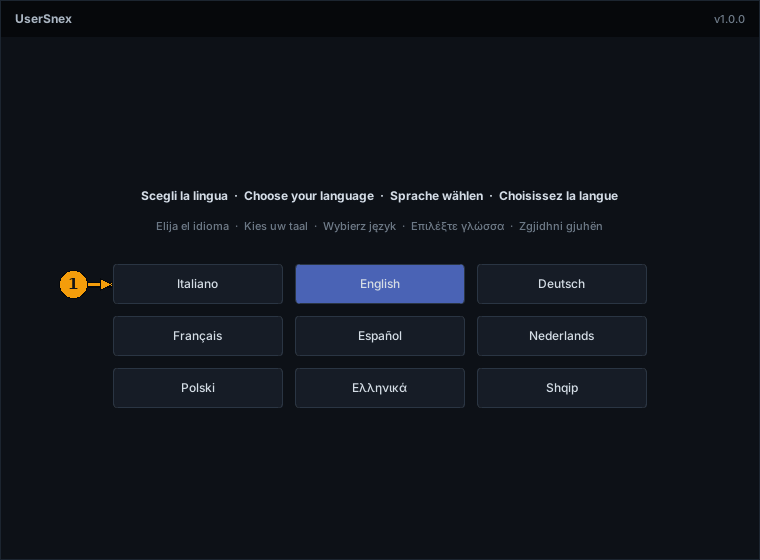
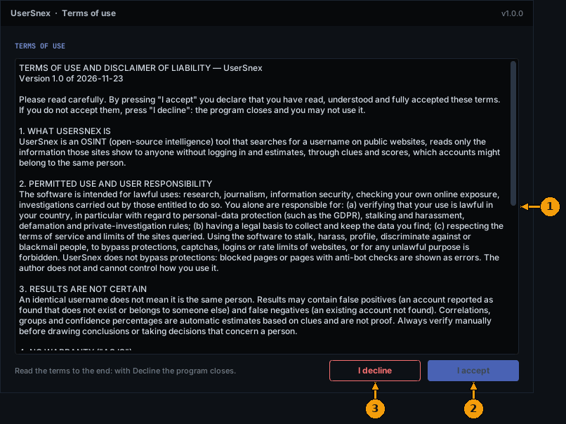
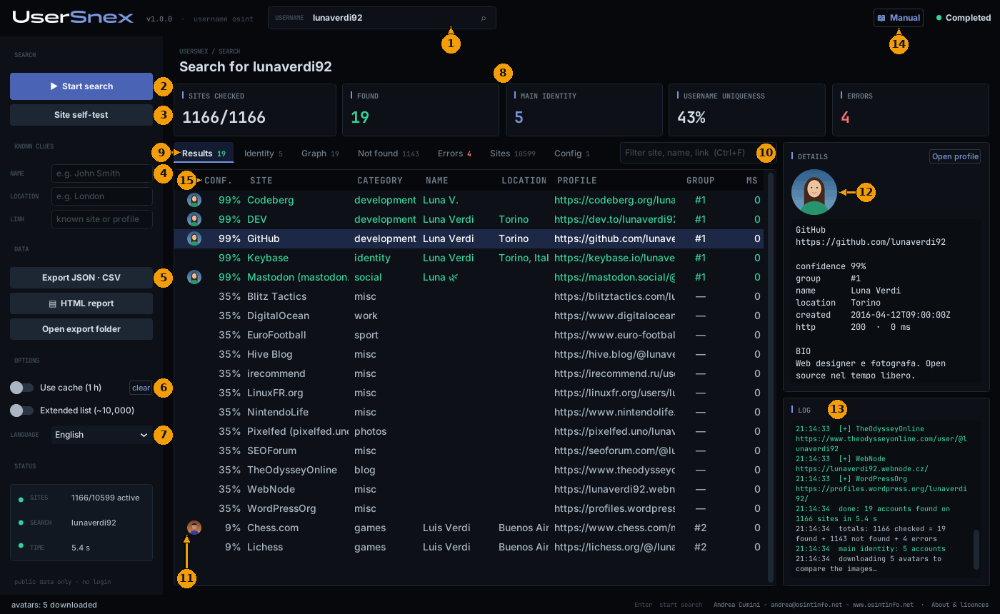
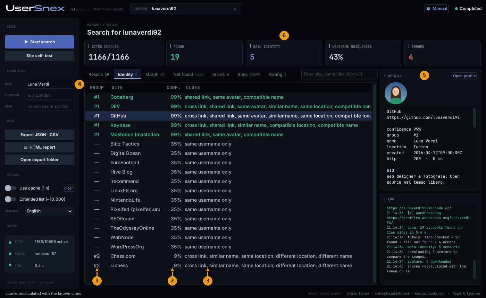
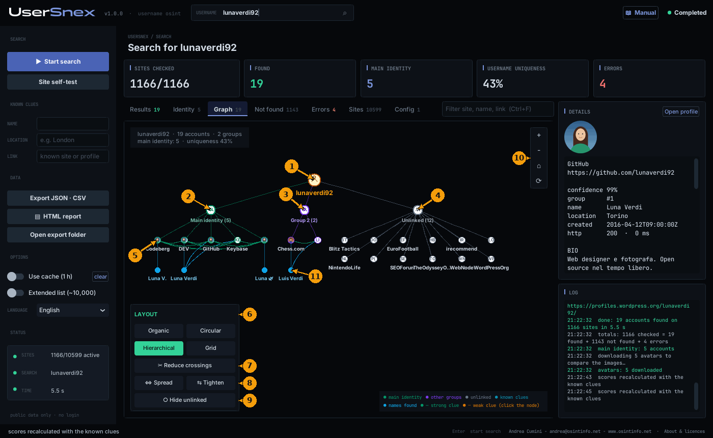
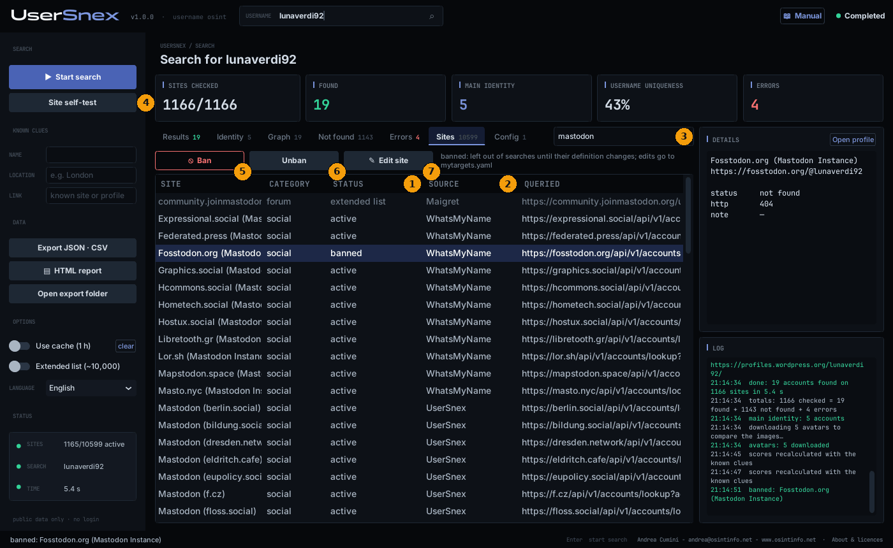
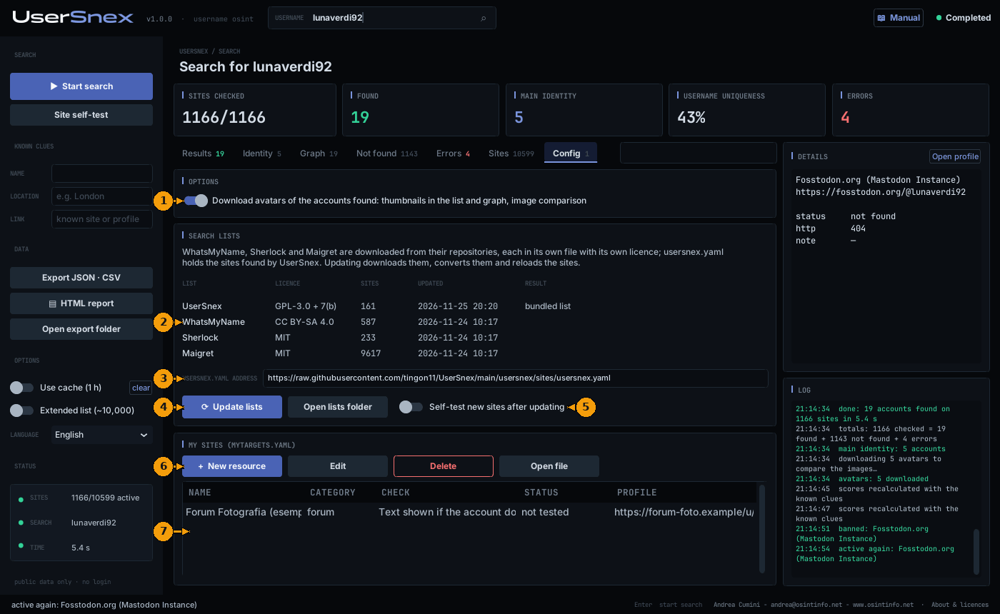
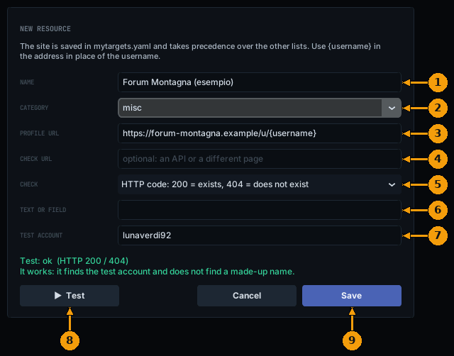

# UserSnex — User manual

UserSnex searches a username across thousands of public sites and does not stop at "it exists here": it estimates **which accounts really belong to the same person**, how confident that is, and always explains why. It uses public data only, without logging in, respects the sites' limits and does not bypass protections: a blocked page or an anti-bot check shows up as an error, never as a result.

All names, accounts and data in the examples of this manual are **made up** (the example user is `lunaverdi92`).

## Contents

1. [First launch: language and terms of use](#1-first-launch-language-and-terms-of-use)
2. [The main window](#2-the-main-window)
3. [Running a search](#3-running-a-search)
4. [Results, details and avatars](#4-results-details-and-avatars)
5. [Identity and scores](#5-identity-and-scores)
6. [Graph](#6-graph)
7. [Not found and Errors](#7-not-found-and-errors)
8. [Sites and self-test](#8-sites-and-self-test)
9. [Config](#9-config)
10. [Adding a site: New resource](#10-adding-a-site-new-resource)
11. [Exporting data](#11-exporting-data)
12. [Command line](#12-command-line)
13. [About and licences](#13-about-and-licences)
14. [Common problems](#14-common-problems)

---

## 1. First launch: language and terms of use

The first time you open UserSnex a window appears that cannot be skipped.



1. **Choose the language.** The buttons show the nine available languages: italiano, English, Deutsch, Français, Español, Nederlands, Polski, Ελληνικά, Shqip. The language applies to the whole program and can be changed later from the **Language** menu in the sidebar.



1. The **terms of use**, in the chosen language. Read them to the end.
2. **I accept** becomes active only after you have scrolled the text to the end.
3. **I decline** closes the program.

Your acceptance is saved: the window only appears again if the terms change version. On first launch UserSnex also downloads the site lists (see [Config](#9-config)).

## 2. The main window



1. **USERNAME**: the username to search for. **Enter** starts the search.
2. **Start search**. While a search runs the button becomes **Stop**.
3. **Site self-test**: checks which sites work from your network (see [chapter 8](#8-sites-and-self-test)).
4. **Known clues**: a name, location or link you already know belongs to the person. They help pick the right identity (see [chapter 5](#5-identity-and-scores)).
5. **Data**: **Export JSON · CSV**, **HTML report** and **Open export folder** (see [chapter 11](#11-exporting-data)).
6. **Options**: **Use cache (1 h)** reuses recent responses (**clear** empties it); **Extended list (~10,000)** adds thousands of forums and minor sites, but makes the search much longer.
7. Interface **Language**.
8. **Counters**: sites checked, accounts found, accounts in the main identity, username uniqueness, errors.
9. **Tabs**: Results, Identity, Graph, Not found, Errors, Sites, Config. The number next to the name is the row count.
10. **Filter** (**Ctrl+F**): shows only the rows that contain the text, in site, name, link or category.
11. **Avatar thumbnail** of the account, when the site publishes one.
12. **Details**: avatar and full data of the selected row. **Open profile** opens the page in the browser.
13. **Log**: the program's messages, with the time.
14. **📖 Manual** (or **F1**) opens this manual in the interface language.
15. **Sorting**: click a column header to sort from A to Z, click again to sort from Z to A; the ▲ or ▼ arrow shows the column in use (here *Conf.*, highest first).

In the manual window the search box at the top (**Ctrl+F**) highlights every match: **Enter** or **F3** goes to the next one, **Shift+Enter** to the previous one, **Esc** clears the search. The contents on the left lead to the chapters.

## 3. Running a search

1. Type the username in the box at the top and press **Enter** or **Start search**.
2. UserSnex queries all active sites in parallel, with a request limit per site. Accounts found appear immediately in **Results** and in the **Log**.
3. At the end of the search UserSnex downloads the public avatars of the accounts found (if the option is on), compares them and recalculates the scores.

If you already know something about the person, type it in **Known clues**, even after the search: the scores are recalculated at once, without searching again.

A rare username (`lunaverdi92`) has few namesakes; a common one (`luna`) has very many. That is why the **Username uniqueness** counter weighs on every score.

## 4. Results, details and avatars

The **Results** tab lists the accounts found, sorted by confidence: **Conf.**, site, category, display name, location, profile link, group and response time. Green rows belong to the main identity.

- A click selects the account and shows its **Details** on the right: avatar, URL, confidence, group, name, location, creation date, HTTP code, bio, links found and the clues that tie it to the other accounts.
- A double click opens the profile in the browser.

**Avatars.** Profile pictures are downloaded only once (7-day cache), shown in the list, in the details and in the graph, and compared by **visual fingerprint**: the same photo is recognised even when it is resized or recompressed on different servers. Empty images and the sites' default avatars do not count. Downloading can be turned off in [Config](#9-config).

**Sorting tables.** In every table, click a column header to sort the rows from A to Z (or from the smallest value); click the same column again to sort from Z to A. The ▲ or ▼ arrow next to the title shows the column and the direction; empty cells stay at the bottom.

## 5. Identity and scores



1. **Group**: accounts with strong ties between them form a group. **#1** is the main identity, — means "unlinked".
2. **Conf.**: the confidence that the account belongs to the person you are looking for.
3. **Clues**: the reasons, in plain words. For example *cross link* (one profile links the other), *shared link*, *same avatar*, *similar name*, *same location*; or contrary clues such as *different name* and *different location*. *same username only* means there is nothing else.
4. **Known clues**: here the name *Luna Verdi* has been entered. The main identity becomes the group that matches the known clues.
5. **Details** of the selected account.
6. The **Main identity** counter shows how many accounts belong to it.

In the example, Codeberg, DEV, GitHub, Keybase and Mastodon form the main identity (link to the personal site, same avatar, same name). Chess.com and Lichess link to each other but belong to a namesake, *Luis Verdi* from Buenos Aires: they form a second group with low confidence.

Scores are **estimates**, not proof: always check by hand before drawing conclusions.

## 6. Graph



1. The **username** searched, at the centre of the structure.
2. **Main identity**, with the number of accounts.
3. **Other groups** (here *Group 2*, the namesake).
4. **Unlinked**: accounts with the same username but no other clues.
5. An **account**, with its avatar. Lines between accounts are clues: solid for strong clues, dashed for weak ones (visible when you click the node).
6. **Layout** panel: **Organic**, **Circular**, **Hierarchical** (the default) and **Grid**.
7. **Reduce crossings** reorders the nodes so that fewer lines cross.
8. **Spread** and **Tighten** widen or narrow the drawing.
9. **Hide unlinked** removes accounts without clues (the button becomes **Show unlinked**).
10. **Zoom**: +, −, fit to window and redraw. The mouse wheel zooms too.
11. **Name found** (light-blue node): here *Luis Verdi*, the same name found on Chess.com and Lichess and merged into a single node.

A click on a node selects it and shows its details; hovering shows its clues. A double click on a group collapses or expands it. Nodes can be dragged.

**Names found.** Every display name found on a profile becomes a light-blue node, linked to all the accounts where it appears: when the same name (ignoring case, accents and symbols) appears on several sites, there is a single node that shows the co-occurrences. In the example *Luna Verdi* joins DEV, GitHub and Keybase, and *Luis Verdi* joins Chess.com and Lichess. Names equal to the username are not added. Hover over the node to see the sites.

## 7. Not found and Errors

- **Not found**: sites that answered that the account does not exist.
- **Errors**: sites that did not give a valid answer: blocked page (401/403), too many requests (429), anti-bot check, timeout, network error. UserSnex does not bypass these protections: for those sites **check by hand**. In the example Reddit answers 429 and Docker Hub 403.

## 8. Sites and self-test



1. Site **status**: *active*, *extended list* (used only with the Extended list option), or disabled by the self-test. A site you banned shows *banned*.
2. **Source**: the list the site comes from (UserSnex, WhatsMyName, Sherlock, Maigret or your own sites, *mytargets*). The **Queried** column shows the address that is called.
3. The **filter** works here too: in the example it shows the sites containing "mastodon".
4. **Site self-test**: for each site it tries an account that exists and a made-up one. Sites that give wrong answers or errors from your network are skipped in later searches. The result is saved.
5. **Ban**: leaves the selected sites out of searches (here *Fosstodon.org*, with the status *banned*).
6. **Unban**: turns the selected sites back on.
7. **Edit site**: opens the site in the New resource form and saves the change to `mytargets.yaml`.

**Banning a site.** If a site stops working or gives wrong results, select it (several at once with Ctrl or Shift) and press **Ban**, or right-click a row in any table. The site is left out of searches and the Status column shows *banned*. **Unban** turns it back on. When you update the lists (WhatsMyName, Sherlock, Maigret, UserSnex), a banned site whose definition is identical stays banned; if the definition has changed (for example the address was fixed) the ban is lifted and the site is active again. Bans are saved in `banlist.json`.

**Editing a site.** **Edit site** (or right-click › Edit site) opens the [New resource](#10-adding-a-site-new-resource) form with the site's data. When you save, the edited version goes straight into `mytargets.yaml` and replaces the one from the original list; the rules the form does not show (profile fields, expressions, headers) are kept. If the site was banned and you changed its address, it becomes active again.

## 9. Config



1. **Download avatars** of the accounts found: thumbnails in the list and in the graph, and image comparison. Turn it off to avoid extra requests.
2. **Search lists**: for each list its licence, number of sites, date of the last update and outcome. *usersnex.yaml* holds the sites found by UserSnex and improved versions of known sites; WhatsMyName, Sherlock and Maigret are downloaded from their repositories, each in its own file with its own licence.
3. **usersnex.yaml address**: where the UserSnex list is updated from (the project repository). It can be changed.
4. **Update lists** downloads all lists, converts them and reloads the sites. If a list cannot be downloaded or looks broken, the previous one is kept. **Open lists folder** opens the `lists` folder.
5. **Self-test new sites after updating**: when on, sites added by the update are tested straight away.
6. **My sites (mytargets.yaml)**: **New resource** adds a site (see [chapter 10](#10-adding-a-site-new-resource)); **Edit**, **Delete** and **Open file** act on the selected site or on the file.
7. The list of your sites. A double click opens it for editing.

## 10. Adding a site: New resource

A site added here is saved in `mytargets.yaml` and takes precedence over the other lists: if it has the same name as an existing site, it replaces it.



1. Site **name**.
2. **Category** (forum, social, development, games…).
3. **Profile URL**, with `{username}` in place of the username, for example `https://forum-montagna.example/u/{username}`.
4. **Check URL** (optional): an API or a page other than the profile, queried instead of it.
5. **Check**: how to tell whether the account exists. *HTTP code* (200 = exists, 404 = does not exist), a *text present only if the account exists* (for example "Member since"), a *text that appears if the account does not exist* (for example "User not found"), or a *field of the JSON API* (for example `data.id`).
6. **Text or field** used by the chosen check (not needed, and greyed out, with *HTTP code*).
7. **Test account**: a username you know exists on the site.
8. **Test**: queries the site with the test account and with a made-up name and tells you whether the check works. In the example: *ok (HTTP 200 / 404)*.
9. **Save** writes the site to `mytargets.yaml`; **Cancel** closes without saving.

## 11. Exporting data

- **Export JSON · CSV** saves results and identities in the `results` folder.
- **HTML report** creates a report readable in any browser and opens it.
- **Open export folder** opens the folder with the saved files.

The files may contain personal data: keep them safe and delete them when they are no longer needed.

## 12. Command line

The same functions are available from a terminal:

```
python run.py lunaverdi92 --html --name "Luna Verdi" --location Torino
python run.py --update-lists
python run.py --selftest
```

Main options: `--name`, `--location`, `--link` (known clues, `--link` can be repeated), `--extended` (extended list), `--only` (only some sites, comma separated), `--sites` (extra YAML file or folder), `--out` (output folder), `--html`, `--no-export`, `--no-cache`, `--all` (also show sites where nothing was found), `--timeout`, `--usersnex-url`. `python run.py --help` lists them all.

## 13. About and licences

Click **About & licences** in the bottom bar: version, author, the program's licence (GPL-3.0 with an attribution requirement), the site lists and third-party components with their licences, and the **Terms of use** button to read the terms again. UserSnex is free software, with no warranty of any kind.

## 14. Common problems

| Message or situation | What to do |
|---|---|
| Lists missing on first launch | Config › Update lists. An internet connection is needed. |
| Many 429 errors | The site limits requests: wait and try again, or turn on the cache. |
| 403 error or anti-bot page | The site blocks programs: check that account by hand in the browser. |
| A site always gives wrong results | Press Site self-test: sites that fail from your network are excluded. |
| Very slow search | Turn off Extended list: it adds about 9,000 minor sites. |
| Avatars do not appear | Config › Options › Download avatars must be on; some sites do not publish a picture. |
| My site does not find the account | In New resource press Test and check URL, check type and text. |
| manual not found | The `docs/manual` folder is missing: reinstall the program. |
