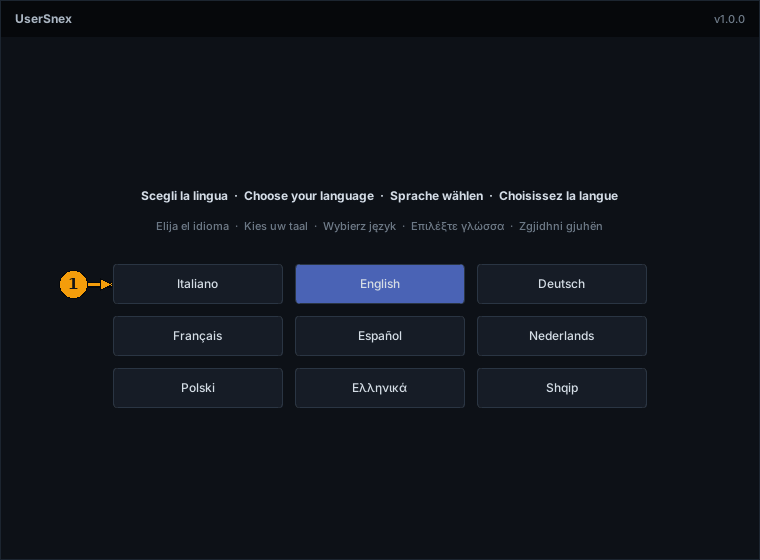
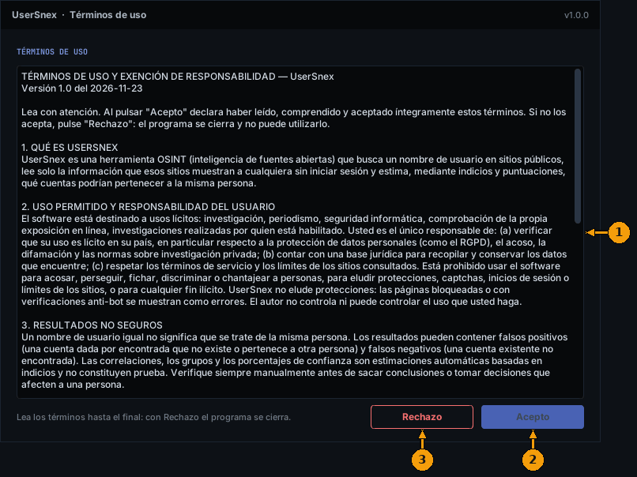
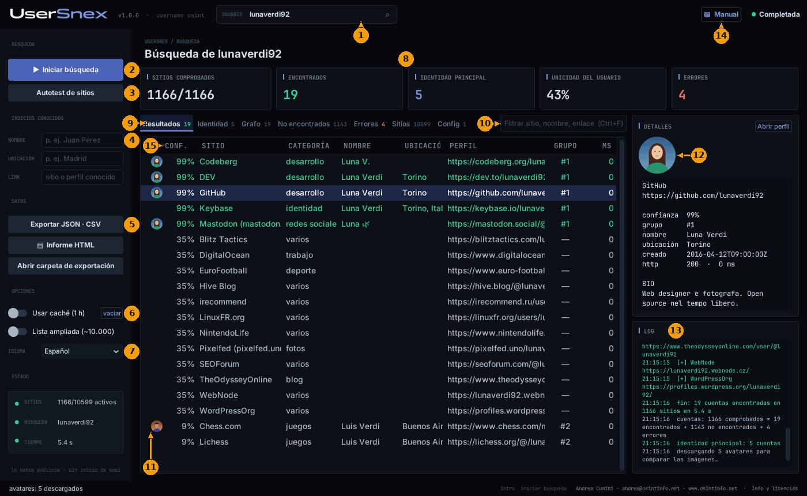
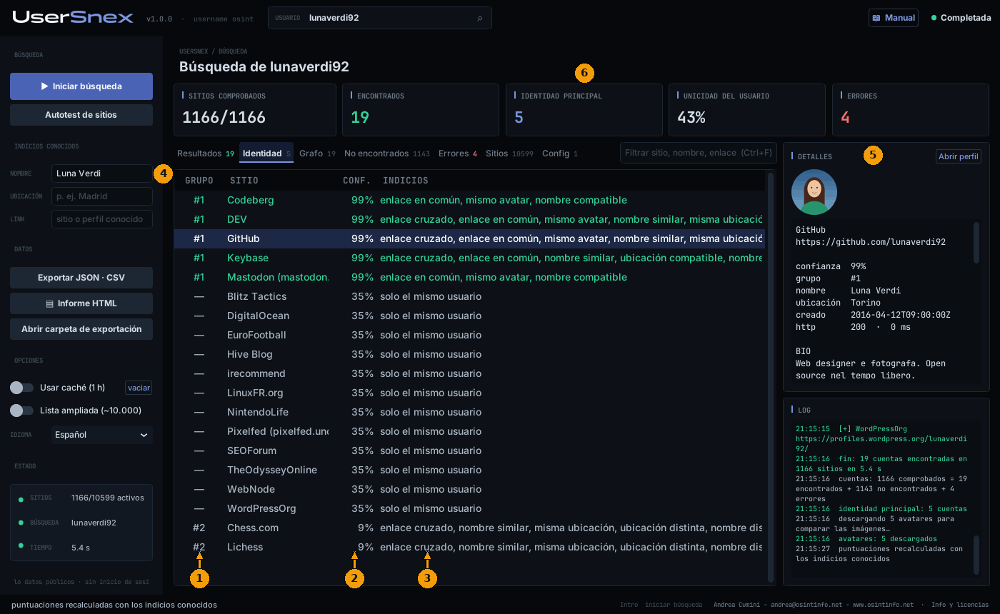
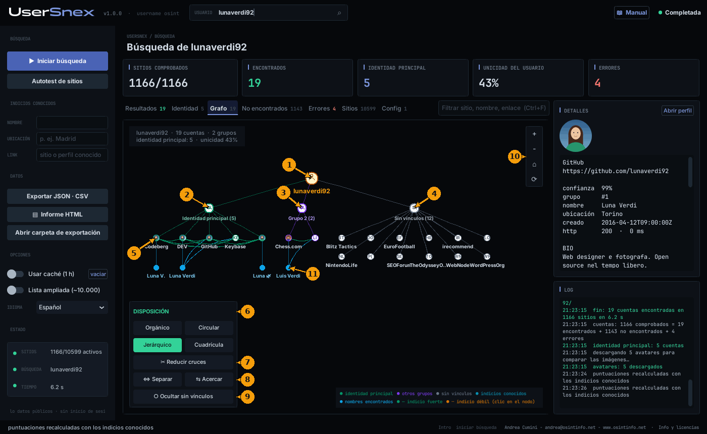
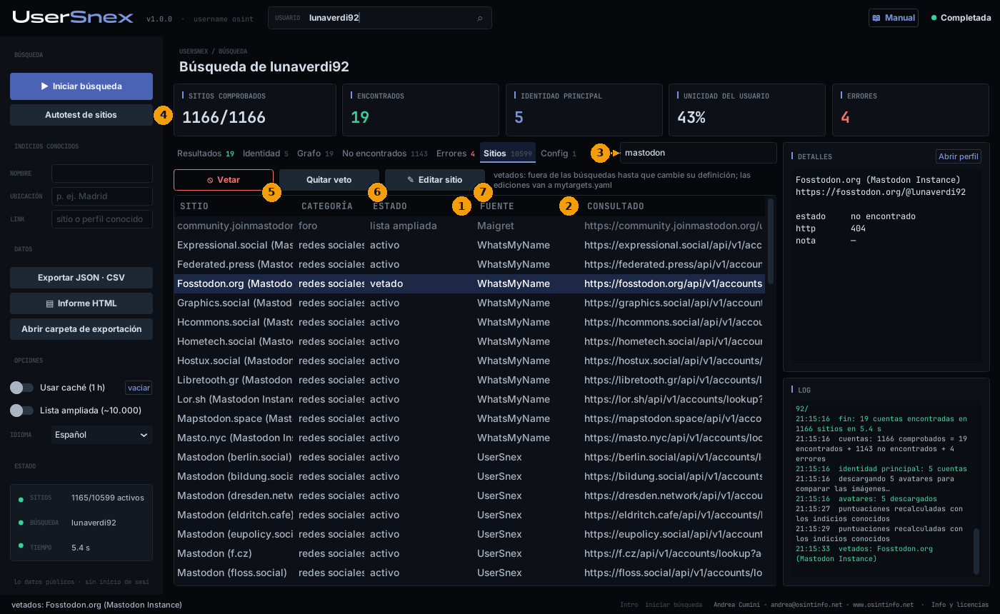
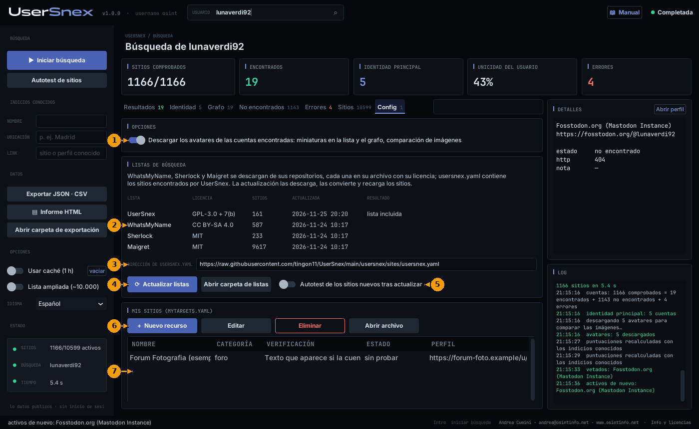
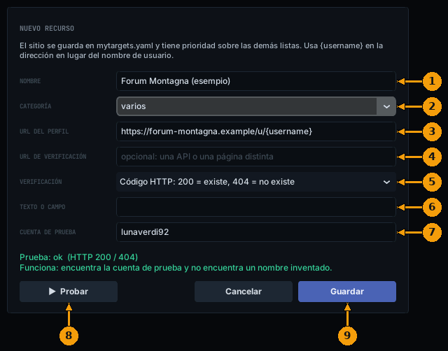

# UserSnex — Manual de usuario

UserSnex busca un nombre de usuario en miles de sitios públicos y no se limita a decir "existe aquí": estima **qué cuentas pertenecen realmente a la misma persona**, con qué confianza, y siempre explica por qué. Usa solo datos públicos, sin iniciar sesión, respeta los límites de los sitios y no elude protecciones: una página bloqueada o una verificación anti-bot aparecen como error, nunca como resultado.

Todos los nombres, cuentas y datos de los ejemplos de este manual son **inventados** (el usuario de ejemplo es `lunaverdi92`).

## Índice

1. [Primer inicio: idioma y términos de uso](#1-primer-inicio-idioma-y-términos-de-uso)
2. [La ventana principal](#2-la-ventana-principal)
3. [Hacer una búsqueda](#3-hacer-una-búsqueda)
4. [Resultados, detalles y avatares](#4-resultados-detalles-y-avatares)
5. [Identidad y puntuaciones](#5-identidad-y-puntuaciones)
6. [Grafo](#6-grafo)
7. [No encontrados y Errores](#7-no-encontrados-y-errores)
8. [Sitios y autotest](#8-sitios-y-autotest)
9. [Config](#9-config)
10. [Añadir un sitio: Nuevo recurso](#10-añadir-un-sitio-nuevo-recurso)
11. [Exportar los datos](#11-exportar-los-datos)
12. [Línea de comandos](#12-línea-de-comandos)
13. [Información y licencias](#13-información-y-licencias)
14. [Problemas frecuentes](#14-problemas-frecuentes)

---

## 1. Primer inicio: idioma y términos de uso

La primera vez aparece una ventana que no se puede omitir.



1. **Elija el idioma.** Los botones muestran los nueve idiomas disponibles: italiano, English, Deutsch, Français, Español, Nederlands, Polski, Ελληνικά, Shqip. El idioma vale para todo el programa y se puede cambiar después desde el menú **Idioma** de la barra lateral.



1. El texto de los **términos de uso**, en el idioma elegido. Léalo hasta el final.
2. **Acepto** se activa solo después de desplazar el texto hasta el final.
3. **Rechazo** cierra el programa.

La aceptación se guarda: la ventana solo vuelve a aparecer si los términos cambian de versión. En el primer inicio UserSnex también descarga las listas de sitios (véase [Config](#9-config)).

## 2. La ventana principal



1. **USERNAME**: el nombre de usuario que se busca. **Intro** inicia la búsqueda.
2. **Iniciar búsqueda**. Durante la búsqueda el botón se convierte en **Detener**.
3. **Autotest de sitios**: comprueba qué sitios funcionan desde su red (véase el [capítulo 8](#8-sitios-y-autotest)).
4. **Indicios conocidos**: un nombre, una ubicación o un enlace que ya sabe que pertenecen a la persona. Sirven para elegir la identidad correcta (véase el [capítulo 5](#5-identidad-y-puntuaciones)).
5. **Datos**: **Exportar JSON · CSV**, **Informe HTML** y **Abrir carpeta de exportación** (véase el [capítulo 11](#11-exportar-los-datos)).
6. **Opciones**: **Usar caché (1 h)** reutiliza las respuestas recientes (**vaciar** la borra); **Lista ampliada (~10.000)** añade miles de foros y sitios menores, pero hace la búsqueda mucho más larga.
7. **Idioma** de la interfaz.
8. **Contadores**: sitios comprobados, cuentas encontradas, cuentas de la identidad principal, unicidad del usuario, errores.
9. **Pestañas**: Resultados, Identidad, Grafo, No encontrados, Errores, Sitios, Config. El número junto al nombre es la cantidad de filas.
10. **Filtro** (**Ctrl+F**): muestra solo las filas que contienen el texto, en sitio, nombre, enlace o categoría.
11. **Miniatura del avatar** de la cuenta, cuando el sitio publica uno.
12. **Detalles**: avatar y datos completos de la fila seleccionada. **Abrir perfil** abre la página en el navegador.
13. **Log**: los mensajes del programa, con la hora.
14. **📖 Manual** (o **F1**) abre este manual en el idioma de la interfaz.
15. **Orden**: un clic en el encabezado de una columna ordena de la A a la Z y un segundo clic de la Z a la A; la flecha ▲ o ▼ indica la columna usada (aquí *Conf.*, de mayor a menor).

En la ventana del manual, el cuadro de búsqueda de arriba (**Ctrl+F**) resalta todas las coincidencias: **Intro** o **F3** pasa a la siguiente, **Mayús+Intro** a la anterior, **Esc** vacía la búsqueda. El índice de la izquierda lleva a los capítulos.

## 3. Hacer una búsqueda

1. Escriba el nombre de usuario en el cuadro de arriba y pulse **Intro** o **Iniciar búsqueda**.
2. UserSnex consulta en paralelo todos los sitios activos, con un límite de peticiones por sitio. Las cuentas encontradas aparecen enseguida en **Resultados** y en el **Log**.
3. Al terminar, UserSnex descarga los avatares públicos de las cuentas encontradas (si la opción está activa), los compara y recalcula las puntuaciones.

Si ya sabe algo de la persona, escríbalo en **Indicios conocidos**, incluso después de la búsqueda: las puntuaciones se recalculan al momento, sin repetir la búsqueda.

Un nombre de usuario raro (`lunaverdi92`) tiene pocos homónimos; uno común (`luna`) tiene muchísimos. Por eso el contador **Unicidad del usuario** influye en todas las puntuaciones.

## 4. Resultados, detalles y avatares

La pestaña **Resultados** muestra las cuentas encontradas, ordenadas por confianza: **Conf.**, sitio, categoría, nombre visible, ubicación, enlace al perfil, grupo y tiempo de respuesta. Las filas verdes pertenecen a la identidad principal.

- Un clic selecciona la cuenta y muestra sus **Detalles** a la derecha: avatar, URL, confianza, grupo, nombre, ubicación, fecha de creación, código HTTP, biografía, enlaces encontrados y los indicios que la unen a las demás cuentas.
- Un doble clic abre el perfil en el navegador.

**Avatares.** Las imágenes de perfil se descargan una sola vez (caché de 7 días), se muestran en la lista, en los detalles y en el grafo, y se comparan por **huella visual**: la misma foto se reconoce aunque esté redimensionada o recomprimida en servidores distintos. Las imágenes vacías y los avatares predeterminados de los sitios no cuentan. La descarga se desactiva en [Config](#9-config).

**Ordenar las tablas.** En todas las tablas, un clic en el encabezado de una columna ordena las filas de la A a la Z (o del valor más pequeño); un segundo clic en la misma columna las ordena de la Z a la A. La flecha ▲ o ▼ junto al título indica la columna y el sentido; las celdas vacías quedan al final.

## 5. Identidad y puntuaciones



1. **Grupo**: las cuentas con vínculos fuertes entre sí forman un grupo. **#1** es la identidad principal, — significa "sin vínculos".
2. **Conf.**: la confianza de que la cuenta pertenezca a la persona buscada.
3. **Indicios**: los motivos, en claro. Por ejemplo *enlace cruzado* (un perfil enlaza al otro), *enlace en común*, *mismo avatar*, *nombre similar*, *misma ubicación*; o indicios contrarios como *nombre distinto* y *ubicación distinta*. *solo el mismo usuario* significa que no hay nada más.
4. **Indicios conocidos**: aquí se ha introducido el nombre *Luna Verdi*. La identidad principal pasa a ser el grupo que coincide con los indicios conocidos.
5. **Detalles** de la cuenta seleccionada.
6. El contador **Identidad principal** muestra cuántas cuentas forman parte de ella.

En el ejemplo, Codeberg, DEV, GitHub, Keybase y Mastodon forman la identidad principal (enlace al sitio personal, mismo avatar, mismo nombre). Chess.com y Lichess se enlazan entre sí pero pertenecen a un homónimo, *Luis Verdi* de Buenos Aires: forman un segundo grupo con confianza baja.

Las puntuaciones son **estimaciones**, no pruebas: compruebe siempre a mano antes de sacar conclusiones.

## 6. Grafo



1. El **nombre de usuario** buscado, en el centro de la estructura.
2. **Identidad principal**, con el número de cuentas.
3. **Otros grupos** (aquí *Grupo 2*, el homónimo).
4. **Sin vínculos**: cuentas con el mismo nombre de usuario pero sin otros indicios.
5. Una **cuenta**, con su avatar. Las líneas entre cuentas son los indicios: continuas para los indicios fuertes, discontinuas para los débiles (visibles al hacer clic en el nodo).
6. Panel **Layout**: **Orgánico**, **Circular**, **Jerárquico** (el predeterminado) y **Cuadrícula**.
7. **Reducir cruces** reordena los nodos para que se crucen menos líneas.
8. **Separar** y **Acercar** amplían o estrechan el dibujo.
9. **Ocultar sin vínculos** quita las cuentas sin indicios (el botón pasa a **Mostrar sin vínculos**).
10. **Zoom**: +, −, ajustar a la ventana y redibujar. También se hace zoom con la rueda del ratón.
11. **Nombre encontrado** (nodo celeste): aquí *Luis Verdi*, el mismo nombre encontrado en Chess.com y Lichess y unido en un solo nodo.

Un clic en un nodo lo selecciona y muestra sus detalles; al pasar el ratón por encima se ven sus indicios. Un doble clic en un grupo lo cierra o lo vuelve a abrir. Los nodos se pueden arrastrar.

**Nombres encontrados.** Cada nombre visible encontrado en un perfil se convierte en un nodo celeste, unido a todas las cuentas en las que aparece: si el mismo nombre (sin tener en cuenta mayúsculas, acentos y símbolos) aparece en varios sitios, hay un solo nodo que muestra las coincidencias. En el ejemplo *Luna Verdi* une DEV, GitHub y Keybase, y *Luis Verdi* une Chess.com y Lichess. Los nombres iguales al usuario no se añaden. Al pasar el ratón sobre el nodo se ven los sitios.

## 7. No encontrados y Errores

- **No encontrados**: los sitios que respondieron que la cuenta no existe.
- **Errores**: los sitios que no dieron una respuesta válida: página bloqueada (401/403), demasiadas peticiones (429), verificación anti-bot, tiempo agotado, error de red. UserSnex no elude estas protecciones: para esos sitios **compruebe a mano**. En el ejemplo Reddit responde 429 y Docker Hub 403.

## 8. Sitios y autotest



1. **Estado** del sitio: *activo*, *lista ampliada* (solo se usa con la opción Lista ampliada) o desactivado por el autotest. Un sitio vetado a mano muestra *vetado*.
2. **Fuente**: la lista de la que procede el sitio (UserSnex, WhatsMyName, Sherlock, Maigret o sus propios sitios, *mytargets*). La columna **Consultado** muestra la dirección a la que se llama.
3. El **filtro** también funciona aquí: en el ejemplo muestra los sitios que contienen "mastodon".
4. **Autotest de sitios**: para cada sitio prueba una cuenta que existe y una inventada. Los sitios que fallan o dan error desde su red se omiten en las búsquedas siguientes. El resultado queda guardado.
5. **Vetar**: deja fuera de las búsquedas los sitios seleccionados (aquí *Fosstodon.org*, con el estado *vetado*).
6. **Quitar veto**: reactiva los sitios seleccionados.
7. **Editar sitio**: abre el sitio en el formulario de Nuevo recurso y guarda el cambio en `mytargets.yaml`.

**Vetar un sitio.** Si un sitio deja de funcionar o da resultados erróneos, selecciónelo (también varios, con Ctrl o Mayús) y pulse **Vetar**, o haga clic derecho en una fila de cualquier tabla. El sitio queda fuera de las búsquedas y la columna Estado muestra *vetado*. **Quitar veto** lo reactiva. Al actualizar las listas (WhatsMyName, Sherlock, Maigret, UserSnex), un sitio vetado con la definición idéntica sigue vetado; si la definición ha cambiado (por ejemplo se corrigió la dirección) el veto se anula y el sitio vuelve a estar activo. Los vetos se guardan en `banlist.json`.

**Editar un sitio.** **Editar sitio** (o clic derecho › Editar sitio) abre el formulario de [Nuevo recurso](#10-añadir-un-sitio-nuevo-recurso) con los datos del sitio. Al guardar, la versión editada va directamente a `mytargets.yaml` y sustituye a la de la lista de origen; las reglas que el formulario no muestra (campos del perfil, expresiones, cabeceras) se conservan. Si el sitio estaba vetado y cambió la dirección, vuelve a estar activo.

## 9. Config



1. **Descargar los avatares** de las cuentas encontradas: miniaturas en la lista y en el grafo y comparación de imágenes. Desactívelo para no hacer peticiones adicionales.
2. **Listas de búsqueda**: de cada lista, la licencia, el número de sitios, la fecha de la última actualización y el resultado. *usersnex.yaml* contiene los sitios encontrados por UserSnex y versiones mejoradas de sitios conocidos; WhatsMyName, Sherlock y Maigret se descargan de sus repositorios, cada una en su archivo con su licencia.
3. **Dirección de usersnex.yaml**: desde dónde se actualiza la lista de UserSnex (el repositorio del proyecto). Se puede cambiar.
4. **Actualizar listas** descarga todas las listas, las convierte y recarga los sitios. Si una lista no se descarga o parece dañada, se conserva la anterior. **Abrir carpeta de listas** abre la carpeta `lists`.
5. **Autotest de los sitios nuevos tras actualizar**: si está activo, los sitios añadidos por la actualización se prueban enseguida.
6. **Mis sitios (mytargets.yaml)**: **Nuevo recurso** añade un sitio (véase el [capítulo 10](#10-añadir-un-sitio-nuevo-recurso)); **Editar**, **Eliminar** y **Abrir archivo** actúan sobre el sitio seleccionado o sobre el archivo.
7. La lista de sus sitios. Un doble clic abre la edición.

## 10. Añadir un sitio: Nuevo recurso

Un sitio añadido desde aquí se guarda en `mytargets.yaml` y tiene prioridad sobre las demás listas: si tiene el mismo nombre que un sitio existente, lo sustituye.



1. **Nombre** del sitio.
2. **Categoría** (foro, social, desarrollo, juegos…).
3. **URL del perfil**, con `{username}` en lugar del nombre de usuario, por ejemplo `https://forum-montagna.example/u/{username}`.
4. **URL de verificación** (opcional): una API o una página distinta del perfil, que se consulta en su lugar.
5. **Verificación**: cómo saber si la cuenta existe. *Código HTTP* (200 = existe, 404 = no existe), un *texto presente solo si la cuenta existe* (por ejemplo "Miembro desde"), un *texto que aparece si la cuenta no existe* (por ejemplo "Usuario no encontrado") o un *campo de la API JSON* (por ejemplo `data.id`).
6. **Texto o campo** que usa la verificación elegida (con *Código HTTP* no hace falta y está desactivado).
7. **Cuenta de prueba**: un nombre de usuario que sabe que existe en el sitio.
8. **Probar**: consulta el sitio con la cuenta de prueba y con un nombre inventado e indica si la verificación funciona. En el ejemplo: *ok (HTTP 200 / 404)*.
9. **Guardar** escribe el sitio en `mytargets.yaml`; **Cancelar** cierra sin guardar.

## 11. Exportar los datos

- **Exportar JSON · CSV** guarda los resultados y las identidades en la carpeta `results`.
- **Informe HTML** crea un informe legible en cualquier navegador y lo abre.
- **Abrir carpeta de exportación** abre la carpeta con los archivos guardados.

Los archivos pueden contener datos personales: guárdelos con cuidado y bórrelos cuando ya no los necesite.

## 12. Línea de comandos

Las mismas funciones están disponibles desde el terminal:

```
python run.py lunaverdi92 --html --name "Luna Verdi" --location Torino
python run.py --update-lists
python run.py --selftest
```

Opciones principales: `--name`, `--location`, `--link` (indicios conocidos, `--link` se puede repetir), `--extended` (lista ampliada), `--only` (solo algunos sitios, separados por comas), `--sites` (archivo o carpeta YAML adicional), `--out` (carpeta de salida), `--html`, `--no-export`, `--no-cache`, `--all` (muestra también los sitios sin resultado), `--timeout`, `--usersnex-url`. `python run.py --help` las enumera todas.

## 13. Información y licencias

Haga clic en **Info y licencias** en la barra inferior: versión, autor, licencia del programa (GPL-3.0 con obligación de atribución), las listas de sitios y los componentes de terceros con sus licencias, y el botón **Términos de uso** para volver a leer los términos. UserSnex es software libre, sin ninguna garantía.

## 14. Problemas frecuentes

| Mensaje o situación | Qué hacer |
|---|---|
| Faltan las listas en el primer inicio | Config › Actualizar listas. Se necesita conexión a internet. |
| Muchos errores 429 | El sitio limita las peticiones: espere y vuelva a intentarlo, o active la caché. |
| Error 403 o página anti-bot | El sitio bloquea los programas: compruebe esa cuenta a mano en el navegador. |
| Un sitio siempre da resultados erróneos | Pulse Autotest de sitios: los sitios que fallan desde su red se excluyen. |
| Búsqueda muy lenta | Desactive Lista ampliada: añade unos 9.000 sitios menores. |
| No aparecen los avatares | Config › Opciones › Descargar los avatares debe estar activo; algunos sitios no publican la imagen. |
| Mi sitio no encuentra la cuenta | En Nuevo recurso pulse Probar y revise la URL, la verificación y el texto. |
| manual no encontrado | Falta la carpeta `docs/manual`: reinstale el programa. |
