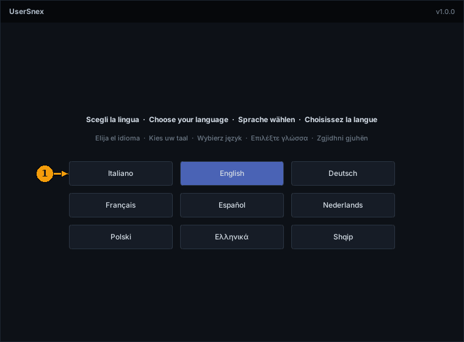
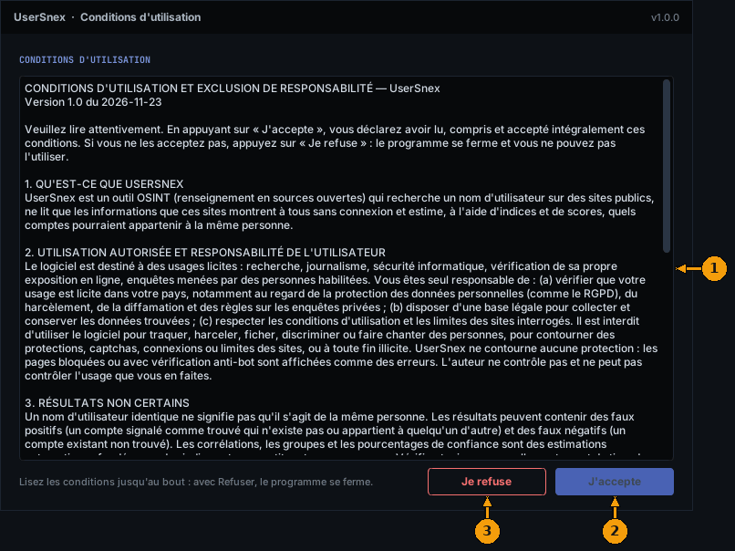
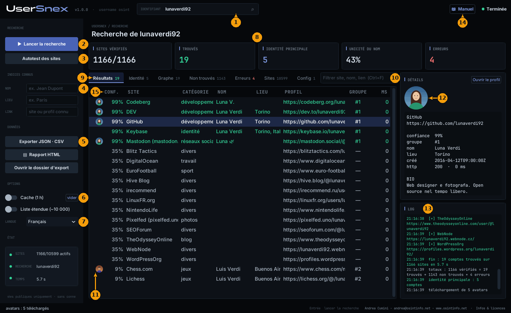
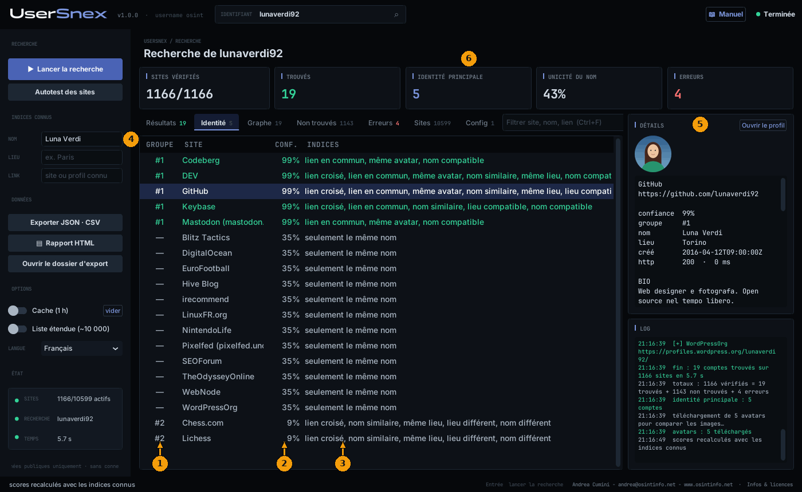
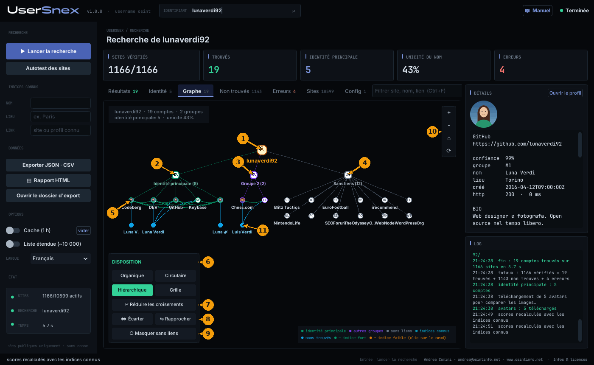
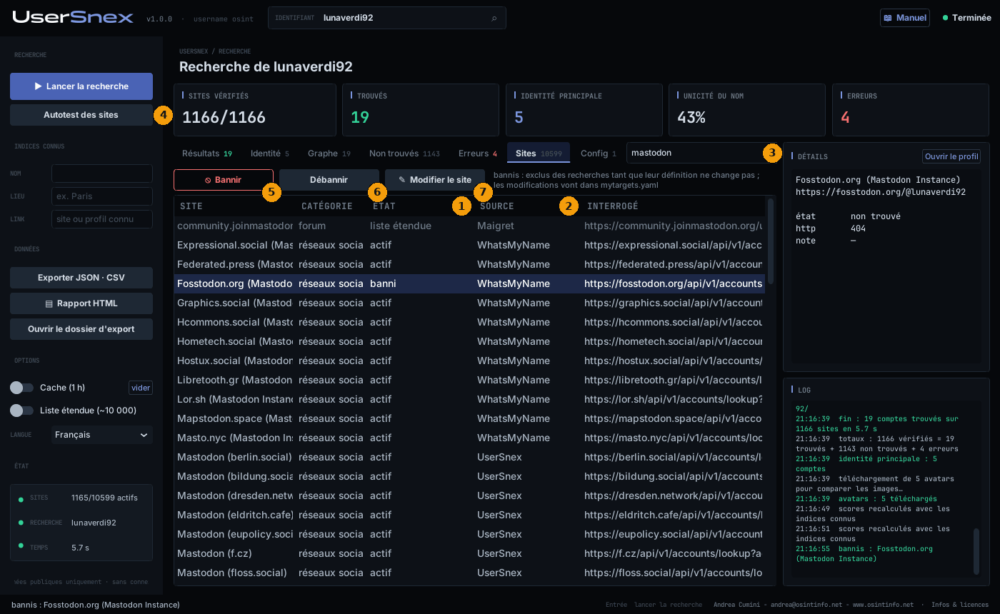
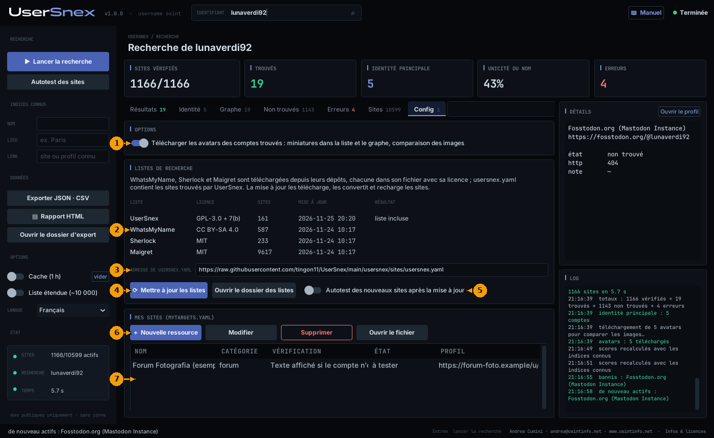
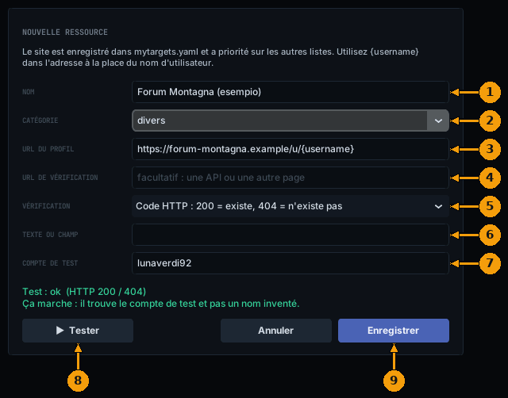

# UserSnex — Manuel d'utilisation

UserSnex recherche un nom d'utilisateur sur des milliers de sites publics et ne se contente pas de dire « il existe ici » : il estime **quels comptes appartiennent vraiment à la même personne**, avec quelle confiance, et explique toujours pourquoi. Il n'utilise que des données publiques, sans connexion, respecte les limites des sites et ne contourne aucune protection : une page bloquée ou une vérification anti-bot apparaît comme une erreur, jamais comme un résultat.

Tous les noms, comptes et données des exemples de ce manuel sont **inventés** (l'utilisateur d'exemple est `lunaverdi92`).

## Sommaire

1. [Premier lancement : langue et conditions d'utilisation](#1-premier-lancement--langue-et-conditions-dutilisation)
2. [La fenêtre principale](#2-la-fenêtre-principale)
3. [Lancer une recherche](#3-lancer-une-recherche)
4. [Résultats, détails et avatars](#4-résultats-détails-et-avatars)
5. [Identité et scores](#5-identité-et-scores)
6. [Graphe](#6-graphe)
7. [Non trouvés et Erreurs](#7-non-trouvés-et-erreurs)
8. [Sites et autotest](#8-sites-et-autotest)
9. [Config](#9-config)
10. [Ajouter un site : Nouvelle ressource](#10-ajouter-un-site--nouvelle-ressource)
11. [Exporter les données](#11-exporter-les-données)
12. [Ligne de commande](#12-ligne-de-commande)
13. [Infos et licences](#13-infos-et-licences)
14. [Problèmes fréquents](#14-problèmes-fréquents)

---

## 1. Premier lancement : langue et conditions d'utilisation

À la première ouverture, une fenêtre apparaît qu'on ne peut pas ignorer.



1. **Choisissez la langue.** Les boutons proposent les neuf langues disponibles : italiano, English, Deutsch, Français, Español, Nederlands, Polski, Ελληνικά, Shqip. La langue s'applique à tout le programme et se change ensuite depuis le menu **Langue** de la barre latérale.



1. Le texte des **conditions d'utilisation**, dans la langue choisie. Lisez-le jusqu'au bout.
2. **J'accepte** ne s'active qu'après avoir fait défiler le texte jusqu'à la fin.
3. **Je refuse** ferme le programme.

L'acceptation est enregistrée : la fenêtre ne réapparaît que si les conditions changent de version. Au premier lancement, UserSnex télécharge aussi les listes de sites (voir [Config](#9-config)).

## 2. La fenêtre principale



1. **USERNAME** : le nom d'utilisateur à rechercher. **Entrée** lance la recherche.
2. **Lancer la recherche**. Pendant la recherche, le bouton devient **Arrêter**.
3. **Autotest des sites** : vérifie quels sites fonctionnent depuis votre réseau (voir le [chapitre 8](#8-sites-et-autotest)).
4. **Indices connus** : un nom, un lieu ou un lien dont vous savez déjà qu'il appartient à la personne. Ils servent à choisir la bonne identité (voir le [chapitre 5](#5-identité-et-scores)).
5. **Données** : **Exporter JSON · CSV**, **Rapport HTML** et **Ouvrir le dossier d'export** (voir le [chapitre 11](#11-exporter-les-données)).
6. **Options** : **Cache (1 h)** réutilise les réponses récentes (**vider** l'efface) ; **Liste étendue (~10 000)** ajoute des milliers de forums et de petits sites, mais rend la recherche beaucoup plus longue.
7. **Langue** de l'interface.
8. **Compteurs** : sites vérifiés, comptes trouvés, comptes de l'identité principale, unicité du nom, erreurs.
9. **Onglets** : Résultats, Identité, Graphe, Non trouvés, Erreurs, Sites, Config. Le nombre à côté du nom est le nombre de lignes.
10. **Filtre** (**Ctrl+F**) : n'affiche que les lignes qui contiennent le texte, dans le site, le nom, le lien ou la catégorie.
11. **Miniature de l'avatar** du compte, quand le site en publie un.
12. **Détails** : avatar et données complètes de la ligne sélectionnée. **Ouvrir le profil** ouvre la page dans le navigateur.
13. **Log** : les messages du programme, avec l'heure.
14. **📖 Manuel** (ou **F1**) ouvre ce manuel dans la langue de l'interface.
15. **Tri** : un clic sur l'en-tête d'une colonne trie de A à Z, un second clic de Z à A ; la flèche ▲ ou ▼ indique la colonne utilisée (ici *Conf.*, de la plus haute à la plus basse).

Dans la fenêtre du manuel, le champ de recherche en haut (**Ctrl+F**) surligne toutes les occurrences : **Entrée** ou **F3** passe à la suivante, **Maj+Entrée** à la précédente, **Échap** vide la recherche. Le sommaire à gauche mène aux chapitres.

## 3. Lancer une recherche

1. Tapez le nom d'utilisateur dans le champ en haut et appuyez sur **Entrée** ou **Lancer la recherche**.
2. UserSnex interroge en parallèle tous les sites actifs, avec une limite de requêtes par site. Les comptes trouvés apparaissent aussitôt dans **Résultats** et dans le **Log**.
3. À la fin, UserSnex télécharge les avatars publics des comptes trouvés (si l'option est active), les compare et recalcule les scores.

Si vous savez déjà quelque chose de la personne, saisissez-le dans **Indices connus**, même après la recherche : les scores sont recalculés immédiatement, sans relancer la recherche.

Un nom d'utilisateur rare (`lunaverdi92`) a peu d'homonymes ; un nom courant (`luna`) en a énormément. C'est pourquoi le compteur **Unicité du nom** pèse sur tous les scores.

## 4. Résultats, détails et avatars

L'onglet **Résultats** liste les comptes trouvés, triés par confiance : **Conf.**, site, catégorie, nom affiché, lieu, lien du profil, groupe et temps de réponse. Les lignes vertes appartiennent à l'identité principale.

- Un clic sélectionne le compte et affiche ses **Détails** à droite : avatar, URL, confiance, groupe, nom, lieu, date de création, code HTTP, bio, liens trouvés et indices qui le relient aux autres comptes.
- Un double-clic ouvre le profil dans le navigateur.

**Avatars.** Les images de profil ne sont téléchargées qu'une fois (cache de 7 jours), affichées dans la liste, les détails et le graphe, et comparées par **empreinte visuelle** : la même photo est reconnue même redimensionnée ou recompressée sur des serveurs différents. Les images vides et les avatars par défaut des sites ne comptent pas. Le téléchargement se désactive dans [Config](#9-config).

**Trier les tableaux.** Dans tous les tableaux, un clic sur l'en-tête d'une colonne trie les lignes de A à Z (ou de la plus petite valeur) ; un second clic sur la même colonne les trie de Z à A. La flèche ▲ ou ▼ à côté du titre indique la colonne et le sens ; les cellules vides restent en bas.

## 5. Identité et scores



1. **Groupe** : les comptes fortement liés entre eux forment un groupe. **#1** est l'identité principale, — signifie « sans liens ».
2. **Conf.** : la confiance que le compte appartienne à la personne recherchée.
3. **Indices** : les raisons, en clair. Par exemple *lien croisé* (un profil renvoie vers l'autre), *lien en commun*, *même avatar*, *nom similaire*, *même lieu* ; ou des indices contraires comme *nom différent* et *lieu différent*. *seulement le même nom* signifie qu'il n'y a rien d'autre.
4. **Indices connus** : ici, le nom *Luna Verdi* a été saisi. L'identité principale devient le groupe qui correspond aux indices connus.
5. **Détails** du compte sélectionné.
6. Le compteur **Identité principale** indique combien de comptes en font partie.

Dans l'exemple, Codeberg, DEV, GitHub, Keybase et Mastodon forment l'identité principale (lien vers le site personnel, même avatar, même nom). Chess.com et Lichess se renvoient l'un à l'autre mais appartiennent à un homonyme, *Luis Verdi* de Buenos Aires : ils forment un second groupe avec une confiance faible.

Les scores sont des **estimations**, pas des preuves : vérifiez toujours à la main avant de tirer des conclusions.

## 6. Graphe



1. Le **nom d'utilisateur** recherché, au centre de la structure.
2. **Identité principale**, avec le nombre de comptes.
3. **Autres groupes** (ici *Groupe 2*, l'homonyme).
4. **Sans liens** : comptes avec le même nom d'utilisateur mais sans autres indices.
5. Un **compte**, avec son avatar. Les lignes entre comptes sont des indices : pleines pour les indices forts, pointillées pour les indices faibles (visibles en cliquant sur le nœud).
6. Panneau **Layout** : **Organique**, **Circulaire**, **Hiérarchique** (par défaut) et **Grille**.
7. **Réduire les croisements** réordonne les nœuds pour que moins de lignes se croisent.
8. **Écarter** et **Rapprocher** élargissent ou resserrent le dessin.
9. **Masquer sans liens** retire les comptes sans indices (le bouton devient **Afficher sans liens**).
10. **Zoom** : +, −, ajuster à la fenêtre et redessiner. La molette de la souris zoome aussi.
11. **Nom trouvé** (nœud bleu clair) : ici *Luis Verdi*, le même nom trouvé sur Chess.com et Lichess et réuni en un seul nœud.

Un clic sur un nœud le sélectionne et affiche ses détails ; le survol avec la souris montre ses indices. Un double-clic sur un groupe le replie ou le déplie. Les nœuds peuvent être déplacés.

**Noms trouvés.** Chaque nom affiché trouvé sur un profil devient un nœud bleu clair, relié à tous les comptes où il apparaît : si le même nom (sans tenir compte des majuscules, des accents et des symboles) apparaît sur plusieurs sites, il n'y a qu'un seul nœud qui montre les co-occurrences. Dans l'exemple, *Luna Verdi* relie DEV, GitHub et Keybase, et *Luis Verdi* relie Chess.com et Lichess. Les noms identiques au nom d'utilisateur ne sont pas ajoutés. Le survol du nœud avec la souris affiche les sites.

## 7. Non trouvés et Erreurs

- **Non trouvés** : les sites qui ont répondu que le compte n'existe pas.
- **Erreurs** : les sites qui n'ont pas donné de réponse valable : page bloquée (401/403), trop de requêtes (429), vérification anti-bot, délai dépassé, erreur réseau. UserSnex ne contourne pas ces protections : pour ces sites, **vérifiez à la main**. Dans l'exemple, Reddit répond 429 et Docker Hub 403.

## 8. Sites et autotest



1. **État** du site : *actif*, *liste étendue* (utilisé seulement avec l'option Liste étendue), ou désactivé par l'autotest. Un site banni à la main affiche *banni*.
2. **Source** : la liste d'où vient le site (UserSnex, WhatsMyName, Sherlock, Maigret ou vos propres sites, *mytargets*). La colonne **Interrogé** montre l'adresse appelée.
3. Le **filtre** fonctionne ici aussi : dans l'exemple, il affiche les sites qui contiennent « mastodon ».
4. **Autotest des sites** : pour chaque site, il essaie un compte existant et un compte inventé. Les sites qui se trompent ou renvoient une erreur depuis votre réseau sont ignorés lors des recherches suivantes. Le résultat est enregistré.
5. **Bannir** : exclut des recherches les sites sélectionnés (ici *Fosstodon.org*, avec l'état *banni*).
6. **Débannir** : réactive les sites sélectionnés.
7. **Modifier le site** : ouvre le site dans le formulaire Nouvelle ressource et enregistre la modification dans `mytargets.yaml`.

**Bannir un site.** Si un site ne fonctionne plus ou donne de mauvais résultats, sélectionnez-le (plusieurs à la fois avec Ctrl ou Maj) et appuyez sur **Bannir**, ou faites un clic droit sur une ligne de n'importe quel tableau. Le site est exclu des recherches et la colonne État affiche *banni*. **Débannir** le réactive. Lors de la mise à jour des listes (WhatsMyName, Sherlock, Maigret, UserSnex), un site banni dont la définition est identique reste banni ; si la définition a changé (par exemple l'adresse a été corrigée), le bannissement est levé et le site redevient actif. Les bannissements sont enregistrés dans `banlist.json`.

**Modifier un site.** **Modifier le site** (ou clic droit › Modifier le site) ouvre le formulaire [Nouvelle ressource](#10-ajouter-un-site--nouvelle-ressource) avec les données du site. À l'enregistrement, la version modifiée va directement dans `mytargets.yaml` et remplace celle de la liste d'origine ; les règles que le formulaire n'affiche pas (champs du profil, expressions, en-têtes) sont conservées. Si le site était banni et que vous avez changé son adresse, il redevient actif.

## 9. Config



1. **Télécharger les avatars** des comptes trouvés : miniatures dans la liste et le graphe, et comparaison des images. Désactivez-le pour éviter des requêtes supplémentaires.
2. **Listes de recherche** : pour chaque liste, la licence, le nombre de sites, la date de la dernière mise à jour et le résultat. *usersnex.yaml* contient les sites trouvés par UserSnex et des versions améliorées de sites connus ; WhatsMyName, Sherlock et Maigret sont téléchargées depuis leurs dépôts, chacune dans son fichier avec sa licence.
3. **Adresse de usersnex.yaml** : d'où la liste UserSnex est mise à jour (le dépôt du projet). Elle peut être modifiée.
4. **Mettre à jour les listes** télécharge toutes les listes, les convertit et recharge les sites. Si une liste ne se télécharge pas ou semble cassée, la précédente est conservée. **Ouvrir le dossier des listes** ouvre le dossier `lists`.
5. **Autotest des nouveaux sites après la mise à jour** : s'il est actif, les sites ajoutés par la mise à jour sont testés tout de suite.
6. **Mes sites (mytargets.yaml)** : **Nouvelle ressource** ajoute un site (voir le [chapitre 10](#10-ajouter-un-site--nouvelle-ressource)) ; **Modifier**, **Supprimer** et **Ouvrir le fichier** agissent sur le site sélectionné ou sur le fichier.
7. La liste de vos sites. Un double-clic ouvre la modification.

## 10. Ajouter un site : Nouvelle ressource

Un site ajouté ici est enregistré dans `mytargets.yaml` et a priorité sur les autres listes : s'il porte le même nom qu'un site existant, il le remplace.



1. **Nom** du site.
2. **Catégorie** (forum, social, développement, jeux…).
3. **URL du profil**, avec `{username}` à la place du nom d'utilisateur, par exemple `https://forum-montagna.example/u/{username}`.
4. **URL de vérification** (facultative) : une API ou une page autre que le profil, interrogée à sa place.
5. **Vérification** : comment savoir si le compte existe. *Code HTTP* (200 = existe, 404 = n'existe pas), un *texte présent seulement si le compte existe* (par exemple « Membre depuis »), un *texte affiché si le compte n'existe pas* (par exemple « Utilisateur introuvable »), ou un *champ de l'API JSON* (par exemple `data.id`).
6. **Texte ou champ** utilisé par la vérification choisie (inutile et grisé avec *Code HTTP*).
7. **Compte de test** : un nom d'utilisateur dont vous savez qu'il existe sur le site.
8. **Tester** : interroge le site avec le compte de test et avec un nom inventé, et indique si la vérification fonctionne. Dans l'exemple : *ok (HTTP 200 / 404)*.
9. **Enregistrer** écrit le site dans `mytargets.yaml` ; **Annuler** ferme sans enregistrer.

## 11. Exporter les données

- **Exporter JSON · CSV** enregistre les résultats et les identités dans le dossier `results`.
- **Rapport HTML** crée un rapport lisible dans n'importe quel navigateur et l'ouvre.
- **Ouvrir le dossier d'export** ouvre le dossier des fichiers enregistrés.

Les fichiers peuvent contenir des données personnelles : conservez-les avec soin et supprimez-les quand ils ne sont plus nécessaires.

## 12. Ligne de commande

Les mêmes fonctions sont disponibles dans un terminal :

```
python run.py lunaverdi92 --html --name "Luna Verdi" --location Torino
python run.py --update-lists
python run.py --selftest
```

Options principales : `--name`, `--location`, `--link` (indices connus, `--link` répétable), `--extended` (liste étendue), `--only` (seulement certains sites, séparés par des virgules), `--sites` (fichier ou dossier YAML supplémentaire), `--out` (dossier de sortie), `--html`, `--no-export`, `--no-cache`, `--all` (affiche aussi les sites sans résultat), `--timeout`, `--usersnex-url`. `python run.py --help` les liste toutes.

## 13. Infos et licences

Cliquez sur **Infos & licences** dans la barre du bas : version, auteur, licence du programme (GPL-3.0 avec obligation d'attribution), les listes de sites et les composants tiers avec leurs licences, et le bouton **Conditions d'utilisation** pour relire les conditions. UserSnex est un logiciel libre, sans aucune garantie.

## 14. Problèmes fréquents

| Message ou situation | Que faire |
|---|---|
| Listes absentes au premier lancement | Config › Mettre à jour les listes. Une connexion internet est nécessaire. |
| Beaucoup d'erreurs 429 | Le site limite les requêtes : attendez et réessayez, ou activez le cache. |
| Erreur 403 ou page anti-bot | Le site bloque les programmes : vérifiez ce compte à la main dans le navigateur. |
| Un site donne toujours de mauvais résultats | Appuyez sur Autotest des sites : les sites qui échouent depuis votre réseau sont exclus. |
| Recherche très lente | Désactivez Liste étendue : elle ajoute environ 9 000 petits sites. |
| Les avatars n'apparaissent pas | Config › Options › Télécharger les avatars doit être actif ; certains sites ne publient pas d'image. |
| Mon site ne trouve pas le compte | Dans Nouvelle ressource, appuyez sur Tester et vérifiez l'URL, la vérification et le texte. |
| manuel introuvable | Le dossier `docs/manual` manque : réinstallez le programme. |
