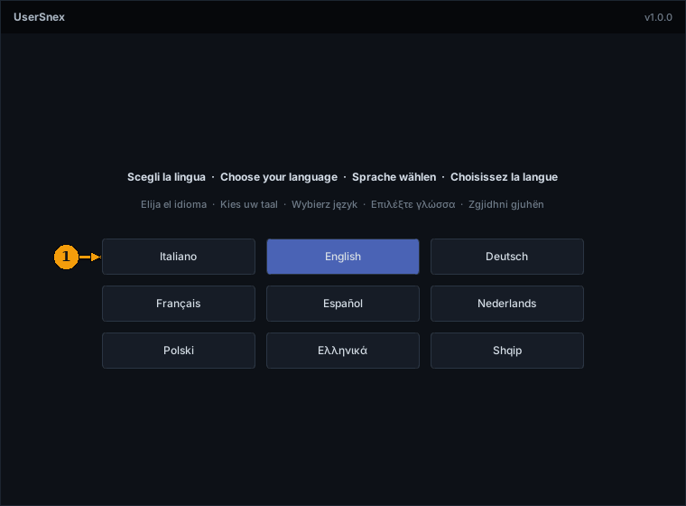
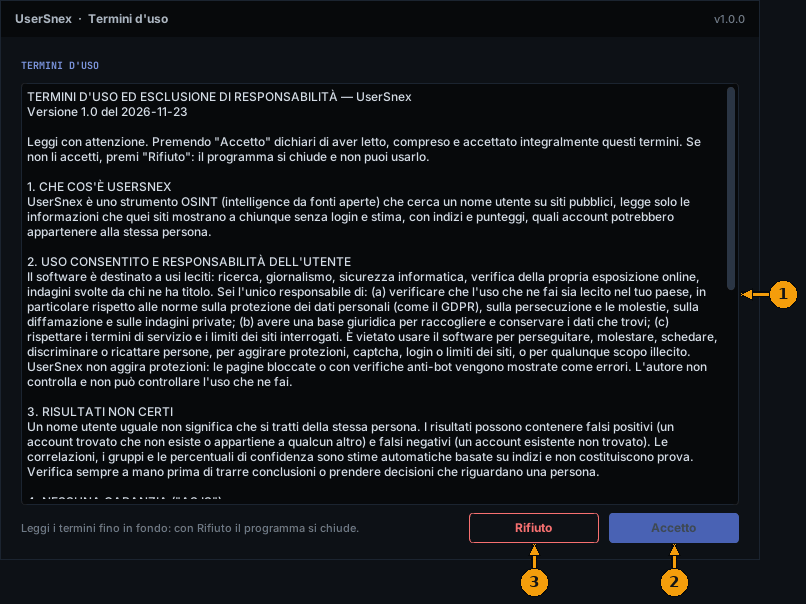
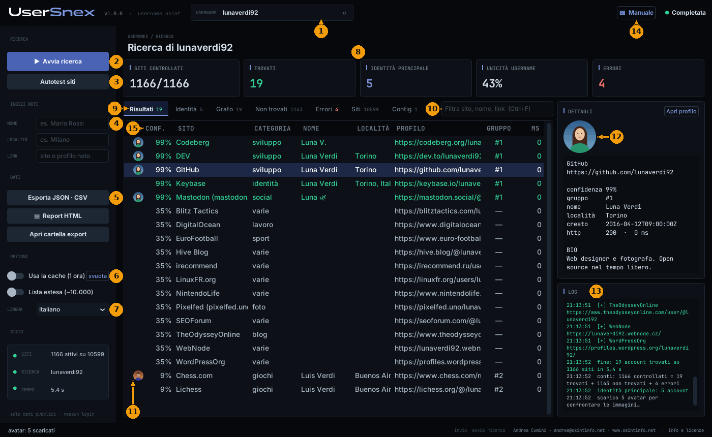
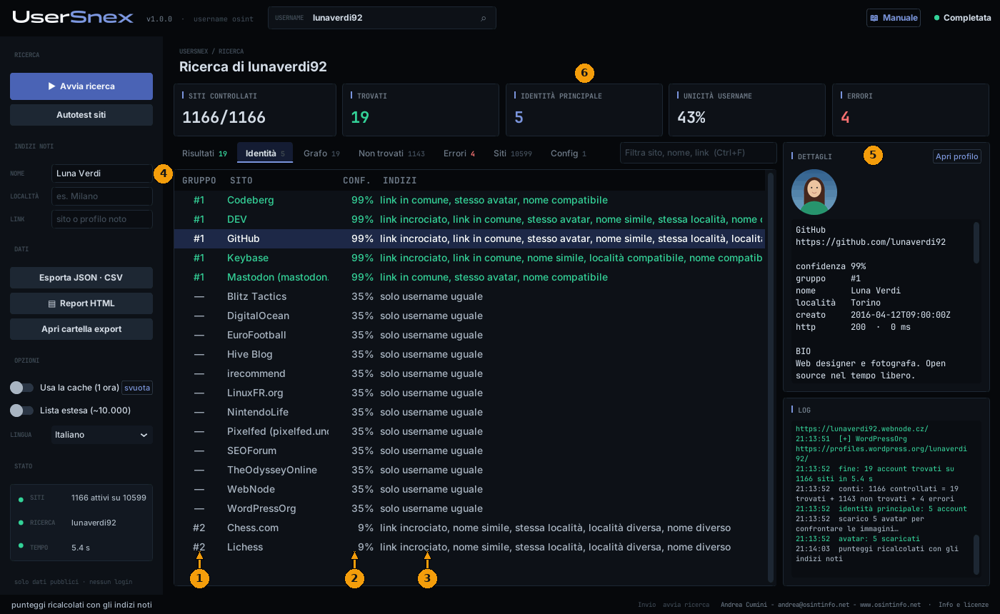
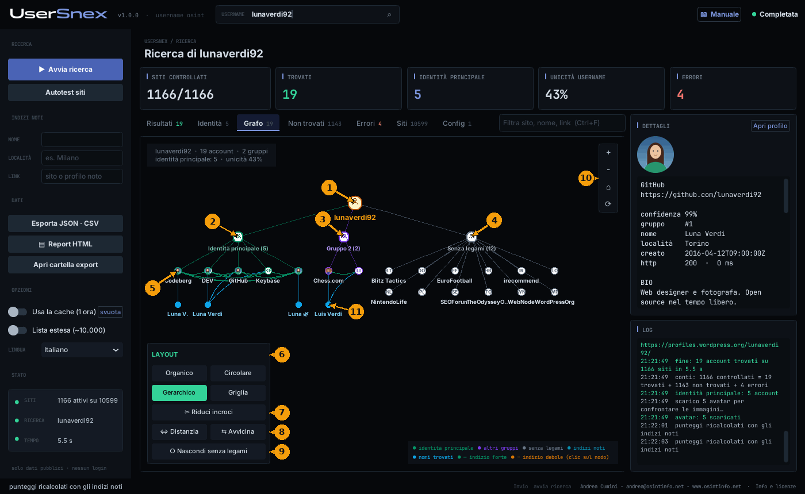
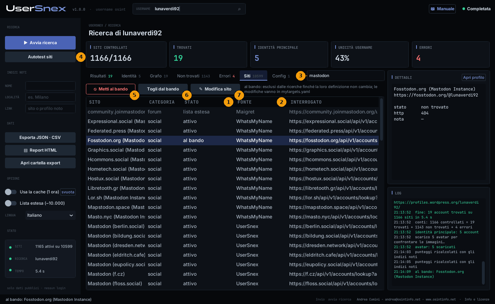
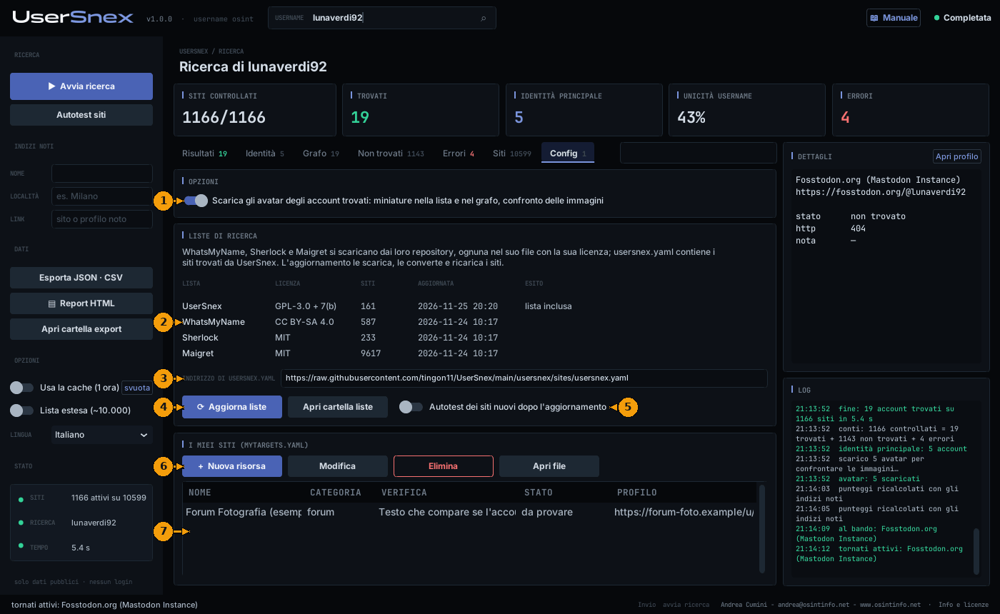
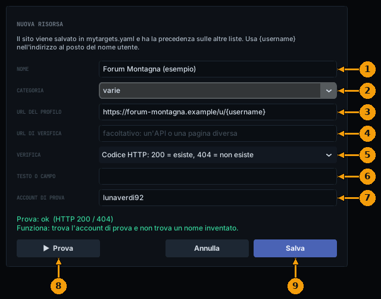

# UserSnex — Manuale utente

UserSnex cerca un nome utente su migliaia di siti pubblici e non si ferma a dire "esiste qui": stima **quali account appartengono davvero alla stessa persona**, con quale confidenza, e spiega sempre perché. Usa solo dati pubblici, senza login, rispetta i limiti dei siti e non aggira protezioni: una pagina bloccata o una verifica anti-bot compaiono come errore, mai come risultato.

Tutti i nomi, gli account e i dati negli esempi di questo manuale sono **inventati** (l'utente d'esempio è `lunaverdi92`).

## Indice

1. [Primo avvio: lingua e termini d'uso](#1-primo-avvio-lingua-e-termini-duso)
2. [La finestra principale](#2-la-finestra-principale)
3. [Fare una ricerca](#3-fare-una-ricerca)
4. [Risultati, dettagli e avatar](#4-risultati-dettagli-e-avatar)
5. [Identità e punteggi](#5-identità-e-punteggi)
6. [Grafo](#6-grafo)
7. [Non trovati ed Errori](#7-non-trovati-ed-errori)
8. [Siti e autotest](#8-siti-e-autotest)
9. [Config](#9-config)
10. [Aggiungere un sito: Nuova risorsa](#10-aggiungere-un-sito-nuova-risorsa)
11. [Esportare i dati](#11-esportare-i-dati)
12. [Riga di comando](#12-riga-di-comando)
13. [Info e licenze](#13-info-e-licenze)
14. [Problemi frequenti](#14-problemi-frequenti)

---

## 1. Primo avvio: lingua e termini d'uso

Alla prima apertura compare una finestra che non si può saltare.



1. **Scegli la lingua.** I pulsanti mostrano le nove lingue disponibili: italiano, English, Deutsch, Français, Español, Nederlands, Polski, Ελληνικά, Shqip. La lingua vale per tutto il programma e si cambia in seguito dal menu **Lingua** nella barra laterale.



1. Il testo dei **termini d'uso**, nella lingua scelta. Leggilo fino in fondo.
2. **Accetto** si attiva solo dopo aver fatto scorrere il testo fino alla fine.
3. **Rifiuto** chiude il programma.

L'accettazione viene salvata: la finestra ricompare solo se i termini cambiano versione. Al primo avvio UserSnex scarica anche le liste dei siti (vedi [Config](#9-config)).

## 2. La finestra principale



1. **USERNAME**: il nome utente da cercare. **Invio** avvia la ricerca.
2. **Avvia ricerca**. Durante la ricerca il pulsante diventa **Interrompi**.
3. **Autotest siti**: controlla quali siti funzionano dalla tua rete (vedi [capitolo 8](#8-siti-e-autotest)).
4. **Indizi noti**: nome, località o un link che sai già appartenere alla persona. Servono a scegliere l'identità giusta (vedi [capitolo 5](#5-identità-e-punteggi)).
5. **Dati**: **Esporta JSON · CSV**, **Report HTML** e **Apri cartella export** (vedi [capitolo 11](#11-esportare-i-dati)).
6. **Opzioni**: **Usa la cache (1 ora)** riusa le risposte recenti (**svuota** la cancella); **Lista estesa (~10.000)** aggiunge migliaia di forum e siti minori, ma rende la ricerca molto più lunga.
7. **Lingua** dell'interfaccia.
8. **Contatori**: siti controllati, account trovati, account dell'identità principale, unicità dell'username, errori.
9. **Schede**: Risultati, Identità, Grafo, Non trovati, Errori, Siti, Config. Il numero accanto al nome è il conteggio delle righe.
10. **Filtro** (**Ctrl+F**): mostra solo le righe che contengono il testo, in sito, nome, link o categoria.
11. **Miniatura dell'avatar** dell'account, quando il sito ne pubblica uno.
12. **Dettagli**: avatar e dati completi della riga selezionata. **Apri profilo** apre la pagina nel browser.
13. **Log**: i messaggi del programma, con l'ora.
14. **📖 Manuale** (o **F1**) apre questo manuale nella lingua dell'interfaccia.
15. **Ordinamento**: un clic sull'intestazione di una colonna ordina dalla A alla Z, un secondo clic dalla Z alla A; la freccia ▲ o ▼ mostra la colonna usata (qui *Conf.*, dalla più alta).

Nella finestra del manuale la casella di ricerca in alto (**Ctrl+F**) evidenzia tutte le occorrenze: **Invio** o **F3** passa alla successiva, **Maiusc+Invio** alla precedente, **Esc** svuota la ricerca. L'indice a sinistra porta ai capitoli.

## 3. Fare una ricerca

1. Scrivi l'username nella casella in alto e premi **Invio** o **Avvia ricerca**.
2. UserSnex interroga in parallelo tutti i siti attivi, con un limite di richieste per sito. Gli account trovati compaiono subito in **Risultati** e nel **Log**.
3. A fine ricerca UserSnex scarica gli avatar pubblici degli account trovati (se l'opzione è attiva), li confronta e ricalcola i punteggi.

Se conosci già qualcosa della persona, scrivilo in **Indizi noti** anche dopo la ricerca: i punteggi si ricalcolano subito, senza rifare la ricerca.

Un username raro (`lunaverdi92`) ha pochi omonimi; uno comune (`luna`) ne ha moltissimi. Per questo il contatore **Unicità username** pesa su tutti i punteggi.

## 4. Risultati, dettagli e avatar

La scheda **Risultati** elenca gli account trovati, ordinati per confidenza: **Conf.**, sito, categoria, nome visualizzato, località, link al profilo, gruppo e tempo di risposta. Le righe verdi appartengono all'identità principale.

- Un clic seleziona l'account e ne mostra i **Dettagli** a destra: avatar, URL, confidenza, gruppo, nome, località, data di creazione, codice HTTP, bio, link trovati e gli indizi che lo legano agli altri account.
- Un doppio clic apre il profilo nel browser.

**Avatar.** Le immagini del profilo vengono scaricate una sola volta (cache di 7 giorni), mostrate in lista, nei dettagli e nel grafo, e confrontate per **impronta visiva**: la stessa foto riconosciuta anche se ridimensionata o ricompressa su server diversi. Le immagini vuote e gli avatar predefiniti dei siti non contano. Il download si disattiva in [Config](#9-config).

**Ordinare le tabelle.** In tutte le tabelle un clic sull'intestazione di una colonna ordina le righe dalla A alla Z (o dal valore più piccolo); un secondo clic sulla stessa colonna le ordina dalla Z alla A. La freccia ▲ o ▼ accanto al titolo mostra la colonna e il verso; le celle vuote restano in fondo.

## 5. Identità e punteggi



1. **Gruppo**: gli account con legami forti tra loro formano un gruppo. **#1** è l'identità principale, — vuol dire "senza legami".
2. **Conf.**: la confidenza che l'account appartenga alla persona cercata.
3. **Indizi**: i motivi, in chiaro. Per esempio *link incrociato* (un profilo linka l'altro), *link in comune*, *stesso avatar*, *nome simile*, *stessa località*; oppure indizi contrari come *nome diverso* e *località diversa*. *solo username uguale* vuol dire che non c'è altro.
4. **Indizi noti**: qui è stato inserito il nome *Luna Verdi*. L'identità principale diventa il gruppo che corrisponde agli indizi noti.
5. **Dettagli** dell'account selezionato.
6. Il contatore **Identità principale** mostra quanti account ne fanno parte.

Nell'esempio, Codeberg, DEV, GitHub, Keybase e Mastodon formano l'identità principale (link al sito personale, stesso avatar, stesso nome). Chess.com e Lichess si linkano tra loro ma appartengono a un omonimo, *Luis Verdi* di Buenos Aires: formano un secondo gruppo con confidenza bassa.

I punteggi sono **stime**, non prove: verifica sempre a mano prima di trarre conclusioni.

## 6. Grafo



1. **Username** cercato, al centro della struttura.
2. **Identità principale**, con il numero di account.
3. **Altri gruppi** (qui *Gruppo 2*, l'omonimo).
4. **Senza legami**: account con lo stesso username ma senza altri indizi.
5. **Account**, con il suo avatar. Le linee tra account sono gli indizi: continue per gli indizi forti, tratteggiate per quelli deboli (visibili cliccando sul nodo).
6. Riquadro **Layout**: **Organico**, **Circolare**, **Gerarchico** (quello predefinito) e **Griglia**.
7. **Riduci incroci** riordina i nodi per avere meno linee che si incrociano.
8. **Distanzia** e **Avvicina** allargano o stringono il disegno.
9. **Nascondi senza legami** toglie gli account senza indizi (il pulsante diventa **Mostra senza legami**).
10. **Zoom**: +, −, adatta alla finestra e ridisegna. Si zooma anche con la rotellina del mouse.
11. **Nome trovato** (nodo azzurro): qui *Luis Verdi*, lo stesso nome trovato su Chess.com e Lichess e unito in un solo nodo.

Un clic su un nodo lo seleziona e mostra i suoi dettagli; passando sopra con il mouse si vedono gli indizi. Un doppio clic su un gruppo lo chiude o lo riapre. I nodi si possono trascinare.

**Nomi trovati.** Ogni nome visualizzato trovato su un profilo diventa un nodo azzurro, collegato a tutti gli account in cui compare: se lo stesso nome (senza badare a maiuscole, accenti e simboli) compare su più siti, il nodo è uno solo e mostra le co-occorrenze. Nell'esempio *Luna Verdi* unisce DEV, GitHub e Keybase, *Luis Verdi* unisce Chess.com e Lichess. I nomi uguali all'username non vengono aggiunti. Passando sopra al nodo con il mouse si vedono i siti.

## 7. Non trovati ed Errori

- **Non trovati**: i siti che hanno risposto che l'account non esiste.
- **Errori**: i siti che non hanno dato una risposta valida: pagina bloccata (401/403), troppe richieste (429), verifica anti-bot, timeout, errore di rete. UserSnex non aggira queste protezioni: per quei siti **controlla a mano**. Nell'esempio Reddit risponde 429 e Docker Hub 403.

## 8. Siti e autotest



1. **Stato** del sito: *attivo*, *lista estesa* (usato solo con l'opzione Lista estesa), oppure disattivato dall'autotest. Un sito messo al bando a mano mostra *al bando*.
2. **Fonte**: la lista da cui viene il sito (UserSnex, WhatsMyName, Sherlock, Maigret o i tuoi siti, *mytargets*). La colonna **Interrogato** mostra l'indirizzo che viene chiamato.
3. Il **filtro** funziona anche qui: nell'esempio mostra i siti che contengono "mastodon".
4. **Autotest siti**: per ogni sito prova un account che esiste e uno inventato. I siti che sbagliano o danno errore dalla tua rete vengono saltati nelle ricerche successive. Il risultato resta salvato.
5. **Metti al bando**: esclude dalle ricerche i siti selezionati (qui *Fosstodon.org*, con lo stato *al bando*).
6. **Togli dal bando**: riattiva i siti selezionati.
7. **Modifica sito**: apre il sito nella maschera della Nuova risorsa e salva la modifica in `mytargets.yaml`.

**Mettere al bando un sito.** Se un sito va fuori uso o dà risultati sbagliati, selezionalo (anche più di uno, con Ctrl o Maiusc) e premi **Metti al bando**, oppure usa il clic destro su una riga di qualsiasi tabella. Il sito resta escluso dalle ricerche e la colonna Stato mostra *al bando*. **Togli dal bando** lo riattiva. Quando aggiorni le liste (WhatsMyName, Sherlock, Maigret, UserSnex), un sito al bando con la definizione identica resta al bando; se la definizione è cambiata (per esempio è stato corretto l'indirizzo) il ban decade e il sito torna attivo. I ban sono salvati in `banlist.json`.

**Modificare un sito.** **Modifica sito** (o clic destro › Modifica sito) apre la maschera della [Nuova risorsa](#10-aggiungere-un-sito-nuova-risorsa) con i dati del sito. Salvando, la versione modificata va direttamente in `mytargets.yaml` e sostituisce quella della lista d'origine; le regole che la maschera non mostra (campi del profilo, espressioni, intestazioni) vengono conservate. Se il sito era al bando e hai cambiato l'indirizzo, torna attivo.

## 9. Config



1. **Scarica gli avatar** degli account trovati: miniature in lista e nel grafo e confronto delle immagini. Spegnilo per non fare richieste in più.
2. **Liste di ricerca**: per ogni lista la licenza, il numero di siti, la data dell'ultimo aggiornamento e l'esito. *usersnex.yaml* contiene i siti trovati da UserSnex e le versioni migliorate di siti noti; WhatsMyName, Sherlock e Maigret vengono scaricate dai loro repository, ognuna nel suo file con la sua licenza.
3. **Indirizzo di usersnex.yaml**: da dove si aggiorna la lista di UserSnex (il repository del progetto). Si può cambiare.
4. **Aggiorna liste** scarica tutte le liste, le converte e ricarica i siti. Se una lista non si scarica o sembra rotta, resta quella di prima. **Apri cartella liste** apre la cartella `lists`.
5. **Autotest dei siti nuovi dopo l'aggiornamento**: se attivo, i siti aggiunti dall'aggiornamento vengono provati subito.
6. **I miei siti (mytargets.yaml)**: **Nuova risorsa** aggiunge un sito (vedi [capitolo 10](#10-aggiungere-un-sito-nuova-risorsa)); **Modifica**, **Elimina** e **Apri file** agiscono sul sito selezionato o sul file.
7. L'elenco dei tuoi siti. Un doppio clic apre la modifica.

## 10. Aggiungere un sito: Nuova risorsa

Un sito aggiunto da qui viene salvato in `mytargets.yaml` e ha la precedenza sulle altre liste: se ha lo stesso nome di un sito esistente, lo sostituisce.



1. **Nome** del sito.
2. **Categoria** (forum, social, sviluppo, giochi…).
3. **URL del profilo**, con `{username}` al posto del nome utente, per esempio `https://forum-montagna.example/u/{username}`.
4. **URL di verifica** (facoltativo): un'API o una pagina diversa da quella del profilo, da interrogare al suo posto.
5. **Verifica**: come capire se l'account esiste. *Codice HTTP* (200 = esiste, 404 = non esiste), un *testo presente* solo se l'account esiste (per esempio "Iscritto dal"), un *testo che compare se l'account non esiste* (per esempio "Utente non trovato"), oppure un *campo dell'API JSON* (per esempio `data.id`).
6. **Testo o campo** usato dalla verifica scelta (con *Codice HTTP* non serve ed è spento).
7. **Account di prova**: un nome utente che sai esistere sul sito.
8. **Prova**: interroga il sito con l'account di prova e con un nome inventato e dice se la verifica funziona. Nell'esempio: *ok (HTTP 200 / 404)*.
9. **Salva** scrive il sito in `mytargets.yaml`; **Annulla** chiude senza salvare.

## 11. Esportare i dati

- **Esporta JSON · CSV** salva i risultati e le identità nella cartella `results`.
- **Report HTML** crea un report leggibile in qualsiasi browser e lo apre.
- **Apri cartella export** apre la cartella con i file salvati.

I file possono contenere dati personali: conservali con cura e cancellali quando non servono più.

## 12. Riga di comando

Le stesse funzioni sono disponibili da terminale:

```
python run.py lunaverdi92 --html --name "Luna Verdi" --location Torino
python run.py --update-lists
python run.py --selftest
```

Opzioni principali: `--name`, `--location`, `--link` (indizi noti, `--link` ripetibile), `--extended` (lista estesa), `--only` (solo alcuni siti, separati da virgola), `--sites` (file o cartella YAML in più), `--out` (cartella dei file), `--html`, `--no-export`, `--no-cache`, `--all` (mostra anche i non trovati), `--timeout`, `--usersnex-url`. `python run.py --help` le elenca tutte.

## 13. Info e licenze

Clic su **Info e licenze** nella barra in basso: versione, autore, licenza del programma (GPL-3.0 con obbligo di attribuzione), le liste di siti e i componenti di terze parti con le loro licenze, e il pulsante **Termini d'uso** per rileggere i termini. UserSnex è software libero, senza alcuna garanzia.

## 14. Problemi frequenti

| Messaggio o situazione | Cosa fare |
|---|---|
| Liste mancanti al primo avvio | Config › Aggiorna liste. Serve una connessione a internet. |
| Molti errori 429 | Il sito limita le richieste: attendi e riprova, o attiva la cache. |
| Errore 403 o pagina anti-bot | Il sito blocca i programmi: controlla quell'account a mano dal browser. |
| Un sito dà sempre risultati sbagliati | Premi Autotest siti: i siti che sbagliano dalla tua rete vengono esclusi. |
| Ricerca molto lenta | Spegni Lista estesa: aggiunge circa 9.000 siti minori. |
| Gli avatar non compaiono | Config › Opzioni › Scarica gli avatar deve essere attivo; alcuni siti non pubblicano l'immagine. |
| Il mio sito non trova l'account | In Nuova risorsa premi Prova e controlla URL, verifica e testo. |
| manuale non trovato | La cartella `docs/manual` manca: reinstalla il programma. |
