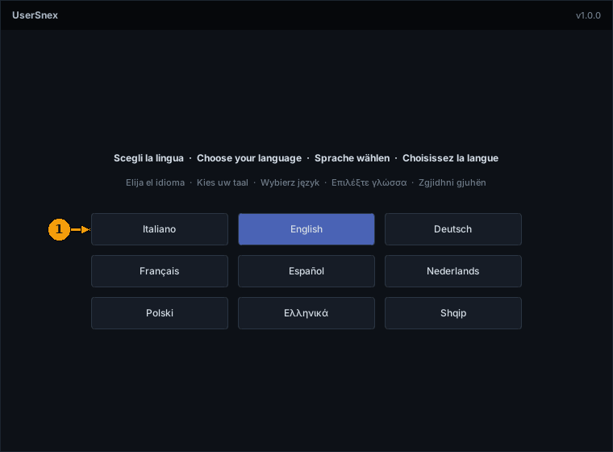
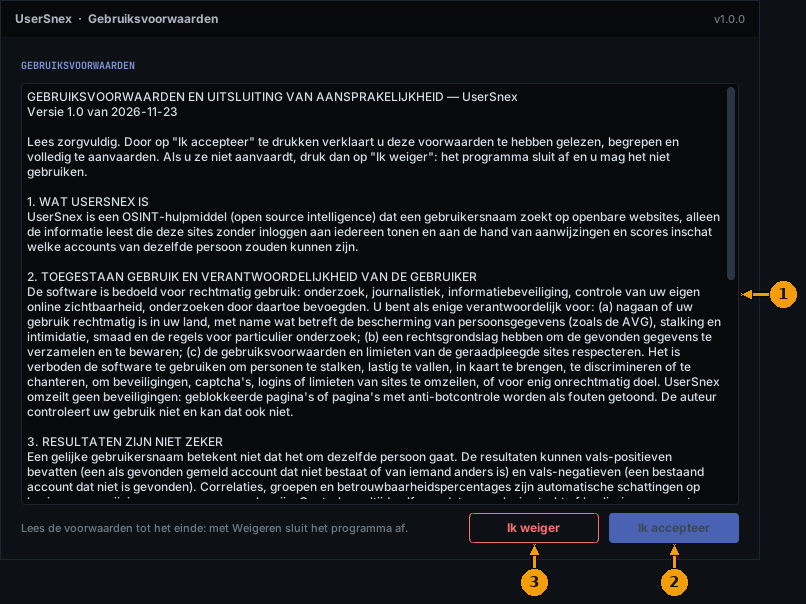
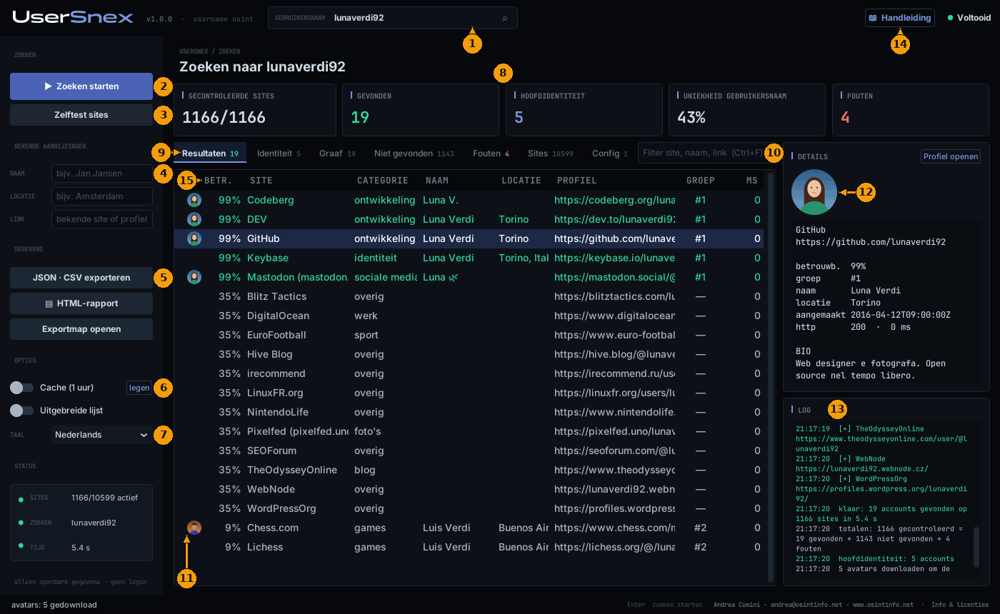
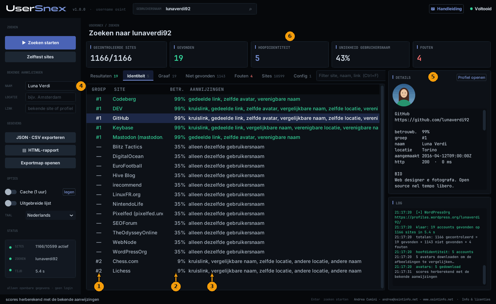
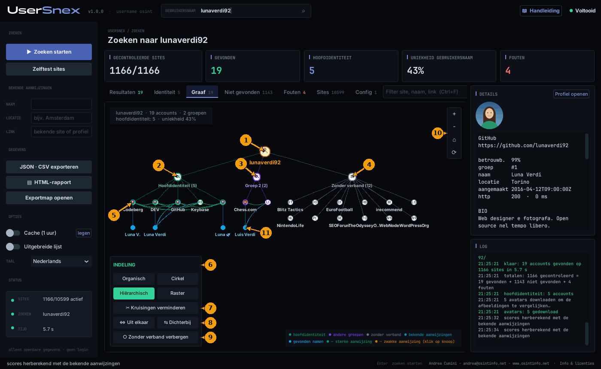
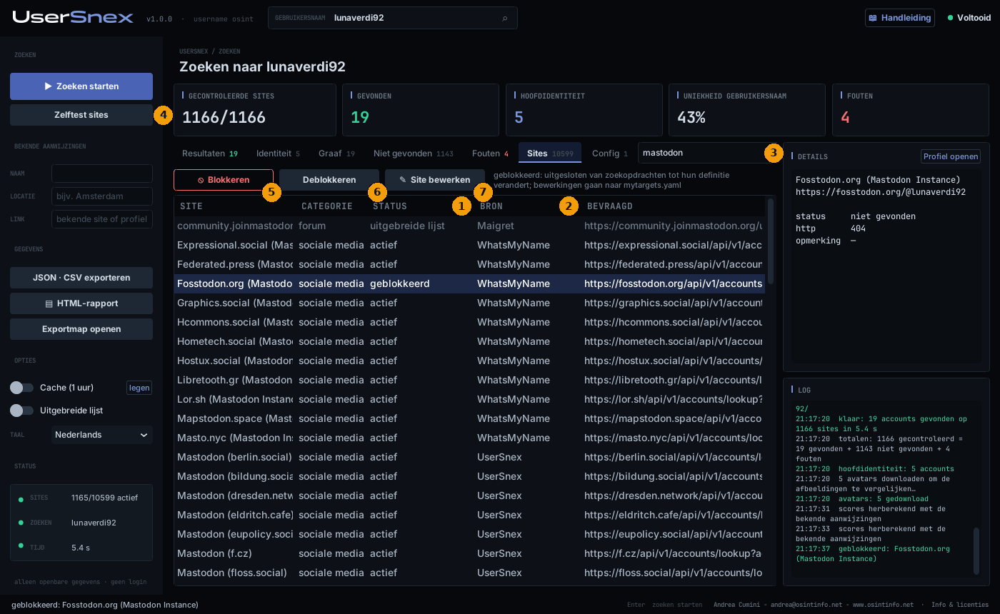
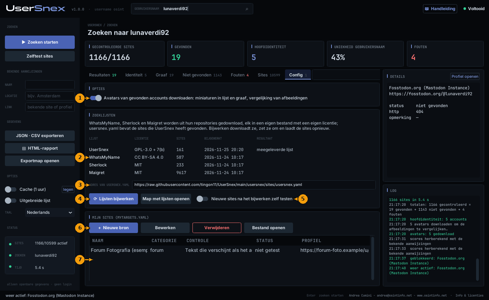
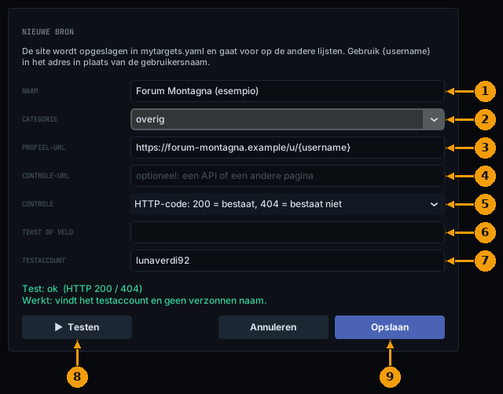

# UserSnex — Handleiding

UserSnex zoekt een gebruikersnaam op duizenden openbare sites en stopt niet bij "bestaat hier": het schat **welke accounts echt bij dezelfde persoon horen**, met welke betrouwbaarheid, en legt altijd uit waarom. Het gebruikt alleen openbare gegevens, zonder in te loggen, respecteert de limieten van de sites en omzeilt geen beveiligingen: een geblokkeerde pagina of een anti-botcontrole verschijnt als fout, nooit als resultaat.

Alle namen, accounts en gegevens in de voorbeelden van deze handleiding zijn **verzonnen** (de voorbeeldgebruiker is `lunaverdi92`).

## Inhoud

1. [Eerste start: taal en gebruiksvoorwaarden](#1-eerste-start-taal-en-gebruiksvoorwaarden)
2. [Het hoofdvenster](#2-het-hoofdvenster)
3. [Een zoekopdracht uitvoeren](#3-een-zoekopdracht-uitvoeren)
4. [Resultaten, details en avatars](#4-resultaten-details-en-avatars)
5. [Identiteit en scores](#5-identiteit-en-scores)
6. [Graaf](#6-graaf)
7. [Niet gevonden en Fouten](#7-niet-gevonden-en-fouten)
8. [Sites en zelftest](#8-sites-en-zelftest)
9. [Config](#9-config)
10. [Een site toevoegen: Nieuwe bron](#10-een-site-toevoegen-nieuwe-bron)
11. [Gegevens exporteren](#11-gegevens-exporteren)
12. [Opdrachtregel](#12-opdrachtregel)
13. [Info en licenties](#13-info-en-licenties)
14. [Veelvoorkomende problemen](#14-veelvoorkomende-problemen)

---

## 1. Eerste start: taal en gebruiksvoorwaarden

De eerste keer verschijnt een venster dat je niet kunt overslaan.



1. **Kies de taal.** De knoppen tonen de negen beschikbare talen: italiano, English, Deutsch, Français, Español, Nederlands, Polski, Ελληνικά, Shqip. De taal geldt voor het hele programma en kan later worden gewijzigd via het menu **Taal** in de zijbalk.



1. De tekst van de **gebruiksvoorwaarden**, in de gekozen taal. Lees hem tot het einde.
2. **Ik accepteer** wordt pas actief nadat je de tekst tot het einde hebt gescrold.
3. **Ik weiger** sluit het programma.

De acceptatie wordt opgeslagen: het venster verschijnt alleen opnieuw als de voorwaarden van versie veranderen. Bij de eerste start downloadt UserSnex ook de sitelijsten (zie [Config](#9-config)).

## 2. Het hoofdvenster



1. **USERNAME**: de gebruikersnaam die je zoekt. **Enter** start de zoekopdracht.
2. **Zoeken starten**. Tijdens het zoeken wordt de knop **Stoppen**.
3. **Zelftest sites**: controleert welke sites werken vanaf je netwerk (zie [hoofdstuk 8](#8-sites-en-zelftest)).
4. **Bekende aanwijzingen**: een naam, locatie of link waarvan je al weet dat die bij de persoon hoort. Ze helpen de juiste identiteit te kiezen (zie [hoofdstuk 5](#5-identiteit-en-scores)).
5. **Gegevens**: **JSON · CSV exporteren**, **HTML-rapport** en **Exportmap openen** (zie [hoofdstuk 11](#11-gegevens-exporteren)).
6. **Opties**: **Cache (1 uur)** hergebruikt recente antwoorden (**legen** wist hem); **Uitgebreide lijst** voegt duizenden fora en kleinere sites toe, maar maakt het zoeken veel langer.
7. **Taal** van de interface.
8. **Tellers**: gecontroleerde sites, gevonden accounts, accounts van de hoofdidentiteit, uniekheid van de gebruikersnaam, fouten.
9. **Tabbladen**: Resultaten, Identiteit, Graaf, Niet gevonden, Fouten, Sites, Config. Het getal naast de naam is het aantal rijen.
10. **Filter** (**Ctrl+F**): toont alleen de rijen die de tekst bevatten, in site, naam, link of categorie.
11. **Avatarminiatuur** van het account, als de site er een publiceert.
12. **Details**: avatar en volledige gegevens van de geselecteerde rij. **Profiel openen** opent de pagina in de browser.
13. **Log**: de meldingen van het programma, met de tijd.
14. **📖 Handleiding** (of **F1**) opent deze handleiding in de taal van de interface.
15. **Sorteren**: een klik op een kolomkop sorteert van A tot Z, een tweede klik van Z tot A; de pijl ▲ of ▼ toont de gebruikte kolom (hier *Betr.*, hoogste eerst).

In het venster van de handleiding markeert het zoekvak bovenaan (**Ctrl+F**) alle treffers: **Enter** of **F3** gaat naar de volgende, **Shift+Enter** naar de vorige, **Esc** wist de zoekopdracht. De inhoud links leidt naar de hoofdstukken.

## 3. Een zoekopdracht uitvoeren

1. Typ de gebruikersnaam in het vak bovenaan en druk op **Enter** of **Zoeken starten**.
2. UserSnex bevraagt alle actieve sites tegelijk, met een limiet op het aantal verzoeken per site. Gevonden accounts verschijnen meteen in **Resultaten** en in het **Log**.
3. Aan het einde downloadt UserSnex de openbare avatars van de gevonden accounts (als de optie aan staat), vergelijkt ze en berekent de scores opnieuw.

Weet je al iets over de persoon, vul het dan in bij **Bekende aanwijzingen**, ook na het zoeken: de scores worden meteen opnieuw berekend, zonder opnieuw te zoeken.

Een zeldzame gebruikersnaam (`lunaverdi92`) heeft weinig naamgenoten; een gewone (`luna`) heel veel. Daarom weegt de teller **Uniekheid gebruikersnaam** mee in alle scores.

## 4. Resultaten, details en avatars

Het tabblad **Resultaten** toont de gevonden accounts, gesorteerd op betrouwbaarheid: **Betr.**, site, categorie, weergavenaam, locatie, profiellink, groep en reactietijd. Groene rijen horen bij de hoofdidentiteit.

- Een klik selecteert het account en toont rechts de **Details**: avatar, URL, betrouwbaarheid, groep, naam, locatie, aanmaakdatum, HTTP-code, bio, gevonden links en de aanwijzingen die het aan de andere accounts koppelen.
- Een dubbelklik opent het profiel in de browser.

**Avatars.** Profielfoto's worden maar één keer gedownload (cache van 7 dagen), getoond in de lijst, de details en de graaf, en vergeleken via een **visuele vingerafdruk**: dezelfde foto wordt herkend, ook als hij op andere servers verkleind of opnieuw gecomprimeerd is. Lege afbeeldingen en standaardavatars van de sites tellen niet mee. Het downloaden kan worden uitgezet in [Config](#9-config).

**Tabellen sorteren.** In elke tabel sorteert een klik op een kolomkop de rijen van A tot Z (of vanaf de kleinste waarde); een tweede klik op dezelfde kolom sorteert van Z tot A. De pijl ▲ of ▼ naast de titel toont de kolom en de richting; lege cellen blijven onderaan.

## 5. Identiteit en scores



1. **Groep**: accounts met sterke banden onderling vormen een groep. **#1** is de hoofdidentiteit, — betekent "zonder verband".
2. **Betr.**: de betrouwbaarheid dat het account bij de gezochte persoon hoort.
3. **Aanwijzingen**: de redenen, in gewone woorden. Bijvoorbeeld *kruislink* (het ene profiel linkt naar het andere), *gedeelde link*, *zelfde avatar*, *vergelijkbare naam*, *zelfde locatie*; of tegenaanwijzingen zoals *andere naam* en *andere locatie*. *alleen dezelfde gebruikersnaam* betekent dat er verder niets is.
4. **Bekende aanwijzingen**: hier is de naam *Luna Verdi* ingevuld. De hoofdidentiteit wordt de groep die bij de bekende aanwijzingen past.
5. **Details** van het geselecteerde account.
6. De teller **Hoofdidentiteit** toont hoeveel accounts erbij horen.

In het voorbeeld vormen Codeberg, DEV, GitHub, Keybase en Mastodon de hoofdidentiteit (link naar de persoonlijke site, zelfde avatar, zelfde naam). Chess.com en Lichess linken naar elkaar maar horen bij een naamgenoot, *Luis Verdi* uit Buenos Aires: ze vormen een tweede groep met lage betrouwbaarheid.

Scores zijn **schattingen**, geen bewijs: controleer altijd zelf voordat je conclusies trekt.

## 6. Graaf



1. De gezochte **gebruikersnaam**, in het midden van de structuur.
2. **Hoofdidentiteit**, met het aantal accounts.
3. **Andere groepen** (hier *Groep 2*, de naamgenoot).
4. **Zonder verband**: accounts met dezelfde gebruikersnaam maar zonder andere aanwijzingen.
5. Een **account**, met zijn avatar. De lijnen tussen accounts zijn aanwijzingen: doorgetrokken voor sterke, gestreept voor zwakke aanwijzingen (zichtbaar als je op de knoop klikt).
6. Paneel **Layout**: **Organisch**, **Cirkel**, **Hiërarchisch** (de standaard) en **Raster**.
7. **Kruisingen verminderen** herschikt de knopen zodat minder lijnen elkaar kruisen.
8. **Uit elkaar** en **Dichterbij** maken de tekening breder of compacter.
9. **Zonder verband verbergen** haalt accounts zonder aanwijzingen weg (de knop wordt **Zonder verband tonen**).
10. **Zoom**: +, −, passend maken en opnieuw tekenen. Ook het muiswiel zoomt.
11. **Gevonden naam** (lichtblauwe knoop): hier *Luis Verdi*, dezelfde naam gevonden op Chess.com en Lichess en samengevoegd tot één knoop.

Een klik op een knoop selecteert hem en toont de details; met de muis erboven zie je de aanwijzingen. Een dubbelklik op een groep klapt hem in of uit. Knopen kun je verslepen.

**Gevonden namen.** Elke weergavenaam die op een profiel wordt gevonden, wordt een lichtblauwe knoop, verbonden met alle accounts waarin hij voorkomt: komt dezelfde naam (zonder te letten op hoofdletters, accenten en tekens) op meerdere sites voor, dan is er één knoop die de overeenkomsten toont. In het voorbeeld verbindt *Luna Verdi* DEV, GitHub en Keybase, en *Luis Verdi* Chess.com en Lichess. Namen die gelijk zijn aan de gebruikersnaam worden niet toegevoegd. Met de muis boven de knoop zie je de sites.

## 7. Niet gevonden en Fouten

- **Niet gevonden**: sites die antwoordden dat het account niet bestaat.
- **Fouten**: sites die geen geldig antwoord gaven: geblokkeerde pagina (401/403), te veel verzoeken (429), anti-botcontrole, time-out, netwerkfout. UserSnex omzeilt deze beveiligingen niet: **controleer die sites zelf**. In het voorbeeld antwoordt Reddit 429 en Docker Hub 403.

## 8. Sites en zelftest



1. **Status** van de site: *actief*, *uitgebreide lijst* (alleen gebruikt met de optie Uitgebreide lijst), of uitgeschakeld door de zelftest. Een site die je zelf blokkeert toont *geblokkeerd*.
2. **Bron**: de lijst waar de site vandaan komt (UserSnex, WhatsMyName, Sherlock, Maigret of je eigen sites, *mytargets*). De kolom **Bevraagd** toont het adres dat wordt aangeroepen.
3. Het **filter** werkt hier ook: in het voorbeeld toont het de sites met "mastodon".
4. **Zelftest sites**: per site wordt een bestaand en een verzonnen account geprobeerd. Sites die vanaf je netwerk verkeerd antwoorden of fouten geven, worden bij volgende zoekopdrachten overgeslagen. Het resultaat wordt bewaard.
5. **Blokkeren**: slaat de geselecteerde sites over bij zoekopdrachten (hier *Fosstodon.org*, met de status *geblokkeerd*).
6. **Deblokkeren**: zet de geselecteerde sites weer aan.
7. **Site bewerken**: opent de site in het formulier Nieuwe bron en slaat de wijziging op in `mytargets.yaml`.

**Een site blokkeren.** Als een site niet meer werkt of verkeerde resultaten geeft, selecteer hem (ook meerdere, met Ctrl of Shift) en druk op **Blokkeren**, of klik met de rechtermuisknop op een rij in een willekeurige tabel. De site wordt overgeslagen bij zoekopdrachten en de kolom Status toont *geblokkeerd*. **Deblokkeren** zet hem weer aan. Bij het bijwerken van de lijsten (WhatsMyName, Sherlock, Maigret, UserSnex) blijft een geblokkeerde site met een identieke definitie geblokkeerd; is de definitie veranderd (bijvoorbeeld een gecorrigeerd adres), dan vervalt de blokkade en is de site weer actief. Blokkades worden opgeslagen in `banlist.json`.

**Een site bewerken.** **Site bewerken** (of rechtermuisknop › Site bewerken) opent het formulier [Nieuwe bron](#10-een-site-toevoegen-nieuwe-bron) met de gegevens van de site. Bij het opslaan gaat de bewerkte versie direct naar `mytargets.yaml` en vervangt die uit de oorspronkelijke lijst; regels die het formulier niet toont (profielvelden, expressies, headers) blijven behouden. Was de site geblokkeerd en heb je het adres veranderd, dan is hij weer actief.

## 9. Config



1. **Avatars downloaden** van de gevonden accounts: miniaturen in de lijst en de graaf, en vergelijking van afbeeldingen. Zet het uit om extra verzoeken te vermijden.
2. **Zoeklijsten**: per lijst de licentie, het aantal sites, de datum van de laatste update en het resultaat. *usersnex.yaml* bevat de sites die UserSnex heeft gevonden en verbeterde versies van bekende sites; WhatsMyName, Sherlock en Maigret worden uit hun repository's gedownload, elk in een eigen bestand met een eigen licentie.
3. **Adres van usersnex.yaml**: waarvandaan de UserSnex-lijst wordt bijgewerkt (de repository van het project). Het kan worden gewijzigd.
4. **Lijsten bijwerken** downloadt alle lijsten, zet ze om en laadt de sites opnieuw. Als een lijst niet te downloaden is of kapot lijkt, blijft de vorige behouden. **Map met lijsten openen** opent de map `lists`.
5. **Nieuwe sites na het bijwerken zelf testen**: als dit aan staat, worden sites die door de update zijn toegevoegd meteen getest.
6. **Mijn sites (mytargets.yaml)**: **Nieuwe bron** voegt een site toe (zie [hoofdstuk 10](#10-een-site-toevoegen-nieuwe-bron)); **Bewerken**, **Verwijderen** en **Bestand openen** werken op de geselecteerde site of op het bestand.
7. De lijst met je sites. Een dubbelklik opent de bewerking.

## 10. Een site toevoegen: Nieuwe bron

Een site die je hier toevoegt, wordt opgeslagen in `mytargets.yaml` en gaat voor op de andere lijsten: heeft hij dezelfde naam als een bestaande site, dan vervangt hij die.



1. **Naam** van de site.
2. **Categorie** (forum, social, ontwikkeling, games…).
3. **Profiel-URL**, met `{username}` op de plaats van de gebruikersnaam, bijvoorbeeld `https://forum-montagna.example/u/{username}`.
4. **Controle-URL** (optioneel): een API of een andere pagina dan het profiel, die in plaats daarvan wordt bevraagd.
5. **Controle**: hoe je ziet of het account bestaat. *HTTP-code* (200 = bestaat, 404 = bestaat niet), een *tekst die alleen aanwezig is als het account bestaat* (bijvoorbeeld "Lid sinds"), een *tekst die verschijnt als het account niet bestaat* (bijvoorbeeld "Gebruiker niet gevonden"), of een *veld van de JSON-API* (bijvoorbeeld `data.id`).
6. **Tekst of veld** voor de gekozen controle (niet nodig, en grijs, bij *HTTP-code*).
7. **Testaccount**: een gebruikersnaam waarvan je weet dat hij op de site bestaat.
8. **Testen**: bevraagt de site met het testaccount en met een verzonnen naam en zegt of de controle werkt. In het voorbeeld: *ok (HTTP 200 / 404)*.
9. **Opslaan** schrijft de site naar `mytargets.yaml`; **Annuleren** sluit zonder op te slaan.

## 11. Gegevens exporteren

- **JSON · CSV exporteren** slaat resultaten en identiteiten op in de map `results`.
- **HTML-rapport** maakt een rapport dat in elke browser leesbaar is en opent het.
- **Exportmap openen** opent de map met de opgeslagen bestanden.

De bestanden kunnen persoonsgegevens bevatten: bewaar ze zorgvuldig en verwijder ze als ze niet meer nodig zijn.

## 12. Opdrachtregel

Dezelfde functies zijn beschikbaar in een terminal:

```
python run.py lunaverdi92 --html --name "Luna Verdi" --location Torino
python run.py --update-lists
python run.py --selftest
```

Belangrijkste opties: `--name`, `--location`, `--link` (bekende aanwijzingen, `--link` herhaalbaar), `--extended` (uitgebreide lijst), `--only` (alleen bepaalde sites, gescheiden door komma's), `--sites` (extra YAML-bestand of -map), `--out` (uitvoermap), `--html`, `--no-export`, `--no-cache`, `--all` (toont ook sites zonder resultaat), `--timeout`, `--usersnex-url`. `python run.py --help` toont ze allemaal.

## 13. Info en licenties

Klik op **Info & licenties** in de onderste balk: versie, auteur, licentie van het programma (GPL-3.0 met naamsvermeldingsplicht), de sitelijsten en componenten van derden met hun licenties, en de knop **Gebruiksvoorwaarden** om de voorwaarden opnieuw te lezen. UserSnex is vrije software, zonder enige garantie.

## 14. Veelvoorkomende problemen

| Melding of situatie | Wat te doen |
|---|---|
| Lijsten ontbreken bij de eerste start | Config › Lijsten bijwerken. Een internetverbinding is nodig. |
| Veel 429-fouten | De site beperkt verzoeken: wacht en probeer opnieuw, of zet de cache aan. |
| Fout 403 of anti-botpagina | De site blokkeert programma's: controleer dat account zelf in de browser. |
| Een site geeft altijd verkeerde resultaten | Druk op Zelftest sites: sites die vanaf je netwerk falen, worden uitgesloten. |
| Zoeken gaat heel traag | Zet Uitgebreide lijst uit: die voegt zo'n 9.000 kleinere sites toe. |
| Avatars verschijnen niet | Config › Opties › Avatars downloaden moet aan staan; sommige sites publiceren geen afbeelding. |
| Mijn site vindt het account niet | Druk in Nieuwe bron op Testen en controleer URL, controle en tekst. |
| handleiding niet gevonden | De map `docs/manual` ontbreekt: installeer het programma opnieuw. |
