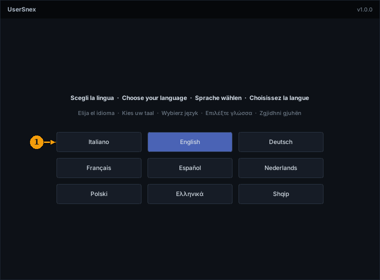
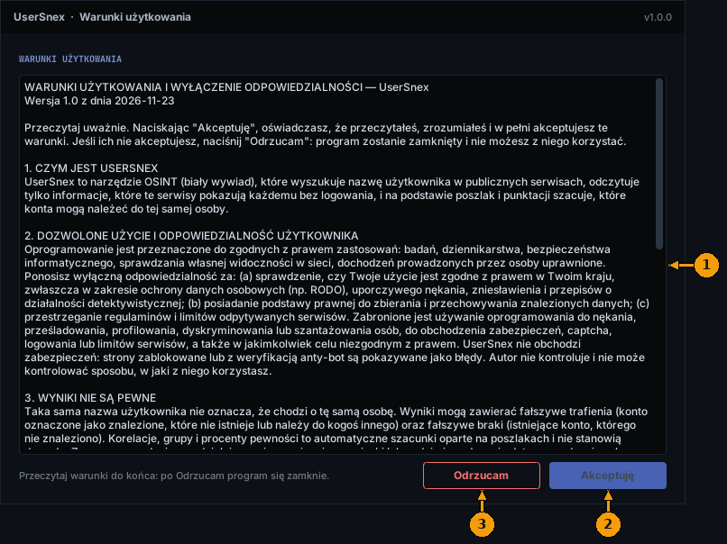
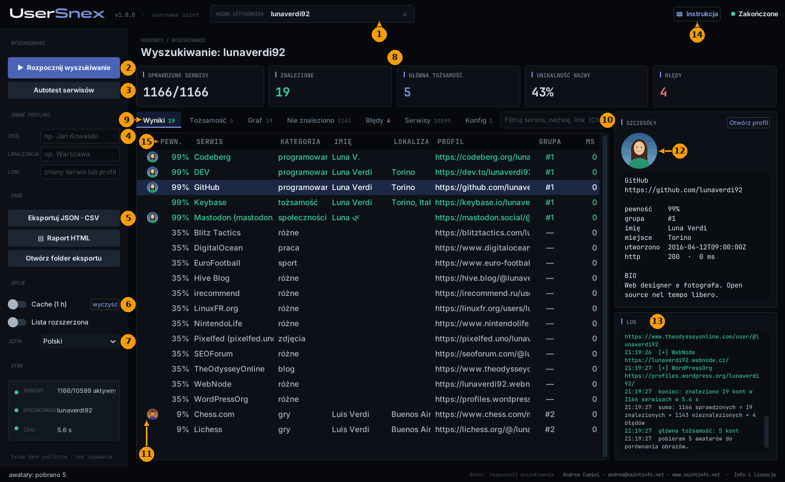
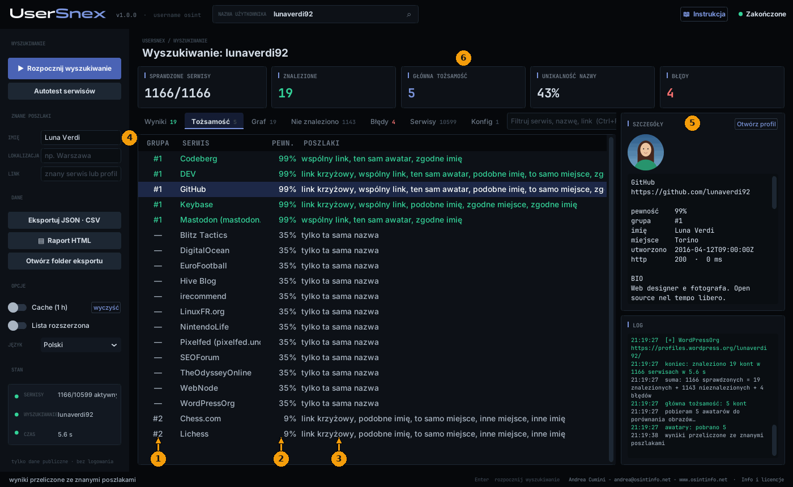
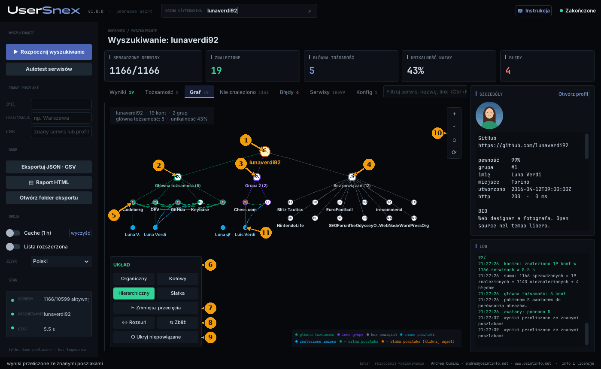
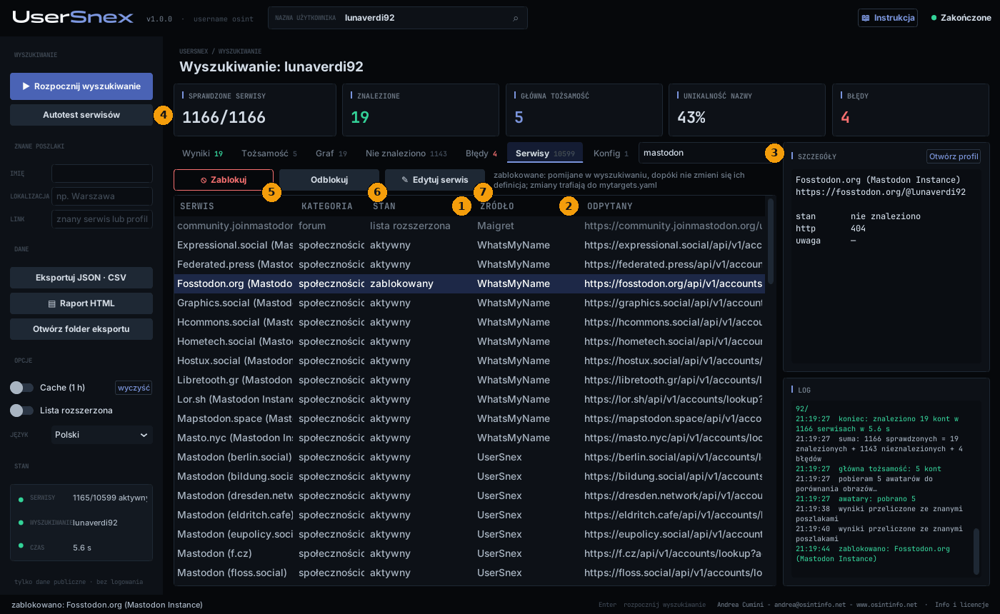
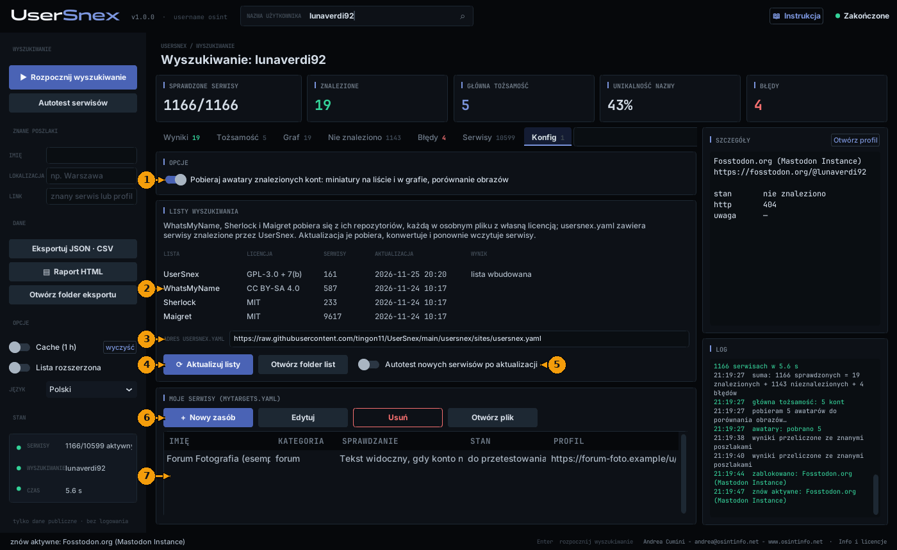
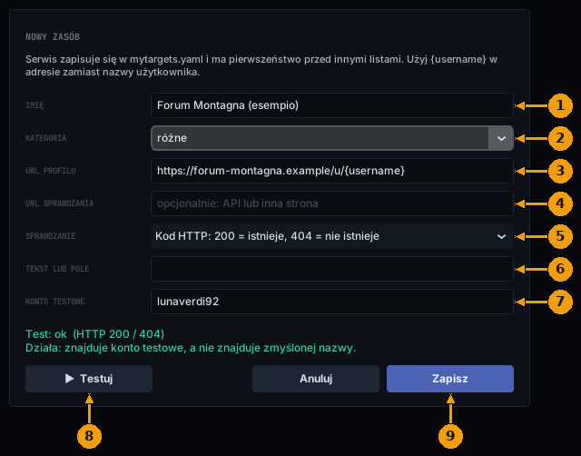

# UserSnex — Instrukcja obsługi

UserSnex wyszukuje nazwę użytkownika w tysiącach publicznych serwisów i nie poprzestaje na „istnieje tutaj”: szacuje, **które konta naprawdę należą do tej samej osoby**, z jaką pewnością, i zawsze wyjaśnia dlaczego. Korzysta wyłącznie z danych publicznych, bez logowania, przestrzega limitów serwisów i nie obchodzi zabezpieczeń: zablokowana strona lub weryfikacja antybotowa pojawia się jako błąd, nigdy jako wynik.

Wszystkie nazwy, konta i dane w przykładach tej instrukcji są **zmyślone** (przykładowy użytkownik to `lunaverdi92`).

## Spis treści

1. [Pierwsze uruchomienie: język i warunki użytkowania](#1-pierwsze-uruchomienie-język-i-warunki-użytkowania)
2. [Okno główne](#2-okno-główne)
3. [Wyszukiwanie](#3-wyszukiwanie)
4. [Wyniki, szczegóły i awatary](#4-wyniki-szczegóły-i-awatary)
5. [Tożsamość i wyniki punktowe](#5-tożsamość-i-wyniki-punktowe)
6. [Graf](#6-graf)
7. [Nie znaleziono i Błędy](#7-nie-znaleziono-i-błędy)
8. [Serwisy i autotest](#8-serwisy-i-autotest)
9. [Konfig](#9-konfig)
10. [Dodawanie serwisu: Nowy zasób](#10-dodawanie-serwisu-nowy-zasób)
11. [Eksport danych](#11-eksport-danych)
12. [Wiersz poleceń](#12-wiersz-poleceń)
13. [Info i licencje](#13-info-i-licencje)
14. [Częste problemy](#14-częste-problemy)

---

## 1. Pierwsze uruchomienie: język i warunki użytkowania

Przy pierwszym uruchomieniu pojawia się okno, którego nie można pominąć.



1. **Wybierz język.** Przyciski pokazują dziewięć dostępnych języków: italiano, English, Deutsch, Français, Español, Nederlands, Polski, Ελληνικά, Shqip. Język dotyczy całego programu i można go później zmienić w menu **Język** na pasku bocznym.



1. Tekst **warunków użytkowania** w wybranym języku. Przeczytaj go do końca.
2. **Akceptuję** staje się aktywny dopiero po przewinięciu tekstu do końca.
3. **Odrzucam** zamyka program.

Akceptacja zostaje zapisana: okno pojawi się ponownie tylko wtedy, gdy zmieni się wersja warunków. Przy pierwszym uruchomieniu UserSnex pobiera też listy serwisów (zob. [Konfig](#9-konfig)).

## 2. Okno główne



1. **USERNAME**: szukana nazwa użytkownika. **Enter** uruchamia wyszukiwanie.
2. **Rozpocznij wyszukiwanie**. Podczas wyszukiwania przycisk zmienia się w **Zatrzymaj**.
3. **Autotest serwisów**: sprawdza, które serwisy działają z Twojej sieci (zob. [rozdział 8](#8-serwisy-i-autotest)).
4. **Znane poszlaki**: imię, miejsce lub link, o którym już wiesz, że należy do tej osoby. Pomagają wybrać właściwą tożsamość (zob. [rozdział 5](#5-tożsamość-i-wyniki-punktowe)).
5. **Dane**: **Eksportuj JSON · CSV**, **Raport HTML** i **Otwórz folder eksportu** (zob. [rozdział 11](#11-eksport-danych)).
6. **Opcje**: **Cache (1 h)** używa ponownie niedawnych odpowiedzi (**wyczyść** go opróżnia); **Lista rozszerzona** dodaje tysiące forów i mniejszych serwisów, ale bardzo wydłuża wyszukiwanie.
7. **Język** interfejsu.
8. **Liczniki**: sprawdzone serwisy, znalezione konta, konta głównej tożsamości, unikalność nazwy, błędy.
9. **Karty**: Wyniki, Tożsamość, Graf, Nie znaleziono, Błędy, Serwisy, Konfig. Liczba obok nazwy to liczba wierszy.
10. **Filtr** (**Ctrl+F**): pokazuje tylko wiersze zawierające tekst – w serwisie, nazwie, linku lub kategorii.
11. **Miniatura awatara** konta, jeśli serwis go publikuje.
12. **Szczegóły**: awatar i pełne dane wybranego wiersza. **Otwórz profil** otwiera stronę w przeglądarce.
13. **Log**: komunikaty programu z godziną.
14. **📖 Instrukcja** (lub **F1**) otwiera tę instrukcję w języku interfejsu.
15. **Sortowanie**: kliknięcie nagłówka kolumny sortuje od A do Z, drugie kliknięcie od Z do A; strzałka ▲ lub ▼ pokazuje użytą kolumnę (tu *Pewn.*, od najwyższej).

W oknie instrukcji pole wyszukiwania u góry (**Ctrl+F**) podświetla wszystkie wystąpienia: **Enter** lub **F3** przechodzi do następnego, **Shift+Enter** do poprzedniego, **Esc** czyści wyszukiwanie. Spis treści po lewej prowadzi do rozdziałów.

## 3. Wyszukiwanie

1. Wpisz nazwę użytkownika w polu u góry i naciśnij **Enter** lub **Rozpocznij wyszukiwanie**.
2. UserSnex odpytuje równolegle wszystkie aktywne serwisy, z limitem zapytań na serwis. Znalezione konta pojawiają się od razu w **Wynikach** i w **Logu**.
3. Na końcu UserSnex pobiera publiczne awatary znalezionych kont (jeśli opcja jest włączona), porównuje je i przelicza wyniki punktowe.

Jeśli już coś wiesz o tej osobie, wpisz to w **Znane poszlaki**, także po wyszukiwaniu: wyniki punktowe przeliczą się od razu, bez ponownego wyszukiwania.

Rzadka nazwa użytkownika (`lunaverdi92`) ma niewielu imienników, częsta (`luna`) – bardzo wielu. Dlatego licznik **Unikalność nazwy** wpływa na wszystkie wyniki.

## 4. Wyniki, szczegóły i awatary

Karta **Wyniki** pokazuje znalezione konta posortowane według pewności: **Pewn.**, serwis, kategoria, wyświetlana nazwa, miejsce, link do profilu, grupa i czas odpowiedzi. Zielone wiersze należą do głównej tożsamości.

- Kliknięcie wybiera konto i pokazuje po prawej jego **Szczegóły**: awatar, URL, pewność, grupę, imię, miejsce, datę utworzenia, kod HTTP, bio, znalezione linki i poszlaki łączące je z innymi kontami.
- Dwukrotne kliknięcie otwiera profil w przeglądarce.

**Awatary.** Zdjęcia profilowe są pobierane tylko raz (cache na 7 dni), wyświetlane na liście, w szczegółach i na grafie oraz porównywane za pomocą **wizualnego odcisku**: to samo zdjęcie jest rozpoznawane, nawet jeśli na różnych serwerach zostało pomniejszone lub ponownie skompresowane. Puste obrazy i domyślne awatary serwisów się nie liczą. Pobieranie można wyłączyć w [Konfig](#9-konfig).

**Sortowanie tabel.** W każdej tabeli kliknięcie nagłówka kolumny sortuje wiersze od A do Z (lub od najmniejszej wartości); drugie kliknięcie tej samej kolumny sortuje od Z do A. Strzałka ▲ lub ▼ obok tytułu pokazuje kolumnę i kierunek; puste komórki zostają na końcu.

## 5. Tożsamość i wyniki punktowe



1. **Grupa**: konta silnie ze sobą powiązane tworzą grupę. **#1** to główna tożsamość, — oznacza „bez powiązań”.
2. **Pewn.**: pewność, że konto należy do szukanej osoby.
3. **Poszlaki**: powody, opisane wprost. Na przykład *link krzyżowy* (jeden profil linkuje do drugiego), *wspólny link*, *ten sam awatar*, *podobne imię*, *to samo miejsce*; albo poszlaki przeciwne, jak *inne imię* i *inne miejsce*. *tylko ta sama nazwa* oznacza, że nie ma nic więcej.
4. **Znane poszlaki**: tutaj wpisano imię *Luna Verdi*. Główną tożsamością staje się grupa, która pasuje do znanych poszlak.
5. **Szczegóły** wybranego konta.
6. Licznik **Główna tożsamość** pokazuje, ile kont do niej należy.

W przykładzie Codeberg, DEV, GitHub, Keybase i Mastodon tworzą główną tożsamość (link do strony osobistej, ten sam awatar, to samo imię). Chess.com i Lichess linkują do siebie nawzajem, ale należą do imiennika, *Luisa Verdi* z Buenos Aires: tworzą drugą grupę o niskiej pewności.

Wyniki to **szacunki**, nie dowody: zawsze sprawdzaj ręcznie, zanim wyciągniesz wnioski.

## 6. Graf



1. Szukana **nazwa użytkownika**, w środku struktury.
2. **Główna tożsamość**, z liczbą kont.
3. **Inne grupy** (tutaj *Grupa 2*, imiennik).
4. **Bez powiązań**: konta o tej samej nazwie, ale bez innych poszlak.
5. **Konto** z jego awatarem. Linie między kontami to poszlaki: ciągłe dla silnych, przerywane dla słabych (widoczne po kliknięciu węzła).
6. Panel **Layout**: **Organiczny**, **Kołowy**, **Hierarchiczny** (domyślny) i **Siatka**.
7. **Zmniejsz przecięcia** zmienia kolejność węzłów tak, aby mniej linii się krzyżowało.
8. **Rozsuń** i **Zbliż** poszerzają lub zagęszczają rysunek.
9. **Ukryj niepowiązane** usuwa konta bez poszlak (przycisk zmienia się w **Pokaż niepowiązane**).
10. **Zoom**: +, −, dopasuj do okna i przerysuj. Kółko myszy również przybliża.
11. **Znalezione imię** (jasnoniebieski węzeł): tu *Luis Verdi*, ta sama nazwa znaleziona na Chess.com i Lichess, połączona w jeden węzeł.

Kliknięcie węzła zaznacza go i pokazuje szczegóły; po najechaniu myszą widać jego poszlaki. Dwukrotne kliknięcie grupy zwija ją lub rozwija. Węzły można przeciągać.

**Znalezione imiona.** Każda wyświetlana nazwa znaleziona w profilu staje się jasnoniebieskim węzłem, połączonym ze wszystkimi kontami, w których występuje: jeśli ta sama nazwa (bez względu na wielkość liter, akcenty i symbole) pojawia się w kilku serwisach, jest tylko jeden węzeł pokazujący współwystąpienia. W przykładzie *Luna Verdi* łączy DEV, GitHub i Keybase, a *Luis Verdi* łączy Chess.com i Lichess. Nazwy równe nazwie użytkownika nie są dodawane. Po najechaniu myszą na węzeł widać serwisy.

## 7. Nie znaleziono i Błędy

- **Nie znaleziono**: serwisy, które odpowiedziały, że konto nie istnieje.
- **Błędy**: serwisy, które nie dały poprawnej odpowiedzi: zablokowana strona (401/403), zbyt wiele zapytań (429), weryfikacja antybotowa, przekroczony czas, błąd sieci. UserSnex nie obchodzi tych zabezpieczeń: te serwisy **sprawdź ręcznie**. W przykładzie Reddit odpowiada 429, a Docker Hub 403.

## 8. Serwisy i autotest



1. **Stan** serwisu: *aktywny*, *lista rozszerzona* (używany tylko z opcją Lista rozszerzona) albo wyłączony przez autotest. Serwis zablokowany ręcznie pokazuje *zablokowany*.
2. **Źródło**: lista, z której pochodzi serwis (UserSnex, WhatsMyName, Sherlock, Maigret lub Twoje serwisy, *mytargets*). Kolumna **Odpytany** pokazuje wywoływany adres.
3. **Filtr** działa także tutaj: w przykładzie pokazuje serwisy zawierające „mastodon”.
4. **Autotest serwisów**: dla każdego serwisu sprawdza konto istniejące i zmyślone. Serwisy, które z Twojej sieci odpowiadają błędnie lub zwracają błąd, są pomijane w kolejnych wyszukiwaniach. Wynik jest zapisywany.
5. **Zablokuj**: pomija zaznaczone serwisy w wyszukiwaniu (tu *Fosstodon.org*, ze stanem *zablokowany*).
6. **Odblokuj**: ponownie włącza zaznaczone serwisy.
7. **Edytuj serwis**: otwiera serwis w formularzu Nowy zasób i zapisuje zmianę w `mytargets.yaml`.

**Blokowanie serwisu.** Jeśli serwis przestał działać lub daje błędne wyniki, zaznacz go (także kilka, z Ctrl lub Shift) i naciśnij **Zablokuj**, albo kliknij prawym przyciskiem wiersz w dowolnej tabeli. Serwis jest pomijany w wyszukiwaniu, a kolumna Stan pokazuje *zablokowany*. **Odblokuj** włącza go ponownie. Podczas aktualizacji list (WhatsMyName, Sherlock, Maigret, UserSnex) zablokowany serwis z identyczną definicją pozostaje zablokowany; jeśli definicja się zmieniła (na przykład poprawiono adres), blokada wygasa i serwis znów jest aktywny. Blokady są zapisywane w `banlist.json`.

**Edycja serwisu.** **Edytuj serwis** (lub prawy przycisk › Edytuj serwis) otwiera formularz [Nowy zasób](#10-dodawanie-serwisu-nowy-zasób) z danymi serwisu. Po zapisaniu zmieniona wersja trafia bezpośrednio do `mytargets.yaml` i zastępuje tę z listy źródłowej; reguły, których formularz nie pokazuje (pola profilu, wyrażenia, nagłówki), zostają zachowane. Jeśli serwis był zablokowany, a zmieniłeś jego adres, znów jest aktywny.

## 9. Konfig



1. **Pobieraj awatary** znalezionych kont: miniatury na liście i na grafie oraz porównywanie obrazów. Wyłącz, aby uniknąć dodatkowych zapytań.
2. **Listy wyszukiwania**: dla każdej listy licencja, liczba serwisów, data ostatniej aktualizacji i wynik. *usersnex.yaml* zawiera serwisy znalezione przez UserSnex i ulepszone wersje znanych serwisów; WhatsMyName, Sherlock i Maigret są pobierane z ich repozytoriów, każda do osobnego pliku z własną licencją.
3. **Adres usersnex.yaml**: skąd aktualizowana jest lista UserSnex (repozytorium projektu). Można go zmienić.
4. **Aktualizuj listy** pobiera wszystkie listy, konwertuje je i ponownie wczytuje serwisy. Jeśli listy nie da się pobrać lub wygląda na uszkodzoną, zostaje poprzednia. **Otwórz folder list** otwiera folder `lists`.
5. **Autotest nowych serwisów po aktualizacji**: gdy jest włączony, serwisy dodane przez aktualizację są od razu testowane.
6. **Moje serwisy (mytargets.yaml)**: **Nowy zasób** dodaje serwis (zob. [rozdział 10](#10-dodawanie-serwisu-nowy-zasób)); **Edytuj**, **Usuń** i **Otwórz plik** działają na wybranym serwisie lub na pliku.
7. Lista Twoich serwisów. Dwukrotne kliknięcie otwiera edycję.

## 10. Dodawanie serwisu: Nowy zasób

Serwis dodany tutaj zostaje zapisany w `mytargets.yaml` i ma pierwszeństwo przed innymi listami: jeśli ma taką samą nazwę jak istniejący serwis, zastępuje go.



1. **Nazwa** serwisu.
2. **Kategoria** (forum, social, programowanie, gry…).
3. **URL profilu**, z `{username}` w miejscu nazwy użytkownika, na przykład `https://forum-montagna.example/u/{username}`.
4. **URL sprawdzania** (opcjonalny): API lub strona inna niż profil, odpytywana zamiast niego.
5. **Sprawdzanie**: jak rozpoznać, że konto istnieje. *Kod HTTP* (200 = istnieje, 404 = nie istnieje), *tekst obecny tylko, gdy konto istnieje* (na przykład „Członek od”), *tekst widoczny, gdy konto nie istnieje* (na przykład „Nie znaleziono użytkownika”) albo *pole API JSON* (na przykład `data.id`).
6. **Tekst lub pole** używane przez wybrane sprawdzanie (przy *Kodzie HTTP* niepotrzebne i wyszarzone).
7. **Konto testowe**: nazwa użytkownika, o której wiesz, że istnieje w serwisie.
8. **Testuj**: odpytuje serwis kontem testowym i zmyśloną nazwą i mówi, czy sprawdzanie działa. W przykładzie: *ok (HTTP 200 / 404)*.
9. **Zapisz** zapisuje serwis w `mytargets.yaml`; **Anuluj** zamyka bez zapisywania.

## 11. Eksport danych

- **Eksportuj JSON · CSV** zapisuje wyniki i tożsamości w folderze `results`.
- **Raport HTML** tworzy raport czytelny w każdej przeglądarce i go otwiera.
- **Otwórz folder eksportu** otwiera folder z zapisanymi plikami.

Pliki mogą zawierać dane osobowe: przechowuj je ostrożnie i usuń, gdy nie będą już potrzebne.

## 12. Wiersz poleceń

Te same funkcje są dostępne w terminalu:

```
python run.py lunaverdi92 --html --name "Luna Verdi" --location Torino
python run.py --update-lists
python run.py --selftest
```

Najważniejsze opcje: `--name`, `--location`, `--link` (znane poszlaki, `--link` można powtarzać), `--extended` (lista rozszerzona), `--only` (tylko wybrane serwisy, oddzielone przecinkami), `--sites` (dodatkowy plik lub folder YAML), `--out` (folder wyjściowy), `--html`, `--no-export`, `--no-cache`, `--all` (pokazuje też serwisy bez wyniku), `--timeout`, `--usersnex-url`. `python run.py --help` wyświetla wszystkie.

## 13. Info i licencje

Kliknij **Info i licencje** na dolnym pasku: wersja, autor, licencja programu (GPL-3.0 z obowiązkiem podania autorstwa), listy serwisów i komponenty stron trzecich z ich licencjami oraz przycisk **Warunki użytkowania**, aby ponownie przeczytać warunki. UserSnex to wolne oprogramowanie, bez żadnej gwarancji.

## 14. Częste problemy

| Komunikat lub sytuacja | Co zrobić |
|---|---|
| Brak list przy pierwszym uruchomieniu | Konfig › Aktualizuj listy. Potrzebne jest połączenie z internetem. |
| Wiele błędów 429 | Serwis ogranicza zapytania: odczekaj i spróbuj ponownie albo włącz cache. |
| Błąd 403 lub strona antybotowa | Serwis blokuje programy: sprawdź to konto ręcznie w przeglądarce. |
| Serwis zawsze daje błędne wyniki | Naciśnij Autotest serwisów: serwisy, które zawodzą w Twojej sieci, zostaną wykluczone. |
| Bardzo wolne wyszukiwanie | Wyłącz Listę rozszerzoną: dodaje około 9000 mniejszych serwisów. |
| Awatary się nie pojawiają | Konfig › Opcje › Pobieraj awatary musi być włączone; niektóre serwisy nie publikują zdjęcia. |
| Mój serwis nie znajduje konta | W Nowym zasobie naciśnij Testuj i sprawdź URL, sprawdzanie i tekst. |
| nie znaleziono instrukcji | Brakuje folderu `docs/manual`: zainstaluj program ponownie. |
