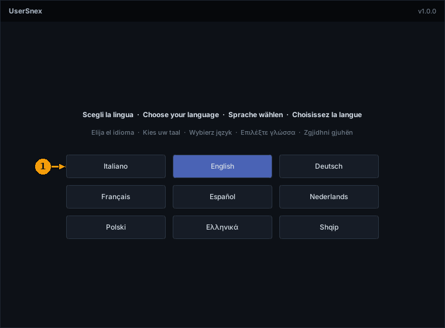
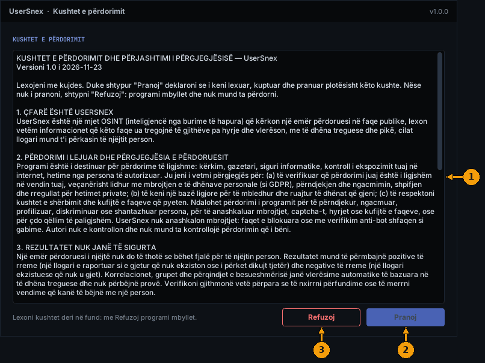
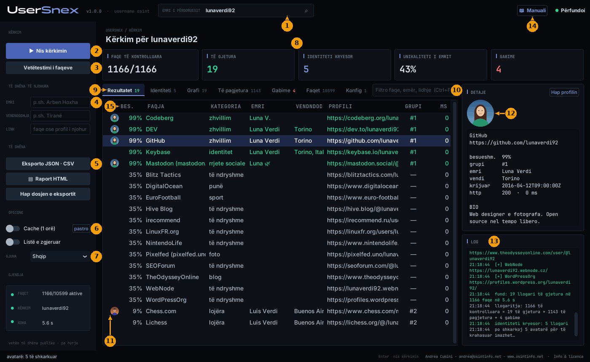
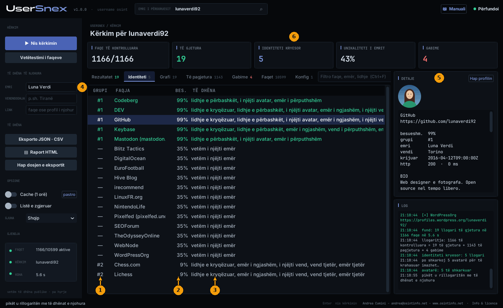
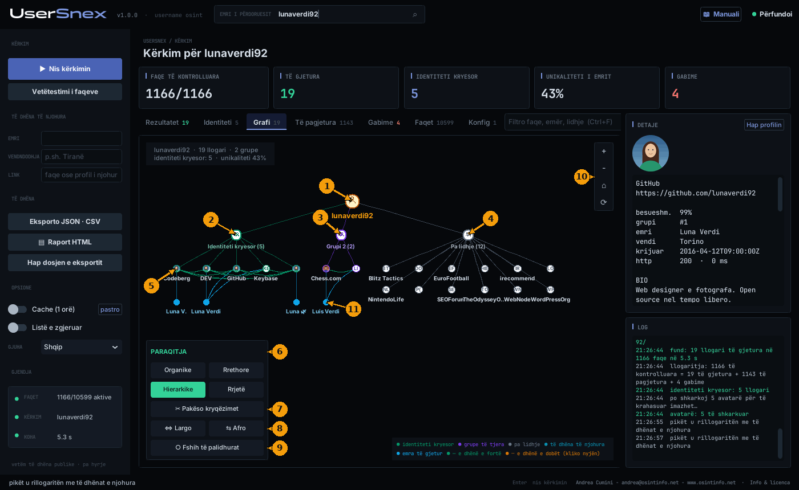
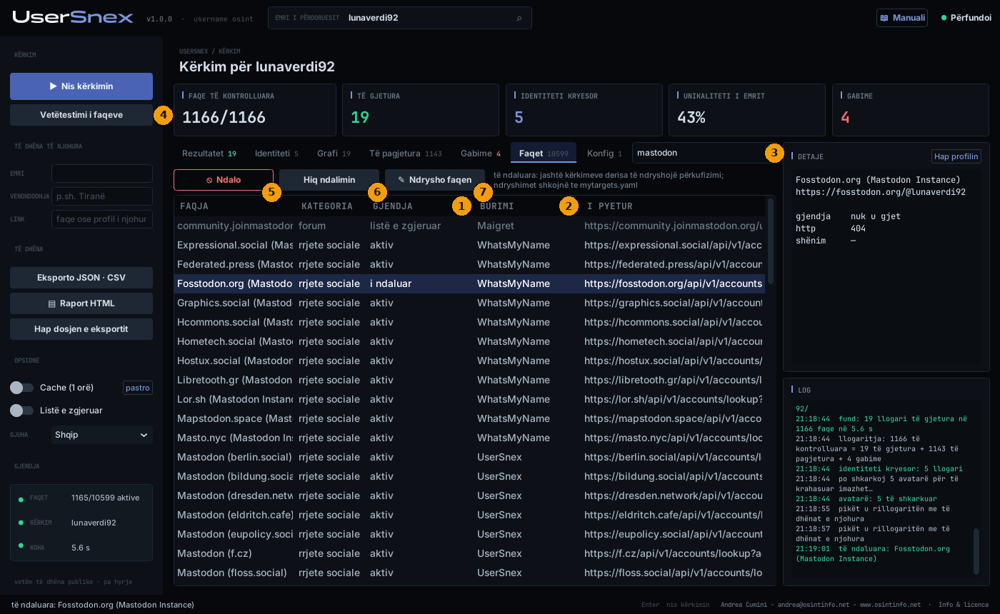
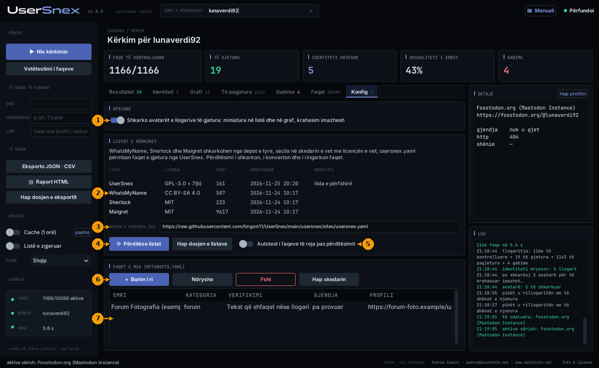
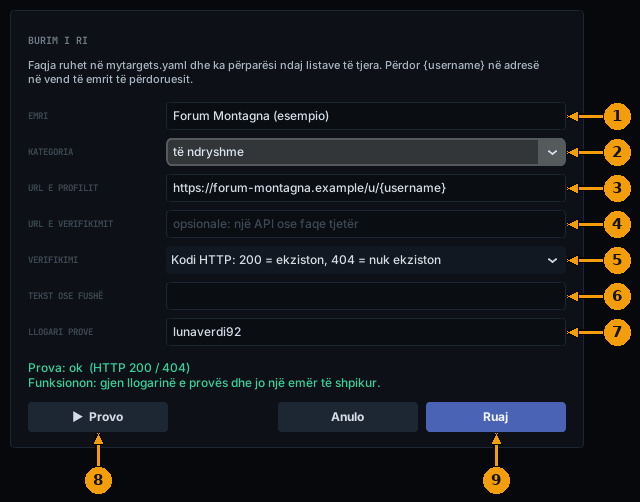

# UserSnex — Manuali i përdorimit

UserSnex kërkon një emër përdoruesi në mijëra faqe publike dhe nuk ndalet te "ekziston këtu": vlerëson **cilat llogari i përkasin vërtet të njëjtit person**, me çfarë besueshmërie, dhe shpjegon gjithmonë pse. Përdor vetëm të dhëna publike, pa hyrje në llogari, respekton kufijtë e faqeve dhe nuk anashkalon mbrojtjet: një faqe e bllokuar ose një verifikim anti-bot shfaqet si gabim, kurrë si rezultat.

Të gjithë emrat, llogaritë dhe të dhënat në shembujt e këtij manuali janë **të sajuara** (përdoruesi i shembullit është `lunaverdi92`).

## Përmbajtja

1. [Nisja e parë: gjuha dhe kushtet e përdorimit](#1-nisja-e-parë-gjuha-dhe-kushtet-e-përdorimit)
2. [Dritarja kryesore](#2-dritarja-kryesore)
3. [Bërja e një kërkimi](#3-bërja-e-një-kërkimi)
4. [Rezultatet, detajet dhe avatarët](#4-rezultatet-detajet-dhe-avatarët)
5. [Identiteti dhe pikët](#5-identiteti-dhe-pikët)
6. [Grafi](#6-grafi)
7. [Të pagjetura dhe Gabime](#7-të-pagjetura-dhe-gabime)
8. [Faqet dhe vetëtestimi](#8-faqet-dhe-vetëtestimi)
9. [Konfig](#9-konfig)
10. [Shtimi i një faqeje: Burim i ri](#10-shtimi-i-një-faqeje-burim-i-ri)
11. [Eksportimi i të dhënave](#11-eksportimi-i-të-dhënave)
12. [Rreshti i komandave](#12-rreshti-i-komandave)
13. [Info dhe licenca](#13-info-dhe-licenca)
14. [Probleme të shpeshta](#14-probleme-të-shpeshta)

---

## 1. Nisja e parë: gjuha dhe kushtet e përdorimit

Herën e parë shfaqet një dritare që nuk mund të anashkalohet.



1. **Zgjidhni gjuhën.** Butonat tregojnë nëntë gjuhët në dispozicion: italiano, English, Deutsch, Français, Español, Nederlands, Polski, Ελληνικά, Shqip. Gjuha vlen për gjithë programin dhe ndryshohet më vonë nga menyja **Gjuha** në shiritin anësor.



1. Teksti i **kushteve të përdorimit**, në gjuhën e zgjedhur. Lexojeni deri në fund.
2. **Pranoj** aktivizohet vetëm pasi ta keni rrëshqitur tekstin deri në fund.
3. **Refuzoj** e mbyll programin.

Pranimi ruhet: dritarja shfaqet sërish vetëm nëse ndryshon versioni i kushteve. Në nisjen e parë UserSnex shkarkon edhe listat e faqeve (shih [Konfig](#9-konfig)).

## 2. Dritarja kryesore



1. **USERNAME**: emri i përdoruesit që kërkoni. **Enter** nis kërkimin.
2. **Nis kërkimin**. Gjatë kërkimit butoni bëhet **Ndalo**.
3. **Vetëtestimi i faqeve**: kontrollon cilat faqe funksionojnë nga rrjeti juaj (shih [kapitullin 8](#8-faqet-dhe-vetëtestimi)).
4. **Të dhëna të njohura**: një emër, një vend ose një lidhje që e dini se i përket personit. Ndihmojnë të zgjidhet identiteti i duhur (shih [kapitullin 5](#5-identiteti-dhe-pikët)).
5. **Të dhëna**: **Eksporto JSON · CSV**, **Raport HTML** dhe **Hap dosjen e eksportit** (shih [kapitullin 11](#11-eksportimi-i-të-dhënave)).
6. **Opsione**: **Cache (1 orë)** ripërdor përgjigjet e fundit (**pastro** e fshin); **Listë e zgjeruar** shton mijëra forume dhe faqe më të vogla, por e bën kërkimin shumë më të gjatë.
7. **Gjuha** e ndërfaqes.
8. **Numëruesit**: faqe të kontrolluara, llogari të gjetura, llogaritë e identitetit kryesor, unikaliteti i emrit, gabime.
9. **Skedat**: Rezultatet, Identiteti, Grafi, Të pagjetura, Gabime, Faqet, Konfig. Numri pranë emrit është numri i rreshtave.
10. **Filtri** (**Ctrl+F**): shfaq vetëm rreshtat që përmbajnë tekstin, në faqe, emër, lidhje ose kategori.
11. **Miniatura e avatarit** të llogarisë, kur faqja e publikon.
12. **Detaje**: avatari dhe të dhënat e plota të rreshtit të zgjedhur. **Hap profilin** e hap faqen në shfletues.
13. **Log**: mesazhet e programit, me orën.
14. **📖 Manuali** (ose **F1**) e hap këtë manual në gjuhën e ndërfaqes.
15. **Renditja**: një klikim mbi titullin e kolonës rendit nga A te Z, një klikim i dytë nga Z te A; shigjeta ▲ ose ▼ tregon kolonën e përdorur (këtu *Bes.*, nga më e larta).

Në dritaren e manualit, kutia e kërkimit lart (**Ctrl+F**) thekson të gjitha përputhjet: **Enter** ose **F3** kalon te tjetra, **Shift+Enter** te e mëparshmja, **Esc** e pastron kërkimin. Përmbajtja në të majtë të çon te kapitujt.

## 3. Bërja e një kërkimi

1. Shkruani emrin e përdoruesit në kutinë lart dhe shtypni **Enter** ose **Nis kërkimin**.
2. UserSnex pyet njëkohësisht të gjitha faqet aktive, me një kufi kërkesash për faqe. Llogaritë e gjetura shfaqen menjëherë te **Rezultatet** dhe në **Log**.
3. Në fund UserSnex shkarkon avatarët publikë të llogarive të gjetura (nëse opsioni është aktiv), i krahason dhe rillogarit pikët.

Nëse dini tashmë diçka për personin, shkruajeni te **Të dhëna të njohura**, edhe pas kërkimit: pikët rillogariten menjëherë, pa e përsëritur kërkimin.

Një emër i rrallë (`lunaverdi92`) ka pak njerëz me të njëjtin emër; një i zakonshëm (`luna`) ka shumë. Prandaj numëruesi **Unikaliteti i emrit** ndikon në të gjitha pikët.

## 4. Rezultatet, detajet dhe avatarët

Skeda **Rezultatet** liston llogaritë e gjetura, të renditura sipas besueshmërisë: **Bes.**, faqja, kategoria, emri i shfaqur, vendi, lidhja e profilit, grupi dhe koha e përgjigjes. Rreshtat e gjelbër i përkasin identitetit kryesor.

- Një klikim zgjedh llogarinë dhe shfaq djathtas **Detajet**: avatar, URL, besueshmëri, grup, emër, vend, datë krijimi, kod HTTP, bio, lidhjet e gjetura dhe të dhënat që e lidhin me llogaritë e tjera.
- Një klikim i dyfishtë e hap profilin në shfletues.

**Avatarët.** Fotot e profilit shkarkohen vetëm një herë (cache 7 ditë), shfaqen në listë, te detajet dhe në graf, dhe krahasohen me **gjurmë vizuale**: e njëjta foto njihet edhe kur është zvogëluar ose rikompresuar në servera të ndryshëm. Imazhet bosh dhe avatarët e paracaktuar të faqeve nuk llogariten. Shkarkimi çaktivizohet te [Konfig](#9-konfig).

**Renditja e tabelave.** Në të gjitha tabelat, një klikim mbi titullin e një kolone i rendit rreshtat nga A te Z (ose nga vlera më e vogël); një klikim i dytë mbi të njëjtën kolonë i rendit nga Z te A. Shigjeta ▲ ose ▼ pranë titullit tregon kolonën dhe drejtimin; qelizat bosh mbeten në fund.

## 5. Identiteti dhe pikët



1. **Grupi**: llogaritë me lidhje të forta mes tyre formojnë një grup. **#1** është identiteti kryesor, — do të thotë "pa lidhje".
2. **Bes.**: besueshmëria që llogaria i përket personit që kërkoni.
3. **Të dhëna**: arsyet, me fjalë të thjeshta. Për shembull *lidhje e kryqëzuar* (një profil lidhet me tjetrin), *lidhje e përbashkët*, *i njëjti avatar*, *emër i ngjashëm*, *i njëjti vend*; ose të dhëna të kundërta si *emër tjetër* dhe *vend tjetër*. *vetëm i njëjti emër* do të thotë që nuk ka asgjë tjetër.
4. **Të dhëna të njohura**: këtu është shkruar emri *Luna Verdi*. Identiteti kryesor bëhet grupi që përputhet me të dhënat e njohura.
5. **Detajet** e llogarisë së zgjedhur.
6. Numëruesi **Identiteti kryesor** tregon sa llogari bëjnë pjesë në të.

Në shembull, Codeberg, DEV, GitHub, Keybase dhe Mastodon formojnë identitetin kryesor (lidhje me faqen personale, i njëjti avatar, i njëjti emër). Chess.com dhe Lichess lidhen me njëra-tjetrën, por i përkasin një personi me të njëjtin emër, *Luis Verdi* nga Buenos Aires: formojnë një grup të dytë me besueshmëri të ulët.

Pikët janë **vlerësime**, jo prova: kontrolloni gjithmonë me dorë para se të nxirrni përfundime.

## 6. Grafi



1. **Emri i përdoruesit** i kërkuar, në qendër të strukturës.
2. **Identiteti kryesor**, me numrin e llogarive.
3. **Grupe të tjera** (këtu *Grupi 2*, personi me të njëjtin emër).
4. **Pa lidhje**: llogari me të njëjtin emër përdoruesi, por pa të dhëna të tjera.
5. Një **llogari**, me avatarin e saj. Vijat mes llogarive janë të dhëna: të plota për të dhënat e forta, me ndërprerje për të dobëtat (të dukshme kur klikoni nyjën).
6. Paneli **Layout**: **Organike**, **Rrethore**, **Hierarkike** (e paracaktuara) dhe **Rrjetë**.
7. **Pakëso kryqëzimet** i rirendit nyjat që të kryqëzohen më pak vija.
8. **Largo** dhe **Afro** e zgjerojnë ose e ngushtojnë vizatimin.
9. **Fshih të palidhurat** heq llogaritë pa të dhëna (butoni bëhet **Shfaq të palidhurat**).
10. **Zoom**: +, −, përshtat me dritaren dhe rivizato. Edhe rrota e miut bën zoom.
11. **Emër i gjetur** (nyjë blu e çelët): këtu *Luis Verdi*, i njëjti emër i gjetur në Chess.com dhe Lichess, i bashkuar në një nyjë të vetme.

Një klikim mbi një nyjë e zgjedh dhe shfaq detajet e saj; duke kaluar miun sipër shihen të dhënat e saj. Një klikim i dyfishtë mbi një grup e mbyll ose e hap. Nyjat mund të zhvendosen me tërheqje.

**Emrat e gjetur.** Çdo emër i shfaqur i gjetur në një profil bëhet një nyjë blu e çelët, e lidhur me të gjitha llogaritë ku shfaqet: nëse i njëjti emër (pa marrë parasysh shkronjat e mëdha, theksat dhe simbolet) shfaqet në disa faqe, ka vetëm një nyjë që tregon përputhjet. Në shembull *Luna Verdi* bashkon DEV, GitHub dhe Keybase, dhe *Luis Verdi* bashkon Chess.com dhe Lichess. Emrat e njëjtë me emrin e përdoruesit nuk shtohen. Duke kaluar miun mbi nyjë shihen faqet.

## 7. Të pagjetura dhe Gabime

- **Të pagjetura**: faqet që u përgjigjën se llogaria nuk ekziston.
- **Gabime**: faqet që nuk dhanë një përgjigje të vlefshme: faqe e bllokuar (401/403), shumë kërkesa (429), verifikim anti-bot, mbarim kohe, gabim rrjeti. UserSnex nuk i anashkalon këto mbrojtje: për ato faqe **kontrolloni me dorë**. Në shembull Reddit përgjigjet 429 dhe Docker Hub 403.

## 8. Faqet dhe vetëtestimi



1. **Gjendja** e faqes: *aktiv*, *listë e zgjeruar* (përdoret vetëm me opsionin Listë e zgjeruar), ose e çaktivizuar nga vetëtestimi. Një faqe e ndaluar me dorë tregon *e ndaluar*.
2. **Burimi**: lista nga vjen faqja (UserSnex, WhatsMyName, Sherlock, Maigret ose faqet tuaja, *mytargets*). Kolona **I pyetur** tregon adresën që thirret.
3. **Filtri** funksionon edhe këtu: në shembull shfaq faqet që përmbajnë "mastodon".
4. **Vetëtestimi i faqeve**: për çdo faqe provon një llogari që ekziston dhe një të sajuar. Faqet që gabojnë ose japin gabim nga rrjeti juaj anashkalohen në kërkimet e mëvonshme. Rezultati ruhet.
5. **Ndalo**: i përjashton nga kërkimet faqet e zgjedhura (këtu *Fosstodon.org*, me gjendjen *e ndaluar*).
6. **Hiq ndalimin**: i riaktivizon faqet e zgjedhura.
7. **Ndrysho faqen**: e hap faqen në formularin Burim i ri dhe e ruan ndryshimin te `mytargets.yaml`.

**Ndalimi i një faqeje.** Nëse një faqe nuk funksionon më ose jep rezultate të gabuara, zgjidheni (edhe disa, me Ctrl ose Shift) dhe shtypni **Ndalo**, ose klikoni me të djathtën mbi një rresht të çdo tabele. Faqja përjashtohet nga kërkimet dhe kolona Gjendja tregon *e ndaluar*. **Hiq ndalimin** e riaktivizon. Kur përditësoni listat (WhatsMyName, Sherlock, Maigret, UserSnex), një faqe e ndaluar me përkufizim të njëjtë mbetet e ndaluar; nëse përkufizimi ka ndryshuar (për shembull u korrigjua adresa), ndalimi bie dhe faqja kthehet aktive. Ndalimet ruhen në `banlist.json`.

**Ndryshimi i një faqeje.** **Ndrysho faqen** (ose klikim i djathtë › Ndrysho faqen) hap formularin [Burim i ri](#10-shtimi-i-një-faqeje-burim-i-ri) me të dhënat e faqes. Kur ruani, versioni i ndryshuar shkon drejtpërdrejt te `mytargets.yaml` dhe zëvendëson atë të listës origjinale; rregullat që formulari nuk i tregon (fushat e profilit, shprehjet, kokat) ruhen. Nëse faqja ishte e ndaluar dhe ndryshuat adresën, kthehet aktive.

## 9. Konfig



1. **Shkarko avatarët** e llogarive të gjetura: miniatura në listë dhe në graf dhe krahasim i imazheve. Çaktivizojeni për të shmangur kërkesa shtesë.
2. **Listat e kërkimit**: për çdo listë licenca, numri i faqeve, data e përditësimit të fundit dhe rezultati. *usersnex.yaml* përmban faqet e gjetura nga UserSnex dhe versione të përmirësuara të faqeve të njohura; WhatsMyName, Sherlock dhe Maigret shkarkohen nga depot e tyre, secila në skedarin e vet me licencën e vet.
3. **Adresa e usersnex.yaml**: nga ku përditësohet lista e UserSnex (depoja e projektit). Mund të ndryshohet.
4. **Përditëso listat** shkarkon të gjitha listat, i konverton dhe ringarkon faqet. Nëse një listë nuk shkarkohet ose duket e prishur, mbetet e mëparshmja. **Hap dosjen e listave** hap dosjen `lists`.
5. **Autotest i faqeve të reja pas përditësimit**: kur është aktiv, faqet e shtuara nga përditësimi provohen menjëherë.
6. **Faqet e mia (mytargets.yaml)**: **Burim i ri** shton një faqe (shih [kapitullin 10](#10-shtimi-i-një-faqeje-burim-i-ri)); **Ndrysho**, **Fshi** dhe **Hap skedarin** veprojnë mbi faqen e zgjedhur ose mbi skedarin.
7. Lista e faqeve tuaja. Një klikim i dyfishtë hap ndryshimin.

## 10. Shtimi i një faqeje: Burim i ri

Një faqe e shtuar nga këtu ruhet në `mytargets.yaml` dhe ka përparësi ndaj listave të tjera: nëse ka të njëjtin emër me një faqe ekzistuese, e zëvendëson.



1. **Emri** i faqes.
2. **Kategoria** (forum, social, zhvillim, lojëra…).
3. **URL e profilit**, me `{username}` në vend të emrit të përdoruesit, për shembull `https://forum-montagna.example/u/{username}`.
4. **URL e verifikimit** (opsionale): një API ose një faqe tjetër nga profili, që pyetet në vend të tij.
5. **Verifikimi**: si të kuptohet nëse llogaria ekziston. *Kodi HTTP* (200 = ekziston, 404 = nuk ekziston), një *tekst i pranishëm vetëm nëse llogaria ekziston* (për shembull "Anëtar që nga"), një *tekst që shfaqet nëse llogaria nuk ekziston* (për shembull "Përdoruesi nuk u gjet"), ose një *fushë e API JSON* (për shembull `data.id`).
6. **Tekst ose fushë** që përdor verifikimi i zgjedhur (me *Kodin HTTP* nuk nevojitet dhe është i çaktivizuar).
7. **Llogari prove**: një emër përdoruesi që e dini se ekziston në faqe.
8. **Provo**: pyet faqen me llogarinë e provës dhe me një emër të sajuar dhe tregon nëse verifikimi funksionon. Në shembull: *ok (HTTP 200 / 404)*.
9. **Ruaj** e shkruan faqen në `mytargets.yaml`; **Anulo** mbyll pa ruajtur.

## 11. Eksportimi i të dhënave

- **Eksporto JSON · CSV** ruan rezultatet dhe identitetet në dosjen `results`.
- **Raport HTML** krijon një raport që lexohet në çdo shfletues dhe e hap.
- **Hap dosjen e eksportit** hap dosjen me skedarët e ruajtur.

Skedarët mund të përmbajnë të dhëna personale: ruajini me kujdes dhe fshijini kur nuk nevojiten më.

## 12. Rreshti i komandave

Të njëjtat funksione janë në dispozicion nga terminali:

```
python run.py lunaverdi92 --html --name "Luna Verdi" --location Torino
python run.py --update-lists
python run.py --selftest
```

Opsionet kryesore: `--name`, `--location`, `--link` (të dhëna të njohura, `--link` mund të përsëritet), `--extended` (listë e zgjeruar), `--only` (vetëm disa faqe, të ndara me presje), `--sites` (skedar ose dosje YAML shtesë), `--out` (dosja e daljes), `--html`, `--no-export`, `--no-cache`, `--all` (shfaq edhe faqet pa rezultat), `--timeout`, `--usersnex-url`. `python run.py --help` i liston të gjitha.

## 13. Info dhe licenca

Klikoni **Info & licenca** në shiritin e poshtëm: versioni, autori, licenca e programit (GPL-3.0 me detyrim atribuimi), listat e faqeve dhe përbërësit e palëve të treta me licencat e tyre, dhe butoni **Kushtet e përdorimit** për t'i rilexuar kushtet. UserSnex është softuer i lirë, pa asnjë garanci.

## 14. Probleme të shpeshta

| Mesazhi ose situata | Çfarë të bëni |
|---|---|
| Mungojnë listat në nisjen e parë | Konfig › Përditëso listat. Nevojitet lidhje interneti. |
| Shumë gabime 429 | Faqja kufizon kërkesat: prisni dhe provoni sërish, ose aktivizoni cache-in. |
| Gabim 403 ose faqe anti-bot | Faqja bllokon programet: kontrolloni atë llogari me dorë në shfletues. |
| Një faqe jep gjithmonë rezultate të gabuara | Shtypni Vetëtestimi i faqeve: faqet që dështojnë nga rrjeti juaj përjashtohen. |
| Kërkim shumë i ngadaltë | Çaktivizoni Listën e zgjeruar: shton rreth 9.000 faqe më të vogla. |
| Avatarët nuk shfaqen | Konfig › Opsione › Shkarko avatarët duhet të jetë aktiv; disa faqe nuk publikojnë foto. |
| Faqja ime nuk e gjen llogarinë | Te Burim i ri shtypni Provo dhe kontrolloni URL-në, verifikimin dhe tekstin. |
| manuali nuk u gjet | Mungon dosja `docs/manual`: riinstaloni programin. |
